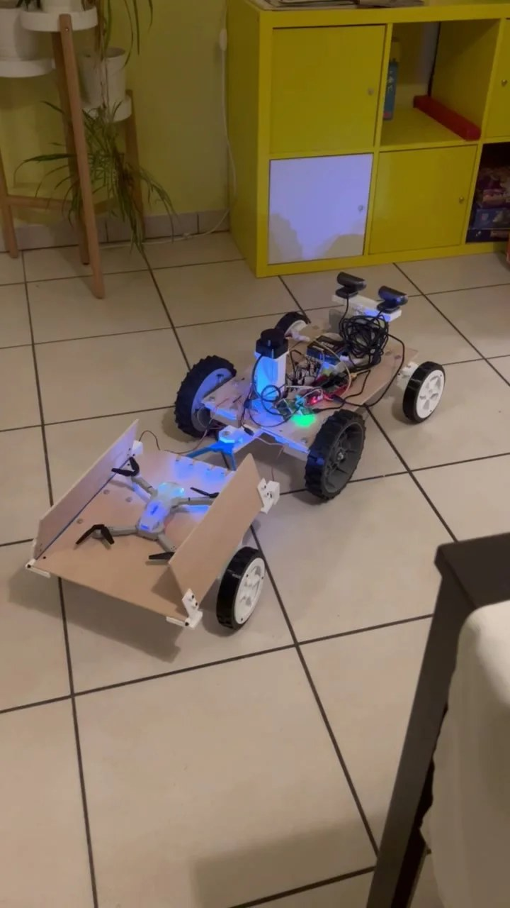
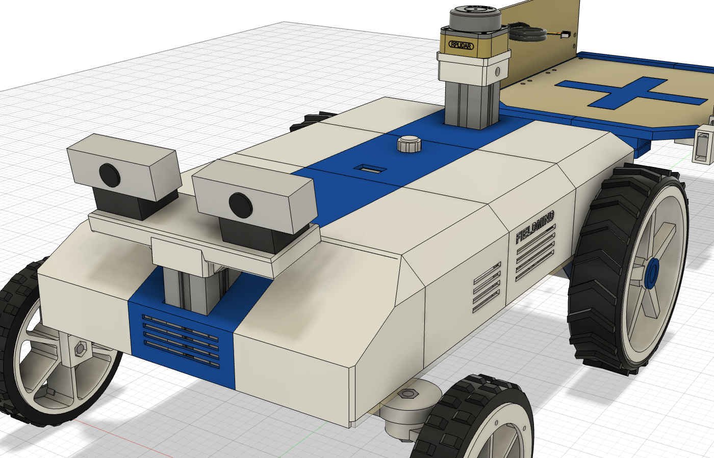
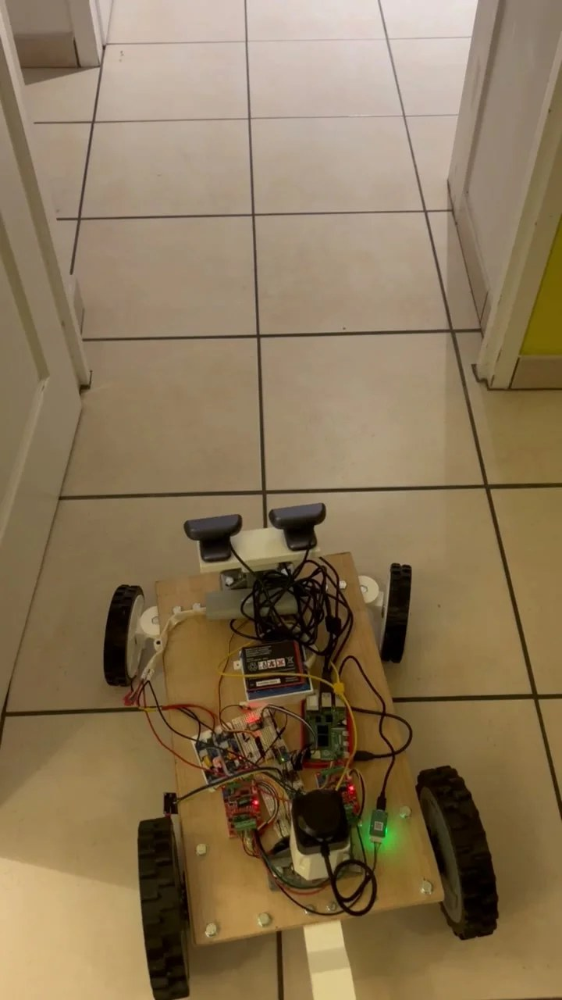
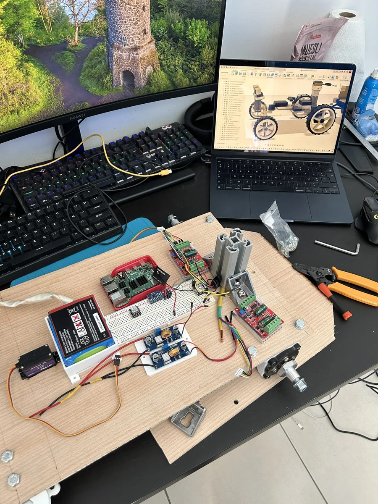
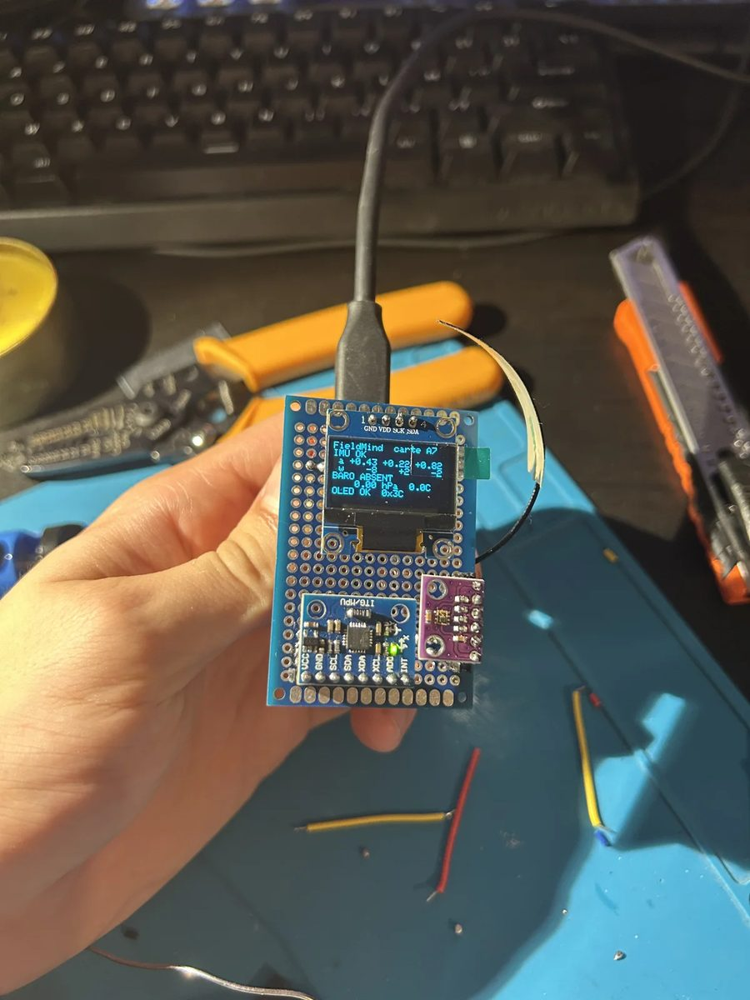
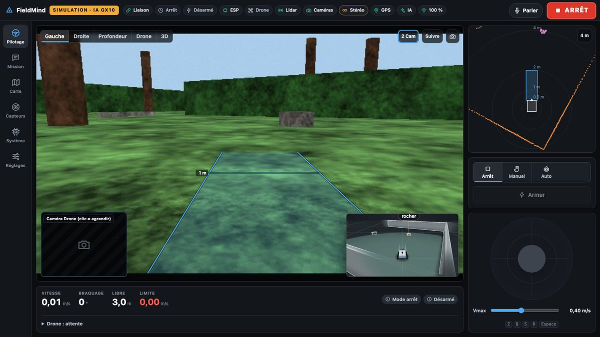
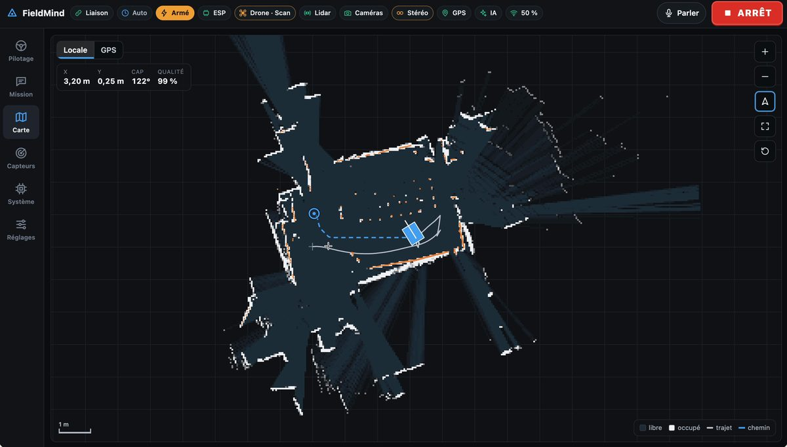
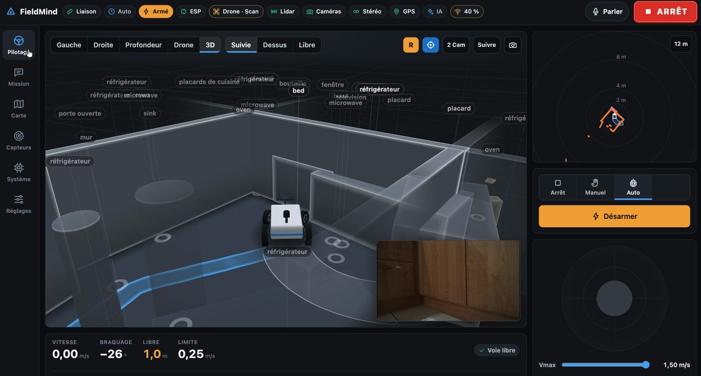
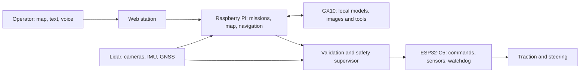

[Français](README.md) · **English**

# FieldMind

[](https://github.com/hugoprigent/FieldMind/actions/workflows/checks.yml)

**A field rover whose missions and perception are driven by a local AI.**

<p align="center">
  
</p>
<p align="center"><em>The rover, without its shell, with the drone-carrier trailer and the drone sitting on it.</em></p>

A project by Hugo Prigent, finalist of the **ASUS Ascent GX10 AI Developer Challenge 2026**.
FieldMind connects a Raspberry Pi / ESP32 rover, a web operator station and models running on an ASUS Ascent GX10. Navigation, command checks and stopping stay in the rover software.

The goal: help an operator explore and document a hard-to-reach area, then share the observations between robots. The prototype is designed to work in the field without any external AI API; this deployment autonomy has yet to be validated.

[**Public simulation of the station**](https://hugoprigent.com/fieldmind/?lang=en) · [Project page](https://hugoprigent.com/projets/fieldmind?lang=en) · [Presentation and tests](https://hugoprigent.com/media/fieldmind/presentation-20261023-en.mp4) · [Architecture](docs/architecture.en.md) · [Status on 23 October](docs/status-2026-10-23.en.md) · [Validation](docs/validation.en.md)

> **Status on 23 October 2026.**
> - The rover drives, with its chassis and electronics exposed; the shell is not fitted. It steers with the rear-wheel differential since the steering servo failed.
> - Autonomous navigation tested indoors on 21 October with the GX10: exploration on the instruction "explore la pièce" ("explore the room") and an autonomous round trip on the lidar map.
> - The drone-carrier trailer is built; its flaps are driven by servos (ESP32-C5 firmware ROVER_4). Autonomous towing is not validated.
> - Drone: video stream received on the Pi; battery level not yet read reliably; autonomous flight is not validated.
> - Eight models served on the GX10: Qwen3.6-35B-A3B NVFP4, RoboBrain 2.5, D-FINE, Depth Anything V2, SAM 2.1, Qwen3-ASR, Qwen3-TTS, Qwen3-VL-Embedding.


*CAD view of the rover with its shell and the trailer. The real rover currently drives without the shell.*

## The prototype

| | |
| :---: | :---: |
|  |  |
| Navigation test in a corridor, with the stereo cameras and the lidar on the chassis. | Wiring the board: Raspberry Pi, motor controllers, converters, battery. |
|  | |
| I²C sensor board: IMU and OLED display showing the sensor status. | |

## The operator station


*Driving view (“Pilotage”, public simulation): left camera with the corridor projected in front of the rover, inset 3D view, lidar and modes on the right.*


*Map (real test on 21 October): lidar occupancy map, path traveled and planned path in auto mode.*


*3D view (real test on 21 October): walls from the lidar, objects named by the GX10's vision, rover camera as an inset.*

## Try the current software, without hardware

Python **3.13+** and [uv](https://docs.astral.sh/uv/):

```bash
git clone https://github.com/hugoprigent/FieldMind.git
cd FieldMind/software/rover
uv venv --python 3.13 .venv
uv pip install --python .venv/bin/python -r requirements-ci.txt
FIELDMIND_IA_PROFIL=aucun .venv/bin/python -m fieldmind \
  --materiel simulation --scenario jardin --hote 127.0.0.1
```

Open **http://127.0.0.1:8080/**. The hardware is simulated; navigation, missions, safety and the interface are the rover's own code. This startup needs no API key and drives no real hardware. Use the FR / EN buttons in the top bar to switch languages. The first visit follows your browser language; the choice is saved.

The [public simulation](https://hugoprigent.com/fieldmind/?lang=en) serves this same web station: each browser gets its own simulated rover, with no access to the hardware. Its server is [`software/rover/fieldmind/public_demo.py`](software/rover/fieldmind/public_demo.py); it can be run locally with `.venv/bin/python -m fieldmind.public_demo --hote 127.0.0.1 --port 8085`. Its deployment and keys are not in this repository. The [first MuJoCo demo](software/README.en.md) is still available.

## How it works



- **Rover**: C1 lidar, stereo, odometry, occupancy map, navigation and test log.
- **AI and missions**: written or spoken instructions, progressive exploration, spatial memory, confirmation of an object over several images. The GX10 chooses among points computed by the Pi; the Pi re-validates the choice, navigates and keeps control of safety. The model does not drive the motors directly.
- **GX10**: agent and vision (Qwen3.6-35B-A3B NVFP4), pointing (RoboBrain 2.5), detection (D-FINE), depth (Depth Anything V2), segmentation (SAM 2.1), speech (Qwen3-ASR, Qwen3-TTS), image embeddings (Qwen3-VL-Embedding). A scene analysis took about 6 to 9 s during the real tests. [Configuration](software/rover/deploiement/gx10/README.en.md) and [status by role](software/rover/MODELES.en.md).
- **Electronics**: XIAO ESP32-C5 firmware, watchdog, OLED display, I²C sensors and USB link with the Pi. Version ROVER_4 drives the two servos of the trailer flaps.
- **Mechanics**: TPU tires, wooden chassis, current steering by rear-wheel differential; drone-carrier trailer printed and assembled. The shell is designed but not fitted; an SG90 servo mount for steering is designed, not validated under load.

During the ASUS session, the GX10 was remote and reached over a private network. The models run locally on the GX10, but a complete off-network deployment in the field has not yet been demonstrated.

## Exploring the repository

| Folder | Contents |
| --- | --- |
| [`software/rover/`](software/rover/README.en.md) | Current Pi software, hardware simulator, web station and isolated public simulation, tests, ROS 2 bridge |
| [`software/esp32/esp_c5/`](software/esp32/esp_c5/README.en.md) | PlatformIO firmware and bench programs |
| [`software/rover/deploiement/gx10/`](software/rover/deploiement/gx10/README.en.md) | AI service configuration and API checker |
| [`software/`](software/README.en.md) | First MuJoCo simulation (predates the current rover) |
| [`cao/`](cao/README.en.md) | Current STL parts, Fusion scripts and fabrication drawings |
| [`hardware/`](hardware/README.en.md) | Current wiring and KiCad electronics studies |
| [`docs/status-2026-10-23.en.md`](docs/status-2026-10-23.en.md) | Status of the rover, trailer, drone and GX10 on 23 October |
| [`docs/validation.en.md`](docs/validation.en.md) | What is measured, what is simulated, what remains to be checked |

Folder names, protocol identifiers and source-code comments retain their original names. Every project Markdown document has a French and English version, linked at the top.

## Checking

From `software/rover`, with the environment created above:

```bash
.venv/bin/python -m pytest -q -m "not lent"
node --test tests/web/*.test.mjs
```

The tests cover the controllers, safety, navigation, AI contracts and simulated scenarios. They do not replace physical tests. [Details and limits](docs/validation.en.md).

## Hardware and rights

Before a real test, read the [rover guide](software/rover/README.en.md) and the [wiring](hardware/electronics/CONNEXIONS.en.md), calibrate the assembly and provide a traction cut-off. The KiCad documents include studies that predate some of the current connections: their status is given in [hardware/README.en.md](hardware/README.en.md).

This edition selects the sources useful for the demonstration, without access files, secrets, private logs, raw footage or work history. [Provenance](docs/publication.en.md).

The original code and designs are published for review; no general open license is granted at this stage. Third-party components keep their licenses. See [rights](RIGHTS.en.md) and [credits](THIRD_PARTY_NOTICES.en.md).

## Languages and videos

The control station and project page are available in French and English: **FR / EN** in the top right, browser language detection and a saved manual choice.

- [Presentation and tests in English](https://hugoprigent.com/media/fieldmind/presentation-20261023-en.mp4)
- [Présentation et essais en français](https://hugoprigent.com/media/fieldmind/presentation-20261023c.mp4)
- [Project page in English](https://hugoprigent.com/projets/fieldmind?lang=en) · [Page projet en français](https://hugoprigent.com/projets/fieldmind?lang=fr)
