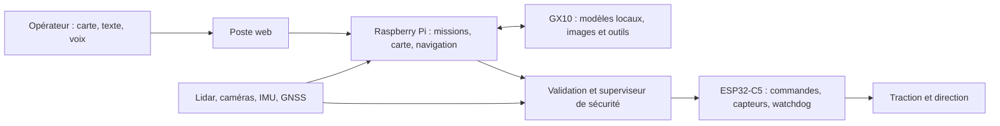

# FieldMind

[](https://github.com/hugoprigent/FieldMind/actions/workflows/checks.yml)

**Un rover de terrain dont les missions et la perception sont pilotées par une IA locale.**

Projet de Hugo Prigent, finaliste du **ASUS Ascent GX10 AI Developer Challenge 2026**.
FieldMind relie un rover Raspberry Pi / ESP32, un poste opérateur web et des modèles exécutés sur un ASUS Ascent GX10. La navigation, les vérifications des commandes et l'arrêt restent dans le logiciel du rover.

L'objectif : aider un opérateur à explorer et documenter une zone difficile d'accès, puis partager les observations entre robots. Le prototype vise un fonctionnement de terrain sans API d'IA externe ; cette autonomie de déploiement reste à valider.

[**Essayer la démo publique**](https://hugoprigent.com/fieldmind/) · [Pitch de candidature](https://youtu.be/ZIIjRc_pI_E) · [Architecture](docs/architecture.md) · [État et résultats](docs/validation.md)

> **Prototype, 21 octobre 2026.** Le rover physique roule en commande manuelle, avec son électronique visible. La coque est conçue en CAO mais n'est pas montée ; la remorque n'est pas encore disponible. Les missions autonomes sont testées en simulation ; leur validation sur le rover réel reste à réaliser. Le drone est une expérimentation simulée, sans vol réel validé.


*Vue CAO : coque et remorque projetées. Le prototype réel roule actuellement avec son châssis et son électronique visibles. Les photos et la vidéo des essais seront ajoutées ici.*

## Essayer le logiciel actuel, sans matériel

Python **3.13+** et [uv](https://docs.astral.sh/uv/) :

```bash
git clone https://github.com/hugoprigent/FieldMind.git
cd FieldMind/software/rover
uv venv --python 3.13 .venv
uv pip install --python .venv/bin/python -r requirements-ci.txt
FIELDMIND_IA_PROFIL=aucun .venv/bin/python -m fieldmind \
  --materiel simulation --scenario jardin --hote 127.0.0.1
```

Ouvrir **http://127.0.0.1:8080/**. Le matériel est simulé ; navigation, missions, sécurité et interface sont le code du rover. Ce démarrage ne demande aucune clé d'API et ne commande aucun matériel réel.

La [démo publique](https://hugoprigent.com/fieldmind/) utilise la première simulation MuJoCo : elle présente le concept et possède sa propre pile. Le logiciel actuel ci-dessus intègre le prototype physique. [Lancer aussi la démo MuJoCo](software/README.md).

## Comment ça fonctionne



- **Rover** : lidar C1, stéréo, odométrie, carte d'occupation, navigation et journal des essais.
- **IA** : consignes traduites en actions structurées, vision, profils interchangeables et appels validés avant exécution.
- **GX10** : inférence hébergée sur le GB10. Les premiers appels à `nvidia/Qwen3.6-35B-A3B-NVFP4` ont réussi. Les rôles supplémentaires sont en intégration ; une configuration n'est pas une preuve de validation.
- **Électronique** : firmware XIAO ESP32-C5, chien de garde, écran OLED, capteurs I²C et liaison USB avec le Pi.
- **Mécanique** : direction par servo central, pièces imprimées, pneus TPU et châssis en bois ; remorque porte-drone conçue séparément.

La session ASUS utilise un GX10 distant, joint par réseau privé. Elle vérifie l'exécution locale des modèles sur le GX10 ; elle ne démontre pas encore un système complet déployé hors réseau sur le terrain.

## Explorer le dépôt

| Dossier | Contenu |
| --- | --- |
| [`software/rover/`](software/rover/README.md) | Logiciel actuel du Pi, simulateur du matériel, poste web, tests, pont ROS 2 |
| [`software/esp32/esp_c5/`](software/esp32/esp_c5/README.md) | Firmware PlatformIO et programmes de banc |
| [`software/rover/deploiement/gx10/`](software/rover/deploiement/gx10/README.md) | Configuration des services IA et vérificateur d'API |
| [`software/`](software/README.md) | Première simulation MuJoCo et code de la démo publique |
| [`cao/`](cao/README.md) | Pièces STL courantes, scripts Fusion et plans de fabrication |
| [`hardware/`](hardware/README.md) | Connexions actuelles et études électroniques KiCad |
| [`docs/validation.md`](docs/validation.md) | Ce qui est mesuré, ce qui est simulé, ce qui reste à vérifier |

## Vérifier

Depuis `software/rover`, avec l'environnement créé ci-dessus :

```bash
.venv/bin/python -m pytest -q -m "not lent"
node --test tests/web/*.test.mjs
```

Les tests couvrent les contrôleurs, la sécurité, la navigation, les contrats IA et les scénarios simulés. Ils ne remplacent pas les essais physiques. [Détails et limites](docs/validation.md).

## Matériel et droits

Avant un essai réel, lire le [guide rover](software/rover/README.md) et les [connexions](hardware/electronics/CONNEXIONS.md), calibrer le montage et prévoir une coupure de traction. Les documents KiCad comportent des études antérieures à certains branchements actuels : leur statut est indiqué dans [hardware/README.md](hardware/README.md).

Cette édition sélectionne les sources utiles à la démonstration, sans les fichiers d'accès, secrets, journaux privés, rushes ni historique de travail. Elle inclut les modifications locales courantes au moment de sa préparation. [Provenance](docs/publication.md).

Le code et les conceptions originaux sont présentés pour consultation ; aucune licence libre globale n'est accordée à ce stade. Les composants tiers conservent leurs licences. Voir [droits](RIGHTS.md) et [crédits](THIRD_PARTY_NOTICES.md).
