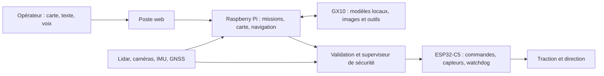

# FieldMind

[](https://github.com/hugoprigent/FieldMind/actions/workflows/checks.yml)

**Un rover de terrain dont les missions et la perception sont pilotées par une IA locale.**

Projet de Hugo Prigent, finaliste du **ASUS Ascent GX10 AI Developer Challenge 2026**.
FieldMind relie un rover Raspberry Pi / ESP32, un poste opérateur web et des modèles exécutés sur un ASUS Ascent GX10. La navigation, les vérifications des commandes et l'arrêt restent dans le logiciel du rover.

L'objectif : aider un opérateur à explorer et documenter une zone difficile d'accès, puis partager les observations entre robots. Le prototype vise un fonctionnement de terrain sans API d'IA externe ; cette autonomie de déploiement reste à valider.

[**Simulation publique du poste**](https://hugoprigent.com/fieldmind/) · [Page projet](https://hugoprigent.com/projets/fieldmind) · [Pitch de candidature](https://youtu.be/ZIIjRc_pI_E) · [Architecture](docs/architecture.md) · [État au 23 octobre](docs/status-2026-10-23.md) · [Validation](docs/validation.md)

> **État au 23 octobre 2026.**
> - Le rover roule, avec son châssis et son électronique visibles ; la coque n'est pas montée. Il tourne par le différentiel des roues arrière depuis la panne du servo de direction.
> - Navigation autonome testée en intérieur le 21 octobre avec le GX10 : exploration sur la consigne « explore la pièce » et trajet autonome aller-retour sur la carte lidar.
> - La remorque porte-drone est fabriquée ; ses volets sont commandés par servos (firmware ESP32-C5 ROVER_4). Le tractage autonome n'est pas validé.
> - Drone : flux vidéo reçu sur le Pi ; niveau de batterie pas encore lu de façon fiable ; le vol autonome n’est pas validé.
> - Huit modèles servis sur le GX10 : Qwen3.6-35B-A3B NVFP4, RoboBrain 2.5, D-FINE, Depth Anything V2, SAM 2.1, Qwen3-ASR, Qwen3-TTS, Qwen3-VL-Embedding.


*Vue CAO du rover avec sa coque et la remorque. Le rover réel roule pour l'instant sans la coque.*

## Essayer le logiciel actuel, sans matériel

Python **3.13+** et [uv](https://docs.astral.sh/uv/) :

```bash
git clone https://github.com/hugoprigent/FieldMind.git
cd FieldMind/software/rover
uv venv --python 3.13 .venv
uv pip install --python .venv/bin/python -r requirements-ci.txt
FIELDMIND_IA_PROFIL=aucun .venv/bin/python -m fieldmind \
  --materiel simulation --scenario jardin --hote 127.0.0.1
```

Ouvrir **http://127.0.0.1:8080/**. Le matériel est simulé ; navigation, missions, sécurité et interface sont le code du rover. Ce démarrage ne demande aucune clé d'API et ne commande aucun matériel réel.

La [simulation publique](https://hugoprigent.com/fieldmind/) sert ce même poste web : chaque navigateur reçoit son propre rover simulé, sans accès au matériel. Son serveur est [`software/rover/fieldmind/public_demo.py`](software/rover/fieldmind/public_demo.py) ; il se lance localement avec `.venv/bin/python -m fieldmind.public_demo --hote 127.0.0.1 --port 8085`. Son déploiement et ses clés ne sont pas dans ce dépôt. La [première démo MuJoCo](software/README.md) reste disponible.

## Comment ça fonctionne



- **Rover** : lidar C1, stéréo, odométrie, carte d'occupation, navigation et journal des essais.
- **IA et missions** : consignes écrites ou dites, exploration progressive, mémoire spatiale, confirmation d'un objet sur plusieurs images. Le GX10 choisit parmi des points calculés par le Pi ; le Pi revalide le choix, navigue et garde la sécurité. Le modèle ne commande pas directement les moteurs.
- **GX10** : agent et vision (Qwen3.6-35B-A3B NVFP4), pointage (RoboBrain 2.5), détection (D-FINE), profondeur (Depth Anything V2), segmentation (SAM 2.1), parole (Qwen3-ASR, Qwen3-TTS), empreintes d'images (Qwen3-VL-Embedding). Une analyse de scène a pris environ 6 à 9 s pendant les essais réels. [Configuration](software/rover/deploiement/gx10/README.md) et [état par rôle](software/rover/MODELES.md).
- **Électronique** : firmware XIAO ESP32-C5, chien de garde, écran OLED, capteurs I²C et liaison USB avec le Pi. La version ROVER_4 commande les deux servos des volets de la remorque.
- **Mécanique** : pneus TPU, châssis en bois, direction actuelle par différentiel des roues arrière ; remorque porte-drone imprimée et assemblée. La coque est dessinée mais pas montée ; un support de servo SG90 pour la direction est dessiné, pas validé sous charge.

Pendant la session ASUS, le GX10 était distant et joint par réseau privé. Les modèles tournent localement sur le GX10, mais un déploiement complet hors réseau, sur le terrain, n'est pas encore démontré.

## Explorer le dépôt

| Dossier | Contenu |
| --- | --- |
| [`software/rover/`](software/rover/README.md) | Logiciel actuel du Pi, simulateur du matériel, poste web et simulation publique isolée, tests, pont ROS 2 |
| [`software/esp32/esp_c5/`](software/esp32/esp_c5/README.md) | Firmware PlatformIO et programmes de banc |
| [`software/rover/deploiement/gx10/`](software/rover/deploiement/gx10/README.md) | Configuration des services IA et vérificateur d'API |
| [`software/`](software/README.md) | Première simulation MuJoCo (antérieure au rover actuel) |
| [`cao/`](cao/README.md) | Pièces STL courantes, scripts Fusion et plans de fabrication |
| [`hardware/`](hardware/README.md) | Connexions actuelles et études électroniques KiCad |
| [`docs/status-2026-10-23.md`](docs/status-2026-10-23.md) | État du rover, de la remorque, du drone et du GX10 au 23 octobre |
| [`docs/validation.md`](docs/validation.md) | Ce qui est mesuré, ce qui est simulé, ce qui reste à vérifier |

## Vérifier

Depuis `software/rover`, avec l'environnement créé ci-dessus :

```bash
.venv/bin/python -m pytest -q -m "not lent"
node --test tests/web/*.test.mjs
```

Les tests couvrent les contrôleurs, la sécurité, la navigation, les contrats IA et les scénarios simulés. Ils ne remplacent pas les essais physiques. [Détails et limites](docs/validation.md).

## Matériel et droits

Avant un essai réel, lire le [guide rover](software/rover/README.md) et les [connexions](hardware/electronics/CONNEXIONS.md), calibrer le montage et prévoir une coupure de traction. Les documents KiCad comportent des études antérieures à certains branchements actuels : leur statut est indiqué dans [hardware/README.md](hardware/README.md).

Cette édition sélectionne les sources utiles à la démonstration, sans les fichiers d'accès, secrets, journaux privés, rushes ni historique de travail. [Provenance](docs/publication.md).

Le code et les conceptions originaux sont présentés pour consultation ; aucune licence libre globale n'est accordée à ce stade. Les composants tiers conservent leurs licences. Voir [droits](RIGHTS.md) et [crédits](THIRD_PARTY_NOTICES.md).
