[Français](README.md) · **English**

# FieldMind — direction V04: everything under the board, through-board servo

Study of the 14 October 2026, Fusion document **`systeme de direction simple v1`**, group `FM_Direction_V04` (the V03 (working reference not included) remains in the document, hidden).

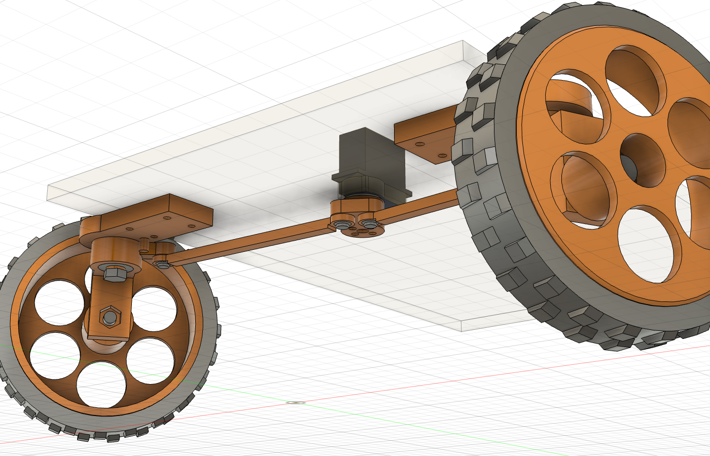

## Principle

- **Horizontal board**: the rear fixes the height. Wheels of **Ø200** (including tread), axis **30 mm below the board**, so the underside of the board is **130 mm** from the ground. With Ø150 front wheels, the front axis must be **55 mm below the board**: this is calculated automatically.
- **On each side, two parts**:
  - a **flat support** fixed under the board by **2 M8 screws** (head captive under the support), with a **captive M8 nut on the board side** for the pivot screw, and two **stops**;
  - a **knuckle** printed flat, with two **608ZZ** bearings brought close together (edge of 2 mm), the integrated steering arm, and at the bottom, the wheel axis (M8 screw in a captive nut).
- **All fasteners are M8×30**, the longest available screw: the pivot screw goes up from below (head under the knuckle) and the wheel screw has its head housed in the hub.
- **DT996 servo through the 5 mm board** (cutout 41,4 × 21 mm), head down. The ears are screwed onto the top of the board; the housing protrudes by 3,6 mm underneath (5,1 with its boss) and the **original star horn** is 13,3 mm below the board.
- **Printed horn**: the star fits into a recess of its shape, carved into its plate. It is level with the arms and carries the two tie rods. The drive is by shape; **a central M3 screw** with a large washer, screwed into the servo's brass shaft, holds the printed horn and the star.

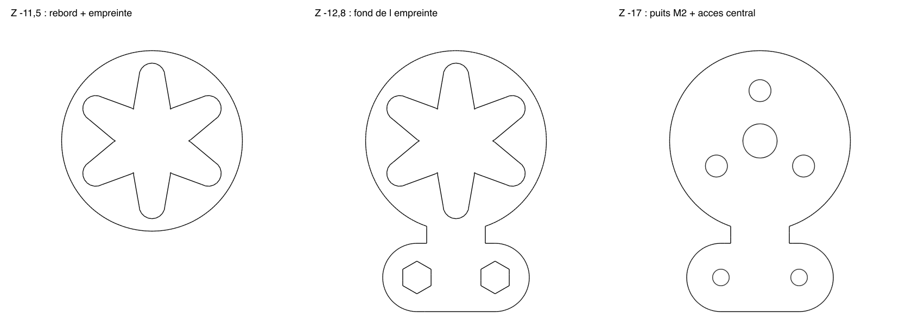
- **Tie rods** mounted on **3×10×4** on both sides. The M3 screw only tightens the inner ring (M3 washer on each side), so without friction.
- **Heights**: under the board, the linkage goes down to 28 mm and the knuckle up to the wheel axis + 13 mm. The **lowest point is 62 mm from the ground**, just under the wheel axis.

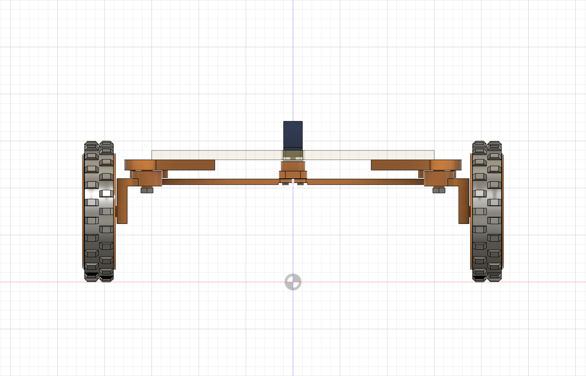

## Fusion Parameters

| Parameter | Value | Effect |
| --- | ---: | --- |
| `d4_planche_larg` | **300 mm** | Board width. The pivot spacing follows it: `d4_E = d4_planche_larg + 2 × d4_debord_pivot` = **310 mm**, and the tie rods lengthen (center-to-center 140,8 mm). |
| `d4_debord_pivot` | 5 mm | Pivot axis beyond each edge of the board. The top of the tires protrudes above the underside of the board, so **keep at least 3 mm**: with 5 mm, there remains 6 mm between tire and board at full lock. |
| `d4_planche_ep` | **5 mm** | Board thickness. The servo mounted on it moves up or down with it, and the star imprint follows. Tested at 10 mm without error. |
| `d4_etoile_sous_oreilles` | **18,3 mm** | Face of the star branches under the support face of the ears (49 − 30,7, measured). Sets the depth of the imprint and the height of the printed servo horn. |
| `d4_roue_ar_d` | 200 mm | Total diameter of the rear wheels. |
| `d4_axe_ar_sous_planche` | 30 mm | Rear axle under the board. |
| `d4_roue_av_d` | 150 mm | Diameter of the front wheels. |
| `d4_axe_av_sous_planche` | derived: 55 mm | Front axle under the board so that the board remains horizontal. Keep ≥ 55 mm, meaning front wheels ≤ Ø150 with the current rear. |
| `d4_vis_roue`, `d4_ecrou_roue_s`, `d4_ecrou_roue_h` | 8 / 13 / 6,5 mm | Wheel screw and nut (M8 single captive nut). |
| `d4_planche_long`, `_avant` | **500** / 60 mm | Board **30 × 50 cm**; front overhang ahead of the pivots. |
| `d4_empattement` | 380 mm | From front pivots to the rear motor axle (the supports reach 6 mm from the rear edge). |

Tests performed in Fusion:
- spacing of 220 and 400 mm;
- board of 15 mm;
- front wheels Ø130 (the axle then passes at 65 mm under the board);
- M10 screw.

Everything rebuilds, with no erroneous functions or constraints and no collision ([mouvement_verifie.json](mouvement_verifie.json)).

Beyond approximately 340 mm of spacing, the connecting rod exceeds 180 mm: it must then be printed diagonally.

## Front wheels

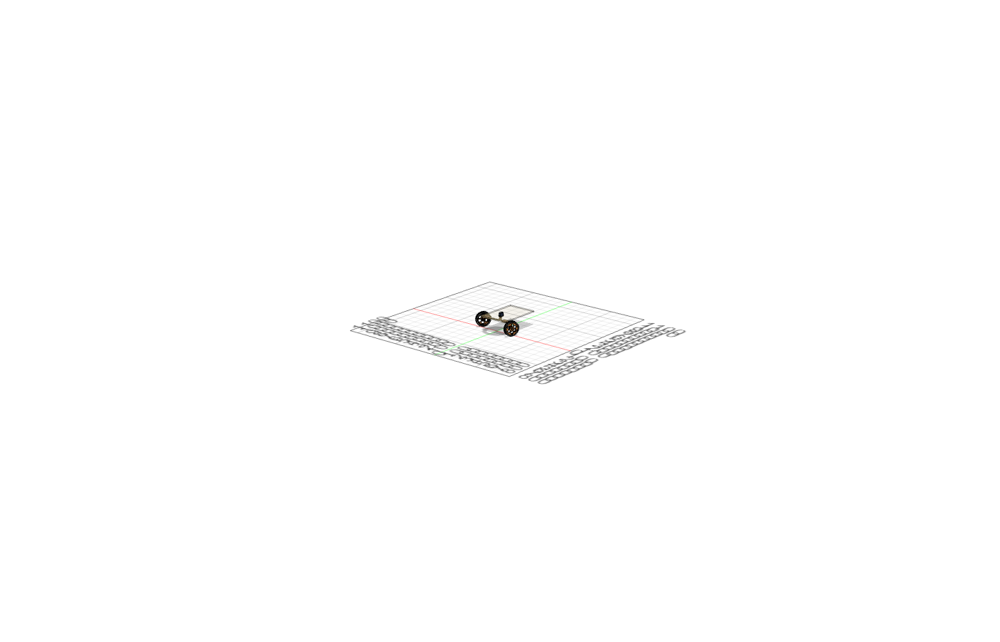

**Recommended diameter: Ø150 total.** This is the maximum possible with the current rear (Ø200 wheels, axle 30 mm below the board): the front axle then falls 55 mm below the board. A smaller diameter also works, since the fork automatically lengthens. It is not the diameter that keeps the board horizontal, but the axle height, which is recalculated.

| Element | Choice |
| --- | --- |
| Tire | **TPU 90A** (70A does not print), thickness **15 mm including lugs** (12 mm rubber + 3 mm lugs), 2 staggered rows of 24 lugs of 7 mm. **Beveled trapezoidal lugs at 45° at both ends**: no overhanging face beyond 45°, regardless of which side is placed on the bed (verified on the model). |
| Rim | PETG, tire contact **Ø120**, **6 full-width spokes** of 4,5 mm connected by fillets (3 mm at the hub, 5 mm at the barrel), inner flange of 2 mm with a ramp at 45°. **Outer flange = screwed flange** (Ø124 × Ø96 × 3): 6 M3×8 screws into 6 M3 inserts hot-staked at the ends of the spokes |
| Bearings | **2 × 608ZZ side-by-side on the fork side** in the hub, separated by a **2 mm rim edge** (Ø19,5) which only presses on the outer rings; **2,2 mm printed spacer** between the inner rings |
| Axle | **M8×30** fixed screw. Its head is housed in the hub (Ø24 bore for a 13 sleeve), it passes through the two 608ZZ and screws into the **M8 captive nut** of the fork leg (6 mm of thread engaged). The inner bearing rests on the Ø12 contact of the fork, which only touches the inner ring. Printed Ø12 washer under the head. |

### The wheel cannot come out of its bearings

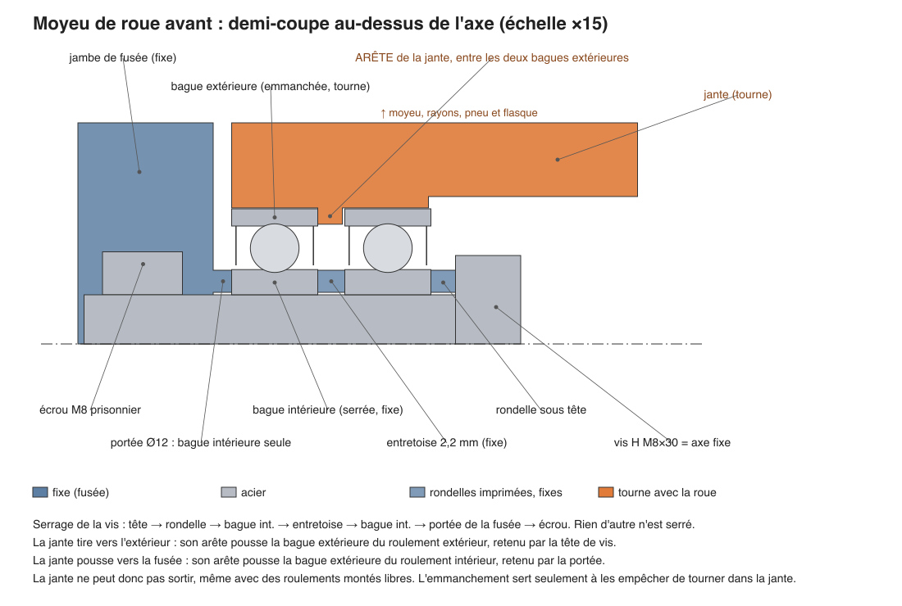

- **What the axle screw tightens**: head → washer → outer bearing inner ring → spacer → inner bearing inner ring → Ø12 fork contact → nut. Nothing else is tightened. The two inner rings are therefore fixed.
- **The rim edge is clamped between the two outer rings**, as in a bicycle hub.
  - If the wheel pulls outward, the edge hits the outer bearing, held by the screw head.
  - If the wheel pushes toward the fork, the edge hits the inner bearing, held by the contact.
  - The rim cannot come out, even with bearings that would slide in freely.
- **The interference fit (Ø22,15) holds nothing axially**: it only prevents the outer rings from rotating in the plastic. A bearing that fits by hand but doesn't fall out is sufficient. If it floats, a drop of cyanoacrylate glue or Loctite 641 on the outer ring.
  - No insert or locking screw: unnecessary.
  - Also no very tight fit: it would split the hub and prevent the outer bearing from seating when tightened.
- **2,2 mm spacer, not 2,0**. If the spacer is thinner than the edge, the tightening pre-stresses the two bearings against the edge: the wheel turns stiffly. With 0,2 mm more, the outer bearing seats itself by sliding 0,2 mm into its housing, and the wheel retains at most 0,2 mm of axial play, with no effect.
  - The underside of the edge prints in overhang. Its bore was increased from Ø17 to Ø19,5 to reduce this overhang from 2,6 to 1,3 mm: less burr.
  - Deburr with a cutter anyway before pressing on the outer bearing.
- **Clearances checked in Fusion** (`14_verifier_roues.py`, [verification_roues.json](verification_roues.json)), straight and turned wheels at ±31° :
  - rim → hub: **1,5 mm** (the hub only contacts via the bearings);
  - tire → plate: **6 mm** at maximum steering angle;
  - flange → any fixed part: 35 mm.

### TPU 90A tire and screwed flange

A 90A tire is too stiff to pass over a fixed rim: its inner diameter would need to be stretched from 119 to 124 mm (+4 %). The outer rim has therefore become a **screwed flange** (`15_jante_flasque.py`).

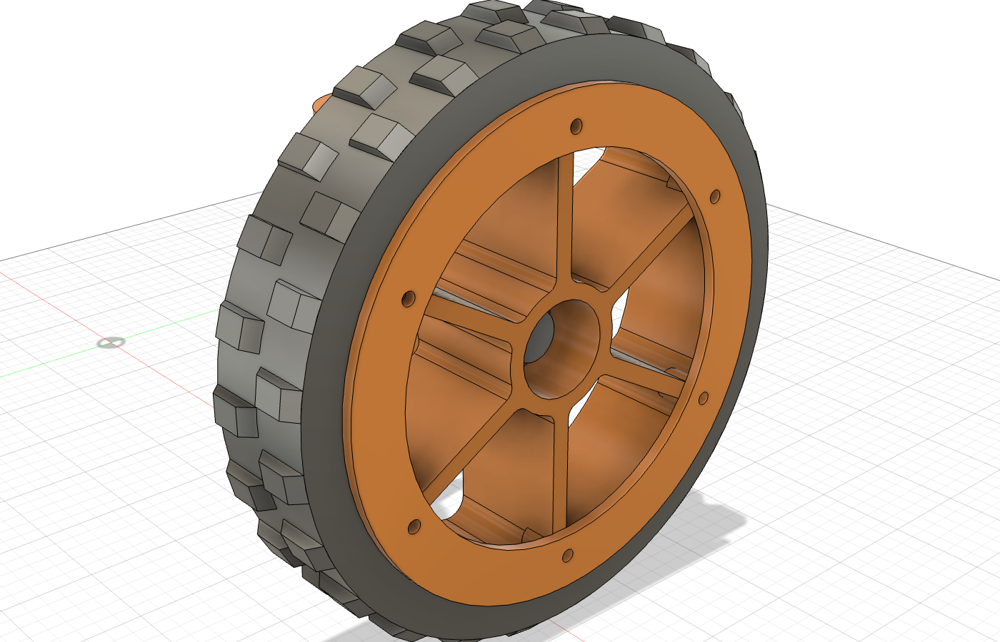
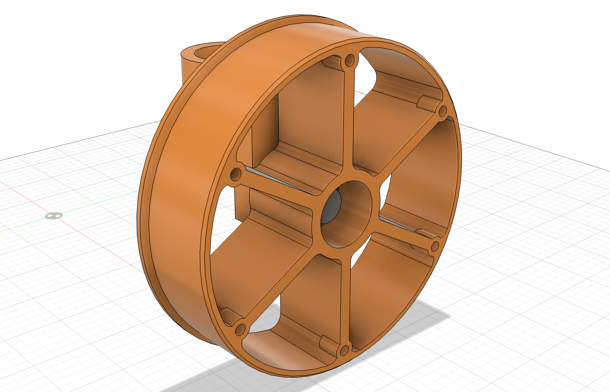

**Tire assembly** :
- place the 6 M3 inserts hot into the bosses, from the outside face (Ø4,0 × 6,5 holes, for M3 inserts of Ø4,6 × 5,7) ;
- with the flange removed, slide the tire **flat** onto the Ø120 section from the outside side :
  - the rim has an entry chamfer of 1 mm;
  - the inner edges of the tire are chamfered by 2 mm;
- push it until the inner rim. The tightening is 1 mm in diameter, so it requires strong pushing. A few minutes in water at 60 °C softens the TPU.
- place the flange and tighten the 6 M3×8 screws;
- there remains 0,2 mm of lateral clearance on each side, between the tire and the rims.

**Settings** :
- `d4_pneu_serrage` : set to 1,5 mm if the tire spins on the rim; set to 0,5 mm if it cannot be fitted;
- `d4_pneu_jeu` : lateral play.

Other parameters: `d4_roue_av_d` (150), `d4_roue_larg` (35), `d4_pneu_ep` (15 max), `d4_crampon_h` (3), `d4_crampon_n` (24), `d4_portee_roue_d` (12). Tests performed without collision up to maximum steering angle, including the board.

The bearings are 608ZZ (bore 8), so **wheel and pivot screws are M8**; the M10×40 are not used here.

### Printing the wheels on the A1 mini

- **Rim (PETG)**: placed on its outer face (the one with the insert holes), without support.
  - The spokes are vertical walls: 3 walls and a gyroid infill of 15 % are sufficient, as the 4,5 mm spokes come out almost solid. Printing is fast and the rim is rigid.
  - Size Ø124 × 33
  - The only overhangs are two ring steps at the bottom of the bearing housings (0,9 and 1,3 mm). They print without support.
- **Flange (PETG)**: flat, 2 walls, 3 solid top and bottom layers. Size Ø124 × 3
- **Tire (TPU 90A)**: flat on one side, **without support**. Spool in external feed, outside AMS lite.
  - **Gyroid infill 15–20 %, 3 walls**, 4–5 solid top and bottom layers. The 90A is much stiffer than the 70A: less infill retains some damping.
    - If the tire is too hard, reduce to 12 %.
    - If it sags under the rover, increase to 25 %.
  - Speed: 20–25 mm/s, first layer at 10 mm/s.
  - Size Ø150 × 31, which fits on the 180 mm bed.
- **Print one rim and one tire first** to adjust tightness before the pair.

### Designed tolerances (FDM, 0,4 mm nozzle)

Printed holes are generally 0,1 to 0,2 mm smaller than the model; the dimensions below account for this.

| Location | Model Dimension | Intended Effect |
| --- | --- | --- |
| 608ZZ Housings (Ø22) | Ø22,15 | Light press fit: the bearing does not fall out when pushed in by hand or in a vise |
| 3×10×4 Housings (Ø10) | Ø10,15 | Same for the connecting rods |
| Edges between bearings | Ø17 (shafts); Ø19,5 (rims) | Support only on the outer rings |
| Printed shafts and washers | Ø12 | Support only on the inner rings (no flange friction) |
| M8 Screw Holes | Ø8,4 | Free passage |
| M8 Head Recesses (supports) | 13,3 on flats × 5,5 | The M8 hex head enters from below, sits flush, and does not rotate |
| M3 Screw Holes (arms, horn) | Ø3,4 | Free passage up to the captive nut |
| Central access of the horn | Ø7 | Passage for the central M3 screw; the wide washer bears around it |
| Ø2,4 Passages under three branches (horn) | Ø2,4 | Unused: the star holes only accept M1 (M2 possible after drilling to Ø1,6) |
| Star Recess | measured contour + 0,25 mm | The star fits by hand, with no visible angular play |
| M8 / M3 Nut Recesses | 13,3 / 5,8 on flats, +0,2 deep | The nut fits by hand and does not rotate |
| Servo cutout in the board | housing + 0,5 mm (41,4 × 21) | No contact between housing and wood; the Ø26 hole in the model (old round horn) is unnecessary |
| Parts rotating against each other | 1 mm (shaft/support, thrust washers/tube); 0,5 mm (M3 washer) | No friction |
| Tire on rim | Inner diameter = rim Ø − 1 mm; 0,2 mm clearance on each side | The tire stays on without glue; flange screwed on for mounting and dismounting |
| Hot M3 Inserts (rims) | Ø4,0 × 6,5 | M3 inserts of Ø4,6 × 5,7; iron set to 230 °C for PETG |
| Wheel spacer | 2,2 mm (edge: 2,0) | No preloading of the 608ZZ bearings, max 0,2 mm axial play |

If the bearings fit too tightly or too loosely on your machine, print a small test ring and adjust the housing by ±0,05 mm. The dimensions are in `01_construire.py` (`SIEGE_608`, `SIEGE_3104`) and `05_roues.py`.

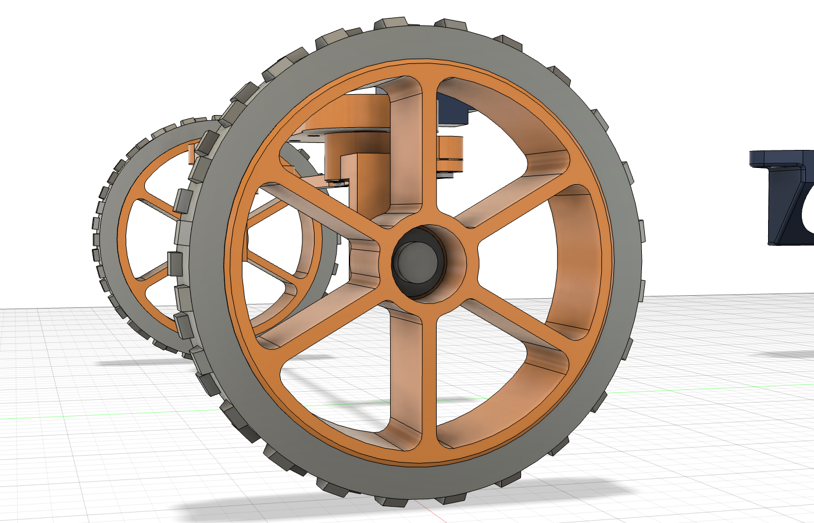

## Rear motor mounts

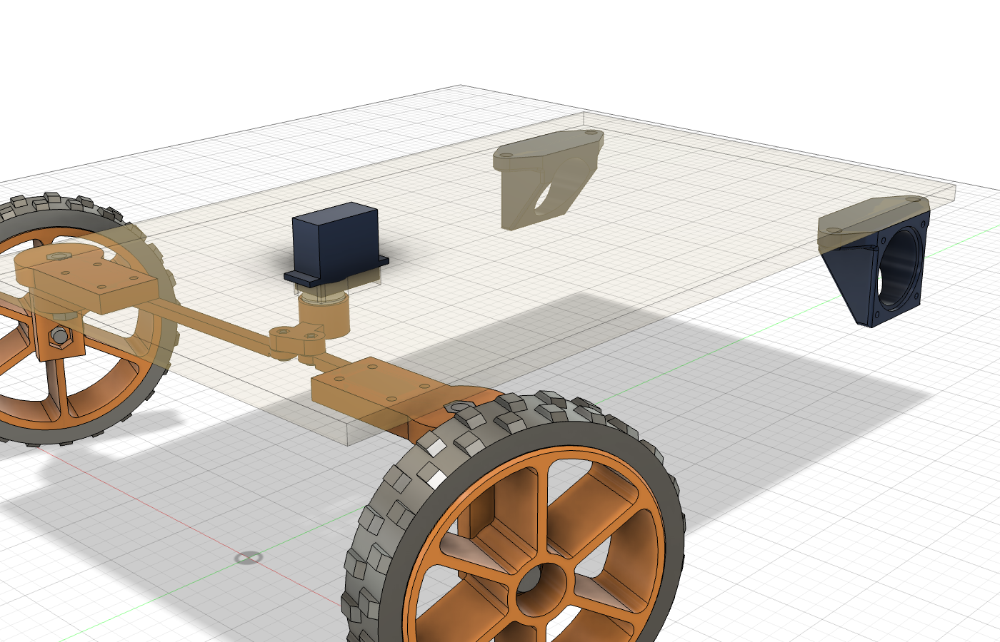

The motor mounts are in their own Fusion document, "fieldmind wheel mounts", inserted by reference into the rover (`prototype_final/scripts/18_document_supports.py`).

**Reinforced knuckles** (`prototype_final/scripts/19_fusees_renfort.py`): the knuckle is L-shaped, and the corner of the L (bridge of 8 mm between the pivot tube and the leg) was bending. A triangular gusset across the full width (26 mm) stiffens it, from 11 to 21 mm from the pivot axis and up to 44 mm below the board. The 13 bushing still goes over the pivot screw head, and the wheel nut pocket remains free. The knuckles rotate with the steering: they remain in the rover document.

Hugo's Onshape part (sources/support_moteur_onshape.step (work reference not included)) held the motor at 37,5 mm with 2 M8 screws in a line: the motor tilted. It is replaced by `prototype_final/scripts/16_supports_moteurs.py`, same motor interface:
- **Motor held at 85 mm**, in a stepped bore like it (Hugo's dimensions: reducer Ø46 on 55,5 mm, then motor Ø42 on the last 58 mm, 113,5 mm total): Ø46,3 then Ø42,3, giving 0,3 mm of play. Ø52 shoulder of 2,5 mm and 4 Ø4 holes on the wheel side.
- **Collar**: 2 mm slot under the motor, tightened by **2 M6×25 screws** and their nuts in a keel. The motor is tightened regardless of print tolerance, and it does not rotate.
- **Base of 95 × 108 × 10 mm** under the board, **4 H M8 screws**: the original 2 holes (x ±130) and 2 new ones at x ±68 (y 335 and 425). Head under the base, washer and nut on the board. M8×25 with the 5 mm board, M8×30 with 10 mm. A Ø14 notch allows the M6 hull screw to pass.
- **Placement**: wheel-side face flush with the board edge, motor axis 30 mm below the board, at **380 mm** behind the pivots. Same part on both sides, rotated by 180°.
- **Printing**: standing on the wheel-side face (vertical bore), without support; 72 × 108 × 95 mm, approx. 225 cm³; 4 walls, gyroid 30 %.
- Lowest point: the keel, at 58 mm from the ground.

**Motors are not modeled**: no 3D model of these motors is available. To add them, you need the manufacturer's STEP file, or failing that, the body diameter and length, the shoulder, shaft length, and mounting center-to-center distances.

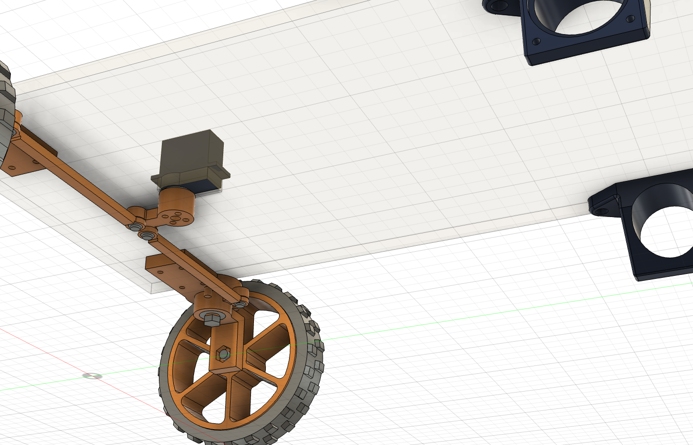

## Sensors: two masts in 40 × 40 profile

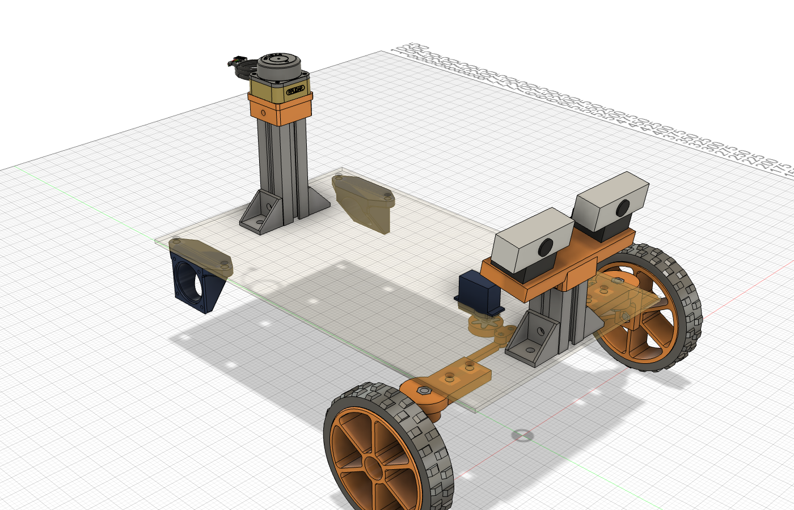

The two sensors are each mounted on an aluminum profile **40 × 40 type B** (groove 10), vertical and centered on the axis. Each profile is held on the board by **two 40 brackets**, on the left and right, screwed in **M8**. At the top of the profile fits a printed part, using the same principle for both masts:
- the fit is 20 mm high, with 0,25 mm of clearance on each side;
- **4 tabs** enter the groove openings, so the part does not rotate;
- **2 M8 side screws** (left and right, Ø8,6 passages) tighten into M8 T-nuts in the groove.

The lidar support follows this principle with a 31 mm fit and only two tabs (front and rear), see below.

These elements are built by `11_lidar_stereo.py` in the same Fusion group and controlled by `12_verifier_capteurs.py` ([verification_capteurs.json](verification_capteurs.json)).

**Brackets**: geometry of a commercial 40 × 40 bracket (Emile Maurin datasheet 94-103, profile 40×40):
- 38 mm wide, wings of 36 mm;
- Ø8,5 hole at **20 mm from the profile face**, which places the board holes at 40 mm from the profile axis;
- for another bracket, place the bracket on the jig and verify that its hole aligns with the cross before drilling.

### Lidar mast (RPLIDAR C1)

- **Position**: directly above the axis of the rear wheels (`d4_lidar_y = d4_empattement`).
  - The rover steers around a point on this axis. The lidar rotates on itself without lateral sweeping, which deforms the scans less.
  - This is also the usual origin (`base_link`) for a car-type steering robot.
- **Height**: profile of **90 mm** above the board (`d4_profil_h`), plus a **printed riser of 60 mm** (`d4_rehausse_lidar`) under the support: the two available profiles make 90.
  - The support is a single piece: an octagonal column of 56 mm, with at the bottom a **fit of 31 mm** slipped onto the top of the profile. Two tabs go into the front and rear grooves. **2 M8×16 side screws** tighten into M8 T-nuts in the left and right grooves, 23 mm below the top of the profile. Nothing is screwed from below the board.
  - The screw heads remain under the shell roof: we mount the complete mast before placing it. It passes over the lidar, with an opening of 61 × 61 mm.
  - The C1 screws are tightened with an Allen key of 2, through the grooves of the column corners.
  - Made by `prototype_final/scripts/12_mats_profiles_90.py`, placed in the rover documentation.
  - The laser plane is at **322 mm from the ground**, like the simulated lidar (0,323 m).
  - It passes 30 mm above the webcams.
  - Control: 360 rays in the plane and at ±1,5° (advertised planarity) do not touch any rover parts.
- **Printed support** (`support_lidar_C1`):
  - a plate of 56 × 56 mm holds the C1, **aligned with the rover**: its 0° (opposite the cable, according to the Slamtec datasheet) faces forward, and the cable goes backward in a groove;
  - the C1 is screwed **from underneath**, through 4 holes in the corners of the skirt.
- **The C1 screws in M2,5, not M3**. The Slamtec datasheet (archived in fusion_v01 (working reference not included)) indicates 4 × M2,5 on 43 × 43, with **4 mm screws maximum in the lidar**, otherwise it is damaged. The support passages are Ø3,0.
  - An M2,5×8 passes through 4,5 mm of plate and enters 3,5 mm into the lidar.
  - If an M3 really goes in by hand without forcing, re-drill the passages to Ø3,4 and keep M3×8.

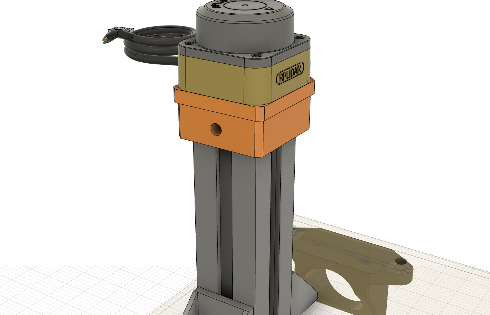

### Camera mast (two UGREEN webcams 15728)

- **90 mm profile** above the board (`d4_cam_profil_h`), at the front edge: the bar and webcams are 5 mm lower than planned (optical centers at **265 mm** from the ground instead of 270). The field of view of both webcams remains clear; the bar passes 3,3 mm from the nose of the shell.
  - Its axis is 25 mm behind the edge (`d4_cam_y`), its faces at 5 mm.
  - Its length derives from the target height for the lenses; the script rounds it to the mm.
- **Printed bar** (`barre_stereo`, 170 × 56 mm) fitted on top of the profile. It holds the two cameras; their relative position depends only on this part, so stereo calibration holds.
  - The top of the bar is the camera support. It is tilted 10° forward, and the joint is vertical, so it is inclined within the bar.
  - **The STL is already oriented for printing**: the top of the bar lies flat on the build plate, providing a well-flat support surface.
  - Four 45° gussets reinforce the arms. They remain clear of the M8 screws and camera screws.
- **Geometry**:

| Quantity | Value | Parameter | Why |
| --- | ---: | --- | --- |
| Optical center spacing (baseline) | **120 mm** | `d4_stereo_base` | The physical minimum is about 85 mm (81 mm housings). 120 mm provides good accuracy at 4 m, the distance where the algorithm confirms obstacles, and the bar fits on the A1 mini build plate. |
| Optical axes | **parallel** | – | Maximum overlap and simple rectification for SGBM |
| Tilt towards the ground | **10°** | `d4_cam_inclinaison` | Same pose as the simulated camera: less sky, ground visible from 0,42 m in front of the lenses |
| Optical center height | **270 mm** | `d4_cam_optique_sol` | Same height as the simulated camera (0,269 m), above short grass and front wheels (150 mm) |
| Position | lenses flush with the front edge | `d4_cam_y` | Nothing of the rover in the field of view, controlled by rays on 75° × 45° |

- **What this means for SGBM**. We count in 640 × 360 with a horizontal field of view of 75°, resulting in a focal length of about 417 px.
  - The accuracy is approximately ±8 cm at 4 m and ±2 cm at 2 m, for 0,25 px of disparity. This is 2,6 times better than the simulated module (baseline of 60 mm).
  - With `numDisparities = 96`, depth is measurable from 0,52 m.
  - With 128, it is measurable from 0,39 m, down to the bottom of the image. The computation costs one-third more.
  - A wider baseline would better tolerate the offset between the two webcams, which are not synchronized. But the bar would no longer fit on the build plate, and the near ground would be lost.
- **Camera mounting**: one photo screw per camera, from below, through 8 mm of plastic.
  - A webcam almost always has a photo thread **1/4"-20**, not M6. Try an M6 screw by hand, without forcing. If it catches, use 1/4"-20 × 1/2" (12,7 mm) screws.
  - The hole in the bar (Ø6,8) allows both to pass through.
- **TF ROS poses**: the `base_link` frame is on the ground, under the middle of the rear wheel axle (x forward, y left, z up).

| Sensor | x | y | z | Orientation |
| --- | ---: | ---: | ---: | --- |
| C1, center of the laser plane | 0 | 0 | 0,322 m | 0° forward (to be confirmed in front of a wall in RViz) |
| Left webcam, optical center | 0,442 m | +0,060 m | 0,270 m | pitch 10° towards the ground |
| Right webcam, optical center | 0,442 m | −0,060 m | 0,270 m | pitch 10° towards the ground |

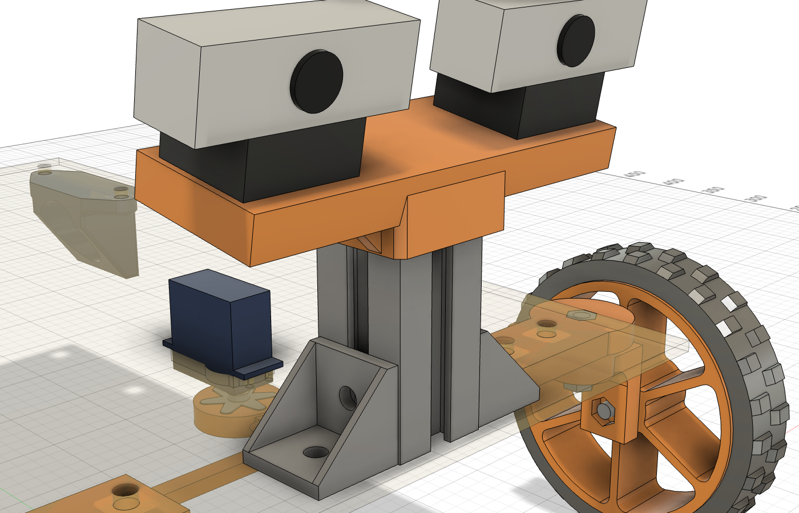
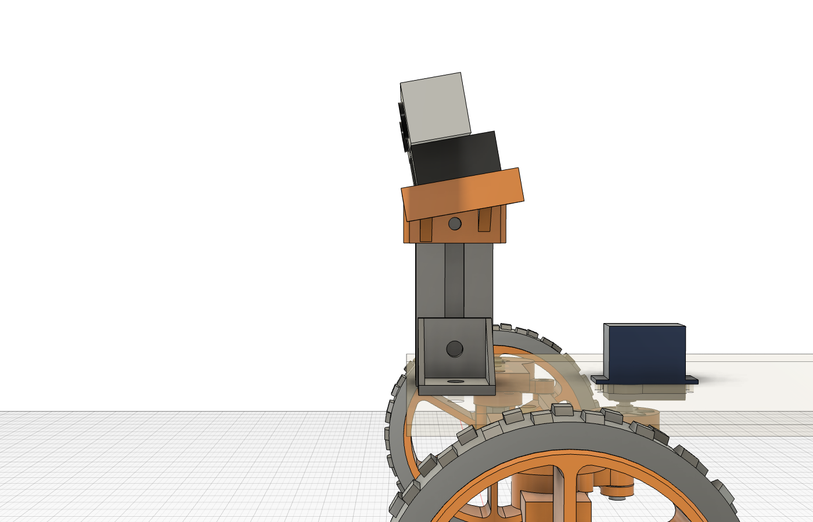
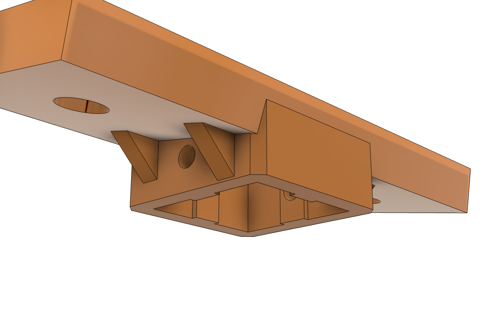

### To measure on the webcams

The webcam envelope comes from commercial dimensions: 81,3 × 48,3 × 47 mm, field of view 85° diagonally, i.e., 75° × 45°. Measure the following dimensions, enter them into the parameters, then restart `11` and `12` :
- `d4_cam_axe_sur_pied` (33 mm assumed): height of the lens center above the foot face carrying the thread;
- `d4_cam_axe_devant_vis` (22 mm assumed): lens protrusion in front of the thread axis.

These two dimensions only change the length of the front profile. The 120 mm base assumes the thread is centered under the lens. Calibration will anyway measure the actual base.

## Drilling plan for the board

[plan_percages/plan_percages.pdf](plan_percages/plan_percages.pdf) contains three parts:
- **page 1**: dimensioned drawing at 1:2,5;
- **page 2**: coordinates of each hole from the left edge and the front edge, with the fasteners;
- **pages 3 to 6**: **scale template 1** on 4 A4 sheets.
  - Print at 100 % and check the 100 mm rule.
  - Assemble the sheets on the green crosses (marks every 50 mm).
  - Tape the template to the board and mark the centers of the crosses.

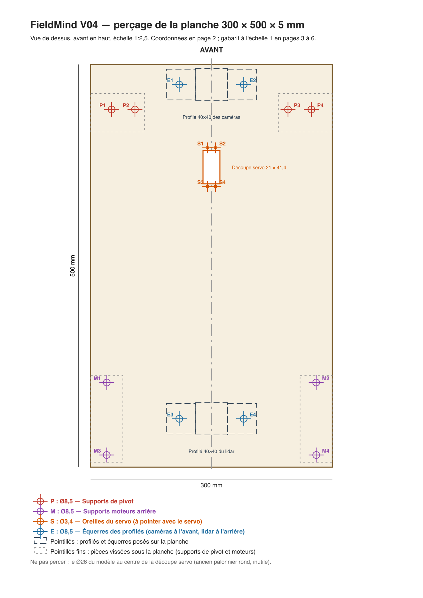

| Mark | Ø | For |
| --- | ---: | --- |
| P1–P4 | 8,5 | Pivot supports (M8×20 screws from below) |
| M1–M8 | 8,5 | Rear motor mounts, 4 per mount (M8×25 through-holes) |
| S1–S4 | 3,4 | Servo ears: **assumed pitch 48 × 10, mark with the servo** |
| E1–E2 | 8,5 | Brackets for the camera profile (Y 25 from the front edge, X ±40 from the axis) |
| E3–E4 | 8,5 | Brackets for the lidar profile (Y 440 from the front edge, X ±40 from the axis) |

The Ø26 that the model keeps in the center of the servo cutout is not drilled.

## Movement verified

The servo is the `D4_SERVO_DIRECTION` link, limited to **±31°**. No collision.

| Servo | Inner wheel | Outer wheel |
| ---: | ---: | ---: |
| ±10° | 10,0° | 9,1° |
| ±20° | 21,0° | 17,4° |
| ±30° | 33,9° | 24,5° |
| ±31° | 35,4° | 25,1° |

The printed stops stop the rocket at approximately **38,6°**. **In the firmware, limit the servo to ±31° around the neutral position.**

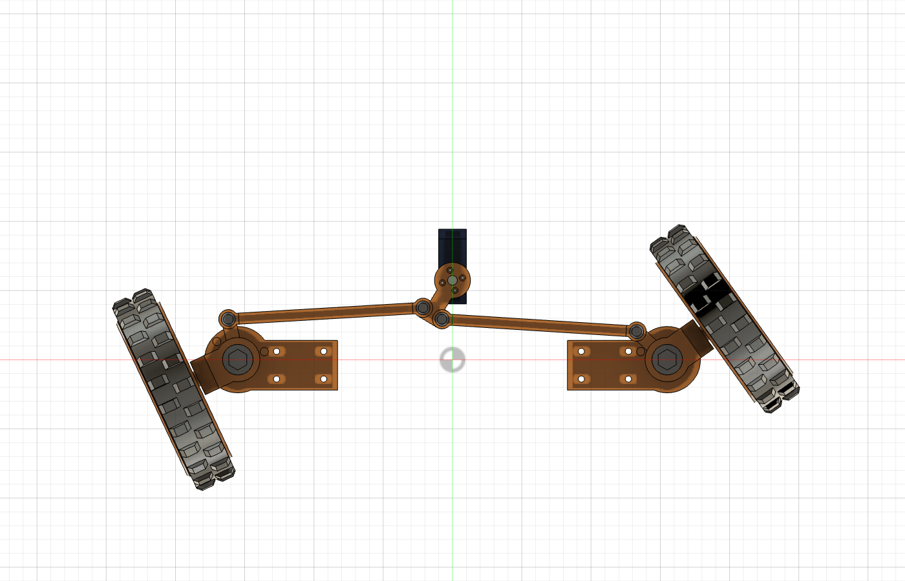

## Parts to print (PETG, no supports)

| File | Qty | Size (mm) | Orientation |
| --- | ---: | --- | --- |
| `support_pivot_D` / `_G` | 1 + 1 | 96 × 48 × 20 | Flat side on the build plate (stops facing up) |
| `fusee_renforcee_D` / `_G` | 1 + 1 | 50 × 52 × 56 | Arm side on the build plate; with the gusset under the bridge (`prototype_final/scripts/19_fusees_renfort.py`) |
| `palonnier` | 1 | 37 × 53,5 × 9 | Linkage plate on the build plate, star imprint facing up |
| `biellette` | 2 | 150 × 14 × 6 | Flat face (top) on the build plate |
| `rondelle_2mm` | **4** | Ø12 × 2 | Flat: one under the head of each pivot screw and each wheel screw |
| `entretoise_roue_2.2mm` | 2 | Ø12 × 2,2 | Flat; between the inner rings of the two 608ZZ bearings of each wheel |
| `rondelle_precharge_1.8mm` / `_1.9mm` | 2 + 2 | Ø12 × 1,8 / 1,9 | Between the two 608ZZ bearings of each rocket, in place of the 2 mm washer: eliminates play (see "Zero-backlash pivot") |
| `rondelle_M3_0.6mm` | 8 (if no M3 metal washers) | Ø5 × Ø3,3 × 0,6 | Flat. It only presses against the inner ring of the 3×10×4; 0,2 mm layer height, 3 layers |
| `jante_608ZZ` | 2 | Ø124 × 33 | Outer face (the one with the insert holes) on the build plate, PETG |
| `flasque_pneu` | 2 | Ø124 × 3 | Flat, PETG |
| `pneu_TPU` | 2 | Ø150 × 31 | Flat, **TPU 90A**, gyroid 15–20 %, 3 walls |
| `support_lidar_C1` | 1 | 56 × 56 × 98,5 | Plate (lidar face) on the build plate, interlocking facing up; 4 walls, gyroid 20 % |
| `barre_stereo` | 1 | 170 × 60 × 36 | STL **already oriented**: top of the bar (camera support) on the build plate, interlocking facing up; 4 walls, gyroid 25 % |

Designed adjustments:
- 608ZZ Ø22,15 and 3×10×4 Ø10,15 (light interference fit);
- Ø8,4 and Ø3,2 passages;
- captive M3 nuts on the top of the arm and horn.

Print **a support and a fuselage** first to validate the interference fit and movement.

## Hardware

| Qty | Item | Role |
| ---: | --- | --- |
| 8 | **608ZZ** | 4 on pivots (2 per fuselage) + 4 in wheels (2 per hub) |
| 4 | **3×10×4** | Linkage joints |
| 2 | H-head screw **M8×30** + 2 M8 nuts | Pivots: screw from below, captive nut in the support (board side), threadlocker recommended |
| 2 | H-head screw **M8×30** + 2 M8 nuts | Wheel axles: captive nut in the fuselage leg, threadlocker recommended |
| 12 | **Hot M3 inserts** (Ø4,6 × 5,7) + 12 **M3×8** screws | Tire flanges (6 per wheel) |
| 4 | H-head screw **M8×20** (M8×25 comfortable; M8×30 protrudes by 11 mm) + 4 M8 nuts + 4 M8 washers | Supports through the 5 mm board: captive head under the support, nut on top (the support serves as a drilling template) |
| 4 | **M3×12 countersunk head** screw + 8 M3 washers + 4 M3 nuts | Linkages: one washer between each bearing and the arm (or horn), one under each screw head. Without metal washers, print `rondelle_M3_0.6mm` (×8) |
| 4 | **M3×12** screw + nuts and washers | Servo ears through the 5 mm board |
| 1 | **M3×16** screw + **wide M3 washer** (DIN 9021, Ø9 or Ø12) | Central screw, from below: holds the printed horn and the star on the servo's brass shaft (tapped M3). Replaces the original star screw. Length: see assembly |
| 2 | **40 × 40 type B profiles** (groove 10): **90 mm** (lidar) and **90 mm** (cameras) | Masts |
| 4 | **40 × 40 brackets** (groove 10) | Mast feet, left and right of each profile |
| 4 | H-head screw **M8×20** + 4 M8 washers + 4 M8 nuts | Brackets on the board (nut under the board) |
| 8 | **M8×16** screws + 8 **M8 T-slot nuts 10** | 4 for brackets on profiles, 2 for the stereo bar, 2 for the lidar mount |
| 4 | **M2,5×8** cylindrical head screws + M2,5 washers | C1 on its mount (4 mm max inside the lidar) |
| 2 | Photo screw **1/4"-20 × 1/2"** (or M6×12 if the thread is indeed M6) | Webcams on the stereo bar |

## Assembly

1. **Board** :
   - cut out the servo rectangle (41,4 × 21 mm) ;
   - drill all holes using the [template 1:1](plan_percages/plan_percages.pdf) (pivot mounts, motor mounts, servo, brackets for both profiles). The mounts themselves can serve as a template for verification.
2. **Pivot**, on the workbench :
   - slide an M8 nut into the recess on the top of the mount ;
   - in the hub, press the bottom 608ZZ bearing up to the edge, place a preload washer (1,9 mm to start) on its inner ring, then press the top 608ZZ bearing up to the edge ;
   - slide the wheel nut into its pocket (inner side of the leg) ;
   - from below, pass the M8×30 screw with a 2 mm washer through the hub and the mount, and screw it into the nut ;
   - tighten firmly, using threadlocker: the tightening acts only on the inner rings, it does not brake the hub (see "Backlash-free Pivot").
3. **Fixation**: from below, slide 2 M8 socket head screws into the hexagonal recesses of the mount, through the board; washer and M8 nut on top. The board closes the recess for the pivot nut.
4. **Servo and horn** :
   - pass the servo through the board and screw in the ears ;
   - embed the star into the recess of the printed horn, flat side facing down ;
   - servo at neutral, push the star alone fully onto the spline and measure how much its flat face protrudes beyond the end of the brass shaft (approximately 4,2 mm based on measurements) ;
   - screw length M3 ≈ 12 mm + this protrusion: 6,7 mm of plastic under the star, 0,8 mm of washer and 4 to 5 mm of thread in the axis. With 4,2 mm, an **M3×16**; it must not bottom out in the axis before tightening;
   - put the star back into the horn, push the assembly onto the spline, then from below, pass the M3 screw with the large washer through the central access (Ø7) and tighten it in the axis, using blue threadlocker;
   - straight wheels, assemble the connecting rods (M3 from below: washer, bearing, washer, arm, captive nut).
5. **Wheels** :
   - place the 6 M3 inserts in the rim; deburr the underside of the central edge;
   - press the 608ZZ inner race from the hub side up to the edge (hand or vise, pressing only on the outer ring);
   - **install the 2,2 mm spacer now**, from the other side, on its inner ring. Once the second bearing is in place, you can no longer slide it in;
   - press the 608ZZ outer race from the flange side (it passes through the Ø24 bore) up to the edge;
   - slide the tire on flat, place the flange and tighten the 6 M3×8 screws;
   - pass the M8×30 screw and its 2 mm washer from the outside, then screw it into the leg nut using a 13 socket. Tighten firmly, with threadlocker;
   - check that the hand-spun wheel rotates several times on its own, and that it has very slight axial play (at most 0,2 mm). If it turns stiffly: the edge was not properly deburred or the bearing is not fully seated in its housing.

6. **Masts** (lidar and cameras, same method) :
   - two **90 mm** profiles (lidar and cameras), deburred;
   - place each profile upright, centered on the axis: cameras from Y 5 to 45 mm from the front edge, lidar from Y 420 to 460 mm (above the rear wheel axis);
   - one bracket on the left and one on the right: M8×20 screw + washer through the board (holes E), nut underneath; M8×16 screw into an M8 T-nut in the profile groove;
   - place two M8 T-nuts in the left and right grooves, 10 mm below the top of the camera profile.
7. **Lidar** (before installing the shell) :
   - screw the C1 onto its mount: 4 M2,5×8, 2 Allen key through the grooves of the wedges; cable towards the rear in the groove;
   - the LiDAR mount is placed with the C1 already screwed on. Two M8 T-nuts are screwed two turns onto the lateral M8×16 screws, lengthwise. Slide the mount onto the top of the profile: the nuts enter the left and right grooves, the tabs into the front and rear grooves. Lower it until it hits the stop, then tighten the two screws.
8. **Webcams** :
   - place each webcam foot flat on the bar, lens facing forward and front face parallel to the bar's edge;
   - tighten the photo screw from underneath;
   - fold the foot hinge into its folded position (lens aligned with the foot axis), then lock it, for example with a dot of hot glue;
   - slide the bar onto the front profile and tighten the two M8s;
   - **calibrate the pair only when everything is tightened**, and recalibrate if a camera has moved.

## Play-free pivot

Play is not adjusted by tightening the spindle against the support: there is intentionally 1 mm between the two, so they do not rub. Everything goes through the **inner rings** of the two 608ZZ bearings:

- **Chain tightened by the pivot screw**: screw head → 2 mm washer → inner ring of the bottom 608ZZ → central washer → inner ring of the top 608ZZ → Ø12 shoulder of the support → support → captive nut. The outer rings, however, are held in the spindle on either side of the 2 mm edge.
- **Preload**: if the central washer is slightly thinner than the edge (1,9 or 1,8 mm instead of 2), tightening brings the two inner rings closer together. The internal play of the bearings disappears, both axially and in tilt. This is the classic mounting of two opposing bearings.
- **Tightening**: tighten firmly, using medium threadlocker (blue). Tightening only affects the inner rings: it does not brake the spindle, as long as the preload remains light.
- **Adjustment** on the workbench, wheel lifted:
  - **play** when shaking the wheel up and down → thinner washer (1,8);
  - **the spindle catches or turns stiffly** → thicker washer (2,0);
  - the three thicknesses are provided; a washer can also be sanded.
- **Bearings held firmly**: each 608ZZ must be pressed in until the edge and not move in its housing. If it goes in too easily, a drop of cyanoacrylate glue or strong threadlocker for bearings (Loctite 641) on the outer ring eliminates this play.
- **Screw threaded into the bearings**: the thread (Ø7,8 approx) leaves a little play in the 8 mm bore. Tightening the rings neutralizes it; a screw with a smooth shank aligned with the bearings is even better if you can find one.

The rest of the steering assembly comes from the **servo** (gears, horn spline) and the **connecting rods**, mounted on the same principle: tight inner ring, no friction.

## To measure or validate

- **Measured DT996** (15/10): housing 40,4 × 20 × 39,3 mm, ears of 2,2 mm whose underside is 28,5 mm from the base, boss up to 40,8, spline up to 44,8, star horn mounted up to 49 mm. The star (6 branches, Ø31,4, thickness 2,6, 5,5 with the hub side towards the servo) was measured from a photo using calipers.
  - **To confirm: the 49 mm with the star fully inserted and its screw tightened.** If the dimension changes, modify `d4_etoile_sous_oreilles` (= dimension − 30,7): the imprint and rim will follow.
  - Still to measure: the boss diameter (assumed 12 mm), the overall length of the ears (54) and the center-to-center distance of their holes (48 × 10).
  - First print the horn alone and test the star in the imprint.
  - Fixation: central M3 screw in the axis using brass (tapped M3, confirmed by Hugo). The star's holes only accept M1 screws; the three M2 passages in the horn remain unused.
- **Bearings interference fits** on a first print run.
- **TPU 90A tire**: tightening on the rim (1 mm), filling and mounting with the flange to be validated on a first print run (`d4_pneu_serrage`).
- **Real load and torque**: the verified poses do not validate the strength.

## Scripts

They go through the local Fusion MCP server, whose address changes on each restart: use the `FUSION_MCP_URL` variable. They reuse `../direction_v03_simple/scripts/d3_helpers.py`.

| Script | Role |
| --- | --- |
| `01_construire.py` | Parameters, parts, joints, board with servo cutout |
| `02_verifier.py` | Servo sweep, collisions, parameter tests, heights → JSON |
| `03_exporter.py` | STLs of parts (stereo bar laid flat for printing), STEP + F3D of the group, manifest |
| `04_portee_roue.py` | Ø12 fit (inner ring) on the outer face of the hubs |
| `05_roues.py` | Spoked rims, TPU tires with trapezoidal lugs, washers and wheel screws |
| `06_planche_30cm.py` | Clearance related to board width, tire/board play during steering |
| `07_supports_moteurs.py` | 30 × 50 board, import and placement of rear motor mounts |
| `08_planche_5mm.py` | 5 mm board, modified in place (retains hand-added fillets on the steering knuckles); its servo/horn section is replaced by the 10 script |
| `09_supports_M8.py` | Pivot mounts fixed with 2 M8 screws (captive head), in place |
| `10_servo_mesure_etoile.py` | Servo to measured dimensions, star horn embedded, 41,4 × 21 cutout, in place |
| `11_lidar_stereo.py` | Two 40 × 40 profiles and their brackets, lidar mount, C1 (STEP Slamtec), stereo bar, webcams, board drilling; re-executable |
| `12_verifier_capteurs.py` | Collisions (steering at neutral and at ±31°), webcam field of view and laser plane by rays, hole locations → `verification_capteurs.json`, `plan_percages.json` |
| `13_plan_percages.py` | Outside Fusion: PDF drilling plan (plan, coordinates, template 1:1) from `plan_percages.json` |
| `14_verifier_roues.py` | Clearance between parts rotating with the wheel and those remaining fixed, steering at neutral and at ±31°, stacking on the axis → `verification_roues.json` |
| `15_jante_flasque.py` | Rims: outer flange screwed (6 M3 inserts), edge Ø19,5, tire entry chamfer; in place, re-executable |
| `16_roue_annexes.py` | Outside Fusion: wheel spacer 2,2 mm (STL) and half-section of the hub |
| `fusion_mcp.py` | Fusion MCP server client (outside Fusion): `run`, `shot`, `read` |

The Fusion document is not saved by the scripts.

**5 mm board**: it carries the pivot mounts, the servo, and the motor mounts. A board this thin may bend under the battery and electronics; if so, a screwed cleat underneath between the motor mounts and pivots is sufficient to stiffen it.
