# FieldMind — prototype final

> **Statut, 21 octobre 2026.** Cette page décrit la conception en CAO et ses contrôles
> géométriques. Les images sont des vues du modèle. Le rover réel roule en commande
> manuelle, avec son châssis et son électronique visibles ; la coque n'est pas montée
> et la remorque n'est pas encore disponible. Les contrôles CAO ne prouvent pas la tenue
> mécanique en charge. Voir les [résultats et limites](../../docs/validation.md).

Document Fusion **`prtotype final fieldmind`**. Il contient deux groupes :
- `FM_Direction_V04` : le rover de la [direction V04](../mounts/prototype/direction_v04_servo_traversant/README.md),
  avec la planche, la direction, les roues, les deux mâts et les capteurs ;
- `FM_Prototype_Final` : les composants embarqués et la coque.

**Côtés** : *gauche* et *droite* s'entendent vus de l'arrière du rover, en regardant vers l'avant.
La gauche est le côté +X de Fusion. Les pièces de coque `G…` sont à gauche, les `D…` à droite.
Attention : les pièces de la direction V04 nommées `_D` sont, elles, côté +X.

**Couleurs** : bleu et blanc.
- Toutes les pièces déjà imprimées (direction, roues, supports du lidar et des caméras) sont en
  blanc dans le modèle, comme en vrai.
- Pour la coque, les flancs sont blancs et la bande centrale bleue.

## Composants posés

Seul le matériel documenté comme acheté ou déjà en place est posé. Il n'y a ni arrêt d'urgence,
ni interrupteur général, ni fusibles, ni relais.

| Composant | Place | Volume (mm) | Cotes |
| --- | --- | --- | --- |
| Raspberry Pi 4 dans son boîtier | droite, derrière le servo | 68 × 96 × 32 | boîtier à mesurer |
| Breadboard 830 points, GPS ATGM336H enfiché dessus | au centre | 55 × 165 × 8,5 | Elegoo |
| Carte capteurs A7 (XIAO, GY-521, BMP280) | sous la bande centrale, **juste au-dessus de la breadboard** | 40 × 60 | plaque A7 |
| Écran OLED 0,96" I2C 128 × 64, enfiché sur la carte A7 | derrière sa fenêtre, vissé sous la bande par 4 vis M2 | 27,3 × 27,8 | plan du fabricant ([cotes LCDwiki MC096GX](https://www.lcdwiki.com/res/MC096GX/MC096GX-size-EN.jpg)) |
| Modulino Knob | à côté de l'écran, au-dessus de la breadboard ; axe et capuchon sur le dessus, vissé sous la bande par 4 vis M3 | 41 × 25,36 | **modèle 3D officiel Arduino** (STEP (référence de travail non incluse), [fiche](https://docs.arduino.cc/resources/datasheets/ABX00107-datasheet.pdf)) |
| Batterie, couchée en long dans son berceau imprimé | **à l'avant gauche**, contre le servo de direction (6,5 mm), centre à 63,5 mm derrière l'axe des pivots | 82 × 68 × 51 | mesurée |
| 2 XL4015 : 5,1 V pour le Pi, 6 V pour le servo | **à l'avant droit**, en miroir de la batterie, sur leur plaque imprimée (`support_xl4015`) à 5 mm l'un de l'autre, vis M3×8 + écrous | 23 × 54 × 15 | AZDelivery ; entraxe des trous à vérifier avec le [gabarit 1:1](exports/support_xl4015_gabarit.pdf) |
| 2 contrôleurs BLDC (ZS-X11H) | de chaque côté du mât du lidar, au-dessus des moteurs | 45 × 63 × 31 | annoncées |
| Adaptateur USB du lidar C1 | derrière le mât du lidar | 40 × 25 × 6 | à mesurer |
| Antenne GNSS | collée sous le dessus de la coque, à droite | 25 × 25 × 8 | à mesurer |
| Moteurs NGP RM24 et roues arrière | sous la planche, dans des supports imprimés à collier (85 mm de long, 4 vis M8) ; chaque roue directement sur l'arbre de son moteur | Ø46 ; Ø200 × 50 | à mesurer (aspect de la roue indicatif) |

### Roues arrière

Ce sont les roues de tondeuse montées **directement sur l'arbre de sortie** des moteurs NGP RM24 :
pas d'axe ni de roulement à part, le motoréducteur porte la roue. Dans le modèle :
- roue de Ø200 × 50, à 3 mm du support moteur ;
- jante blanche à 5 rayons, moyeu Ø36 sur l'arbre (Ø10 supposé) ;
- pneu noir à 22 crampons en chevron, enjoliveur bleu comme les bandes de la coque.

C'est un aspect indicatif, dans le style des roues avant : diamètre, largeur, déport et arbre sont à
mesurer sur les vraies roues. Le script `08_roues_arriere.py` les refait seules, sans toucher au
reste.

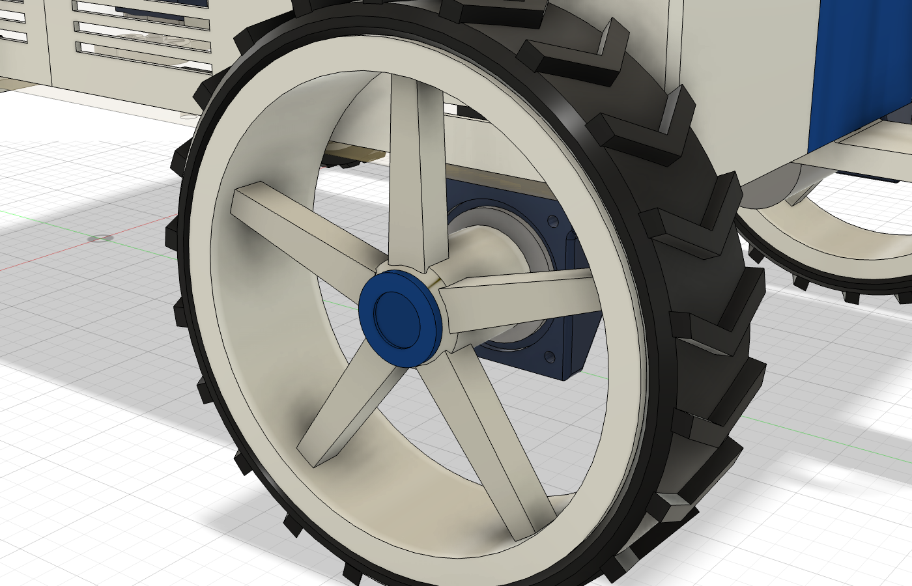

### Support moteur V2, plus léger

Le support moteur V1 (bloc plein de 85 mm, semelle pleine de 10 mm) est massif. La **V2** garde
exactement les mêmes interfaces (alésage étagé Ø46,3 / Ø42,3, épaulement Ø52, 4 trous Ø4 côté roue,
collier fendu à 2 vis M6×25, 4 vis H M8 aux mêmes trous de planche, encoche de la vis de coque) :
même visserie, mêmes perçages, aucune collision nouvelle (elle tient dans l'enveloppe du V1).

| | V1 | V2 |
| --- | ---: | ---: |
| Volume | 233,5 cm³ | 161,4 cm³ (−31 %) |
| PETG plein (majorant) | 297 g | 205 g |

Ce qui change :
- **tube rond** de 5,85 mm de paroi autour du moteur (R 29 sur le réducteur, R 27 sur le moteur) au
  lieu du bloc carré ; **bride carrée de 12 mm** côté roue seulement (trous Ø4 et épaulement) ;
- **collier à deux oreilles** de 18 mm autour des vis M6, au lieu d'une quille sur toute la
  longueur ; le tube reste fendu et serré sur toute sa longueur ;
- **semelle évidée par-dessous** : poches de 6 mm (peau de 4 mm contre la planche), nervure
  transversale au milieu, rail plein de 10 mm le long du tube, bossages pleins Ø18 autour des vis M8.

Les deux versions sont dans l'assemblage (document « supports roues fieldmind », inséré dans le
rover) : **V1 à gauche, V2 à droite**, pour comparer ; les deux autres exemplaires existent,
masqués (rallumer `SR_IMP_Support_moteur_arriere_V2` à gauche pour un rover tout en V2). STL :
`exports/stl/support_moteur_arriere_v2.stl`, imprimé comme le V1, debout sur la face côté roue.

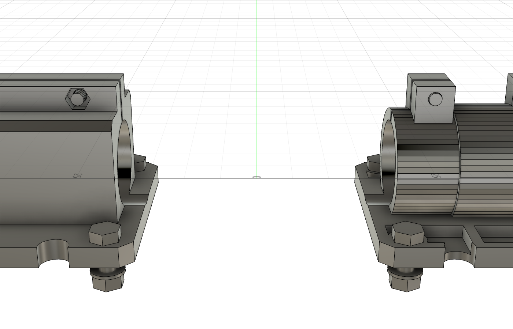

### Mâts en profilés de 90 mm

Les deux profilés disponibles font 90 mm. Les caméras sont donc 5 mm plus bas (centres optiques à
265 mm du sol). Le support du lidar est 60 mm plus haut, d'une seule pièce, pour garder le lidar à
la même hauteur (plan laser à 322 mm). Rien ne se visse par-dessous la planche :
- une colonne octogonale de 56 mm (la largeur de la plaque du C1) qui se termine en bas par un
  **emboîtement de 31 mm** enfilé sur le haut du profilé, comme le support V1 ;
- deux languettes dans les rainures avant et arrière ;
- **2 vis M8×16 latérales** (gauche et droite), 23 mm sous le haut du profilé, dans des **écrous en
  T M8** des rainures ;
- les vis du C1 se serrent avec une clé Allen de 2, par les gorges des quatre coins.

Le profilé ne dépasse que de 5 mm au-dessus de la coque : les vis M8 sont donc sous le toit, 2,6 mm
sous le rebord des flancs. On monte le mât complet (support et lidar) avant de poser la coque. Son
ouverture autour du mât passe à **61 × 61 mm** (pièce C4), et la coque descend par-dessus le
lidar. Le support est à 2,5 mm du bord de l'ouverture.

Vérifié : aucune collision, champ des webcams et plan du lidar dégagés.

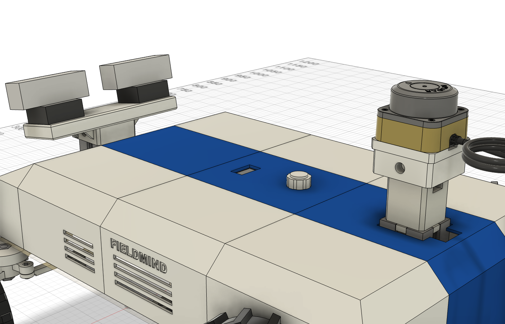
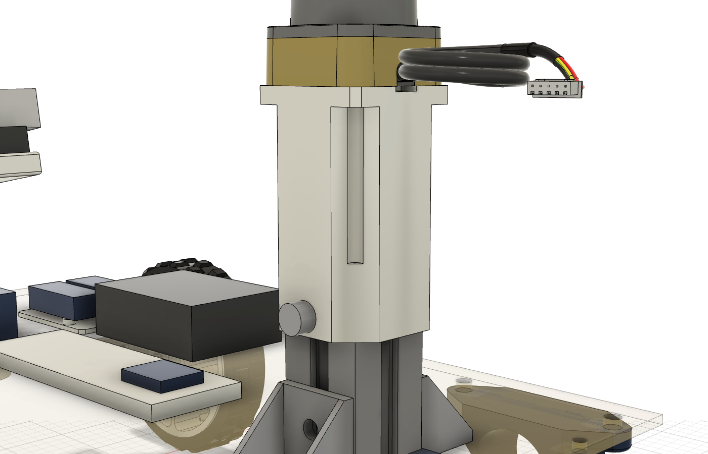
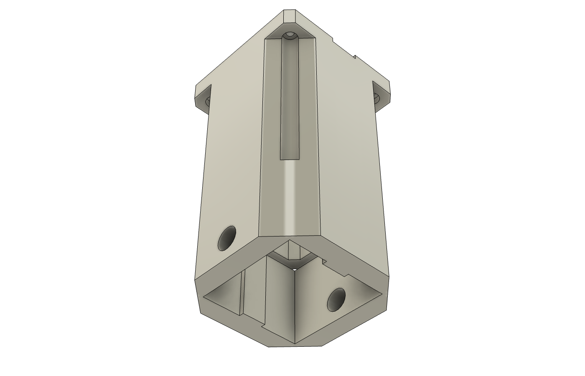
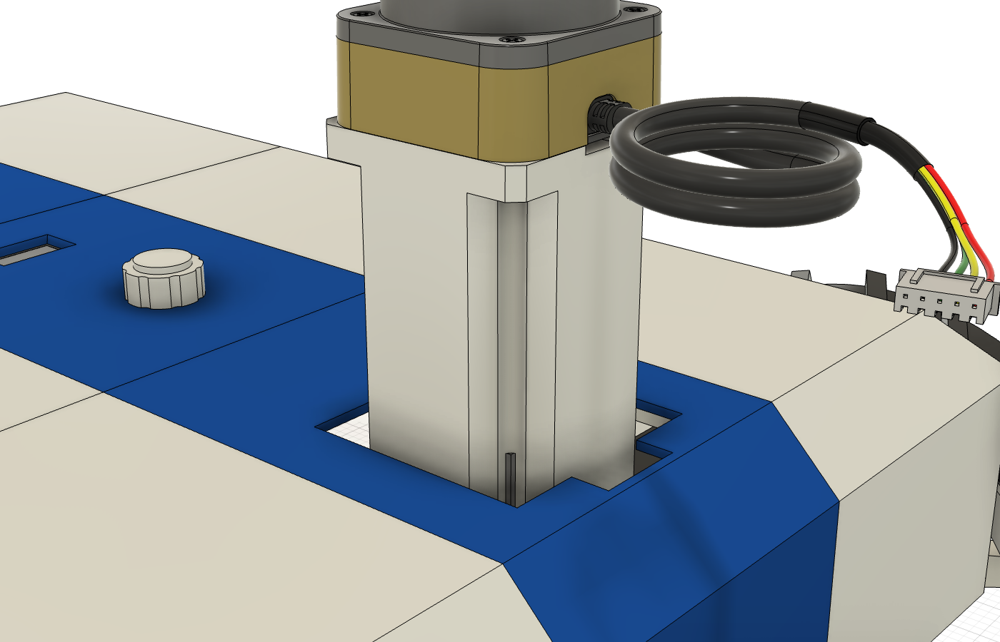

Pourquoi cette implantation :
- la batterie à l'avant gauche et les XL4015 en miroir à l'avant droit : du poids sur les roues
  directrices et le centre de gravité au milieu en largeur (voir ci-dessous) ;
- les contrôleurs sont au plus court de leurs moteurs ;
- le Pi est près des ouïes de son flanc ;
- la carte A7 est au-dessus de la breadboard, et l'écran comme le Knob restent sur le dessus.

### Planche de 10 mm

La planche fait maintenant **10 mm** (deux contreplaqués de 5 mm collés). Le dessous reste à 130 mm du
sol, donc rien ne bouge sous la planche (direction, roues, supports moteurs, chape). Tout ce qui est
posé dessus monte de 5 mm (coque, batterie, électronique, mâts : plan laser du lidar à 327 mm).
- Le servo est tenu par ses oreilles sur le dessus : il remonte de 5 mm, donc le **palonnier est à
  réimprimer** avec une colonne 5 mm plus longue (`exports/stl/palonnier_planche_10mm.stl`,
  37 × 53,5 × 14 mm), pour que les biellettes restent à plat.
- Les vis qui traversent la planche font 5 mm de plus (voir [VISSERIE.md](VISSERIE.md)).
- Vérifié : aucune collision au neutre et à ±31°, pneus avant à 11,7 mm de la coque en braquage
  maximal. Fait par `21_planche_10mm.py`, en place.

### Équilibrage

Tout le poids était à l'arrière : moteurs et roues arrière (1,8 kg) sont sur l'essieu arrière, et la
batterie était juste devant. Elle est passée à l'avant gauche, et les XL4015 à l'avant droit pour
compenser. `13_centre_de_gravite.py` calcule le centre de gravité dans Fusion. Les pièces imprimées
et le bois y sont pesés par leur volume, les profilés au mètre et la visserie en acier. Le reste est
estimé dans [masses.json](masses.json) : batterie 600 g, chaque moteur 600 g, chaque roue arrière
300 g, Pi 150 g.

| Rover seul (5,8 kg) | Avant | Arrière | Gauche | Droite |
| --- | ---: | ---: | ---: | ---: |
| Batterie au centre, devant l'axe arrière (avant) | 34,8 % | 65,2 % | 49,6 % | 50,4 % |
| Batterie à l'avant gauche, XL4015 à l'avant droit | **42,0 %** | **58,0 %** | **50,6 %** | **49,4 %** |
| Idem, remorque attelée (200 g sur la chape) | 39,2 % | 60,8 % | 50,5 % | 49,5 % |

- **Gauche-droite** : le centre de gravité est à 2 mm de l'axe, sur 390 mm de voie. L'écart est
  plus petit que l'incertitude sur les masses estimées.
- **Avant-arrière** : 42/58. Les moteurs et les roues arrière sont sur l'essieu arrière : il
  faudrait environ 650 g de lest à l'avant pour atteindre 50/50. Pour une propulsion arrière,
  40/60 est un bon partage : de l'adhérence sur les roues motrices, et assez de charge sur les
  roues directrices.
- **À faire** : peser la batterie, un moteur avec sa roue et le Pi. Mettre les valeurs dans
  `masses.json` (avec `"pese": true`), puis relancer le script.

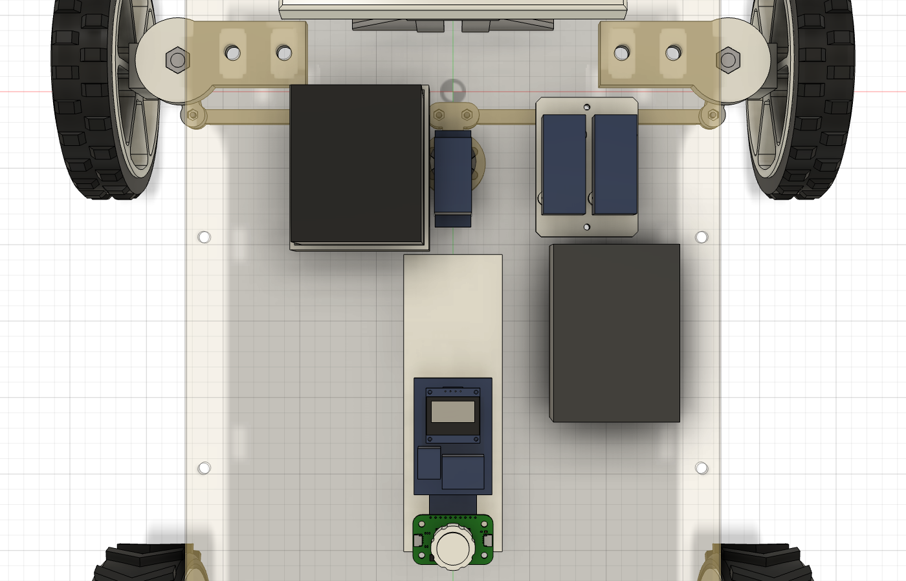

## Coque

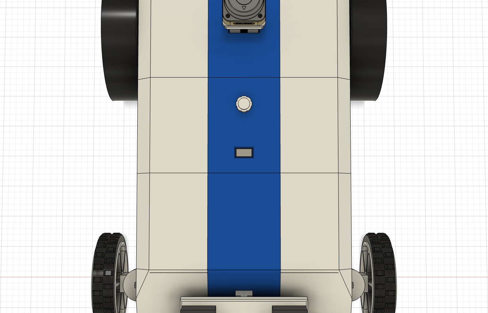

Elle reprend l'allure du premier rendu FieldMind : une caisse blanche à pans coupés, avec une bande
bleue qui court du nez à l'arrière.

- **Planche cachée** :
  - les flancs arrivent au ras des côtés de la planche, il ne reste plus de rebord de bois
    visible ;
  - les faces avant et arrière la débordent et descendent de 5 mm sur sa tranche ;
  - sur les côtés, seule la tranche de 5 mm reste visible sous la coque. Elle ne peut pas être
    recouverte, faute de place entre la planche et les roues : les pneus braqués passent à 8,6 mm
    du flanc.
- **Gabarit** : 300 × 506 mm, haute de 85 mm au-dessus de la planche, soit 220 mm du sol ;
  chanfreins de 20 mm sur les arêtes hautes.
- **Nez incliné** : une face avant de 40 mm avec la grille, puis une pente qui passe sous la
  barre des caméras.
- **Bande centrale bleue** (100 mm de large), du nez à l'arrière :
  - le passage des deux profilés ;
  - derrière chacun, un **passage de câbles de 24 × 14 mm**, assez pour une prise USB-A et pour
    le connecteur du lidar ;
  - la fenêtre de l'écran et le trou du Knob, au-dessus de la breadboard.
- **Flancs blancs** : ouïes en face du Pi et des contrôleurs (les XL4015, à l'avant droit, sont entre la grille du nez et la première ouïe) ; « FIELDMIND » incrusté en bleu (voir ci-dessous).
- **Aucune vis visible** : tout se visse de l'intérieur, et la coque tient sur la planche par
  dessous.

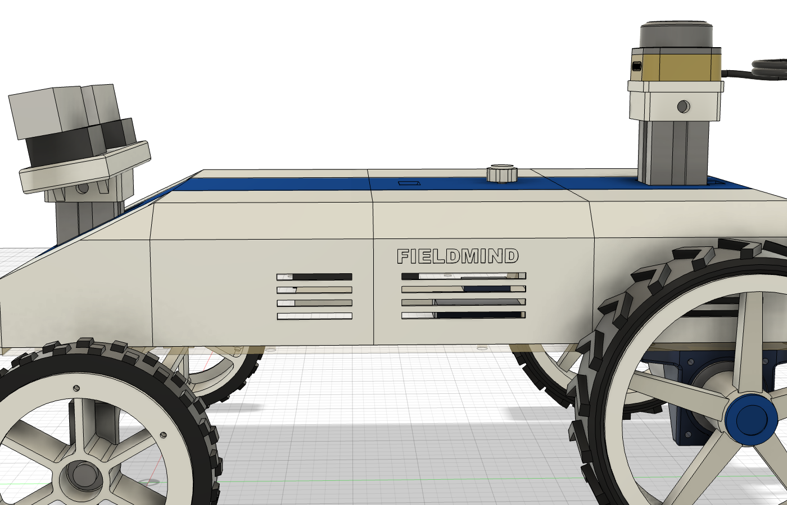

### Incrustation FIELDMIND

Lettres de la couleur opposée, collées dans une poche de 1,2 mm (la moitié de la paroi de 2,4 mm) :
la paroi reste pleine, et l'intérieur des lettres (D) tient au fond de la poche.

| Où | Texte | Insert | Taille | STL |
| --- | --- | --- | --- | --- |
| Flanc gauche et flanc droit, tronçon 3 (D3, G3), entre les ouïes et le chanfrein | FIELDMIND | bleu sur blanc, 9 lettres par côté | 109 × 13 mm | `incrustation_FIELDMIND_G.stl`, `_D.stl` |

- Imprimer les lettres à plat, face visible contre le plateau, avec une **compensation X-Y de
  -0,1 mm** (« X-Y contour compensation » dans Bambu Studio) pour qu'elles entrent dans les poches.
  Les coller à la colle cyanoacrylate.
- Avec un AMS lite, on peut aussi imprimer la pièce et ses lettres d'un coup en deux couleurs.
- Un ASUS sur la bande C2 a été essayé puis retiré. Le même script refait n'importe quel texte ou logo.
- Fait par `20_incrustations.py`, en place sur la coque (après `02_coque.py`).

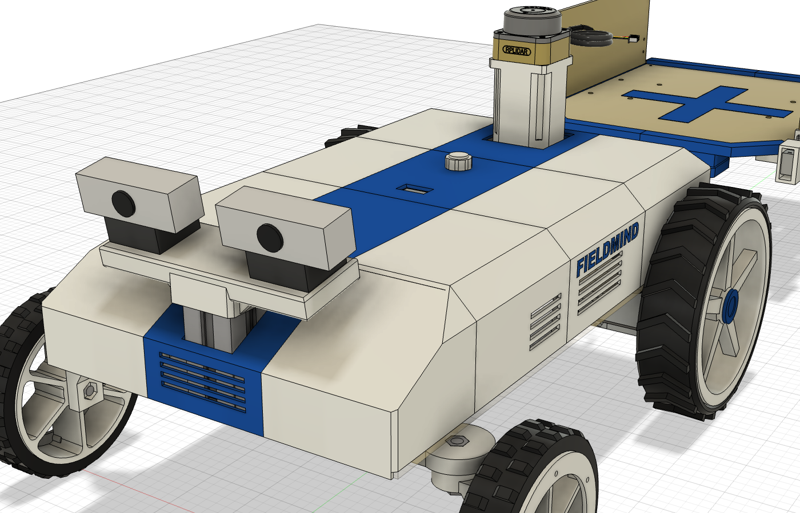
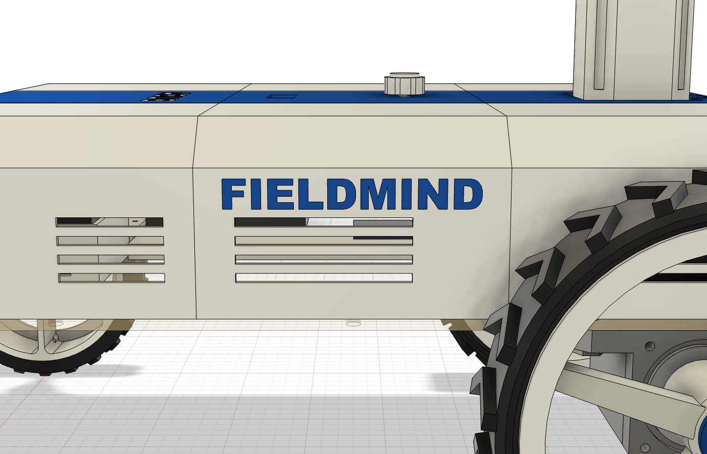

### Couleurs : variantes testées

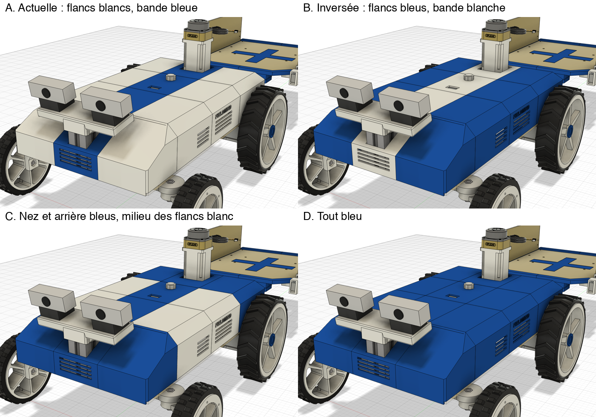

A (actuelle) : flancs blancs, bande bleue. B : flancs bleus, bande blanche. C : nez et arrière
bleus. D : tout bleu. Si on change, les lettres changent de couleur avec la pièce qui les porte.

### Pièces à imprimer (STL déjà orientés, sans support)

| Fichier | Couleur | Posée sur le plateau |
| --- | --- | --- |
| `coque_C1_nez` | bleu | debout sur sa face avant (grille) |
| `coque_C2_bande_avant` | bleu | dessus contre le plateau |
| `coque_C3_bande_ecran_knob` | bleu | dessus contre le plateau (bossages de la carte A7 vers le haut) |
| `coque_C4_bande_arriere_lidar` | bleu | dessus contre le plateau |
| `coque_G1…G4` (flanc gauche), `coque_D1…D4` (flanc droit) | blanc | couchés sur leur paroi extérieure : toutes les parois sont verticales |
| `berceau_batterie` | blanc | fond contre le plateau |
| `capuchon_knob` | blanc | debout, alésage en D contre le plateau |

Taille sur le plateau (X × Y × hauteur) et masse de filament approchée : pièces pleines à 100 %, donc un majorant.

| Pièce | Couleur | Taille (mm) | Filament |
| --- | --- | --- | ---: |
| `coque_C1_nez` | bleu | 100 × 90 × 103 | 36 g |
| `coque_C2_bande_avant` | bleu | 100 × 133 × 7,9 | 41 g |
| `coque_C3_bande_ecran_knob` | bleu | 100 × 133 × 16,4 | 43 g |
| `coque_C4_bande_arriere_lidar` | bleu | 100 × 147 × 90 | 62 g |
| `berceau_batterie` | blanc | 75 × 89 × 30 | 66 g |
| `capuchon_knob` | blanc | 22 × 22 × 11 | 5 g |
| `coque_D1_nez_droit` | blanc | 90 × 93 × 114 | 85 g |
| `coque_D2_flanc_avant_droit` | blanc | 85 × 133 × 114 | 97 g |
| `coque_D3_flanc_milieu_droit` | blanc | 85 × 133 × 114 | 95 g |
| `coque_D4_flanc_arriere_droit` | blanc | 90 × 147 × 114 | 128 g |
| `coque_G1_nez_gauche` | blanc | 90 × 93 × 114 | 85 g |
| `coque_G2_flanc_avant_gauche` | blanc | 85 × 133 × 114 | 97 g |
| `coque_G3_flanc_milieu_gauche` | blanc | 85 × 133 × 114 | 95 g |
| `coque_G4_flanc_arriere_gauche` | blanc | 90 × 147 × 114 | 128 g |

- **Bleu (PLA)** : environ 182 g.
- **Blanc (PETG)** : environ 865 g.
- La plus grande pièce mesure 147 mm : tout tient sur le plateau de 180 mm de l'A1 mini.

Réglages : couches de 0,2 mm, 3 parois, remplissage 20 %. L'inscription en creux se trouve alors
contre le plateau, ce qui s'imprime bien.

### Comment les pièces tiennent ensemble (toutes les vis à l'intérieur)

On assemble la coque **à l'envers sur la table**, on la retourne, puis on la visse sur la planche
par-dessous.

- **Bande centrale sur les flancs** :
  - chaque flanc porte un rebord de 6,5 mm sous le bord de la bande ;
  - les bossages de la bande entrent dans des trous de ce rebord ;
  - chaque bossage reçoit un insert M3 ; on visse par-dessous une **vis M3×6 avec une rondelle
    large** (DIN 9021, Ø9) qui appuie sous le rebord ;
  - à l'avant, le nez est vissé de la même façon derrière sa face avant, et une languette passe
    sous la bande C2.
- **Tronçons entre eux** : à chaque coupe, deux nervures de 8 mm se font face, une par tronçon.
  Deux **boulons M3×12 + écrous** par flanc et par coupe.
- **Coque sur la planche** : 10 blocs au pied de la coque.
  - Chaque bloc a une **fente hexagonale** où l'on glisse un **écrou M6** depuis l'intérieur.
    Sous l'écrou reste une base de 3 mm.
  - Une **vis M6×16 et sa rondelle** passent par-dessous la planche et serrent dans l'écrou, que
    la fente empêche de tourner.
  - Ils sont 3 par flanc, 2 à l'avant et 2 à l'arrière.
- **Carte A7** : vissée sous la bande C3 par 4 vis M3×8, directement dans le plastique (trous
  Ø2,6).
- **Écran** : enfiché sur la carte A7 et, en plus, vissé sous la bande C3 par 4 vis M2×4 dans des
  bossages Ø4 (trous Ø1,6). Sa dalle arrive à 0,3 mm sous la bande. La fenêtre est la zone
  affichée réelle plus 0,6 mm, biseautée à 30° vers le dessus.
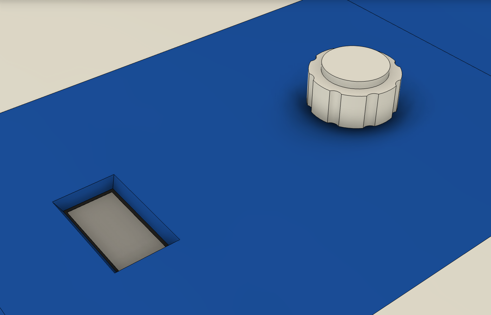

- **Knob** : vissé sous la bande C3 par 4 vis M3×12 dans des bossages Ø6 (trous Ø2,6). Son axe
  Ø6 traverse la bande par un trou Ø7 et dépasse de 5,5 mm. Le **capuchon imprimé** s'enfonce sur
  le méplat et reste à 1,5 mm de la coque, pour laisser la course du bouton-poussoir.

### Visserie

Liste complète du rover et de la remorque, par taille : [VISSERIE.md](VISSERIE.md).

| Quoi | Nombre | Où |
| --- | ---: | --- |
| Insert à chaud M3 (Ø ext. 4,5 à 4,6, longueur 5,7 au plus) | 20 | Bossages des bandes bleues, trous Ø4 × 5,5 |
| Vis M3×6 + rondelle large DIN 9021 (Ø9) | 20 | Bandes sur les rebords des flancs, par-dessous |
| Boulon M3×12 + écrou + rondelle | 12 | Nervures entre tronçons : 2 par flanc et par coupe |
| Vis M6×16 + rondelle | 10 | Coque sur la planche, par-dessous |
| Écrou M6 (10 mm sur plats) | 10 | Glissés dans les fentes hexagonales de la coque |
| Vis M3×8 | 4 | Carte A7 sous la bande C3, directement dans le plastique |
| Vis M2×4 | 4 | Écran sous la bande C3, directement dans le plastique |
| Vis M3×12 | 4 | Modulino Knob sous la bande C3, directement dans le plastique |
| Vis M3×10 + rondelle | 4 | Berceau de batterie, par-dessous la planche, dans 4 écrous M3 noyés dans son fond |
| Sangle auto-agrippante 20 mm | 2 | Batterie dans son berceau |
| Adhésif double-face | — | Composants sur la planche |

### Montage

1. **Planche** :
   - percer les nouveaux trous (plan ci-dessous) : Ø6,5 pour la coque, Ø3,5 pour le berceau ;
   - glisser les 4 écrous M3 dans le fond du berceau, puis le visser par-dessous la planche (M3×10 + rondelle).
2. **Composants** : les poser au double-face ou à l'auto-agrippant aux places du modèle, puis câbler.
3. **Inserts** : les poser dans les bossages des bandes (par-dessous).
4. **Coque à l'envers sur la table** :
   - boulonner les tronçons de chaque flanc ;
   - poser les bandes ;
   - visser les bandes par-dessous dans les rebords ;
   - fixer la carte A7, l'écran (sur son support, puis ses 4 vis M2) et le Knob sous C3 ;
   - enfoncer le capuchon sur l'axe du Knob.
5. **Mâts** :
   - déposer la barre des caméras (2 vis M8). La calibration stéréo ne bouge pas, puisque les deux
     caméras restent sur leur barre ;
   - le support du lidar se pose avec le C1 déjà vissé dessus. Deux écrous en T M8 sont vissés de deux
     tours sur les vis M8×16 latérales, en long. On enfile le support sur le haut du profilé : les écrous
     entrent dans les rainures gauche et droite, les languettes dans les rainures avant et arrière. On
     descend jusqu'en butée, puis on serre les deux vis.
6. **Coque** :
   - glisser les 10 écrous M6 dans leurs fentes ;
   - retourner la coque et la descendre sur les deux profilés : elle passe par-dessus le lidar ;
   - passer les câbles par les passages ;
   - visser les 10 vis M6 par-dessous la planche.
7. **Remonter** la barre des caméras.

Pour accéder à l'intérieur : déposer la barre des caméras, débrancher le câble du lidar de son
adaptateur, puis dévisser les 10 vis M6 sous la planche. La coque se soulève d'un bloc, par-dessus
le lidar. Pour charger la batterie sans tout ouvrir,
prévoir une rallonge de charge jusqu'à une prise sur la face arrière : il faut d'abord connaître
son connecteur.

## Vérifications dans Fusion

Tout est contrôlé par `03_verifier.py` (résultats dans `verification_prototype_final.json`), avec la
direction au neutre puis braquée à ±31° :

- **Collisions** : aucune entre les 12 pièces de coque, le berceau, les composants et le rover.
- **Pneus avant** : 40,7 mm du flanc au neutre, **8,6 mm** au plus près en braquage maximal (jantes : 14,9 mm).
- **Roues arrière** : 3 mm du flanc et 3 mm du support moteur (largeur de roue supposée, voir plus bas).
- **Barre des caméras** : à 7,8 mm du nez. **Support du lidar** : à 2,5 mm du bord de son ouverture dans la coque ; têtes des vis M8 à 2,6 mm sous le rebord des flancs.
- **Champ des deux webcams** (75° × 45°) : aucun rayon ne touche le rover ni la coque.
- **Plan laser du lidar** (360°, ±1,5°) : dégagé.
- **Pièces** : chacune d'un seul tenant, toutes sous 180 mm.

## Stéréo : l'écartement est-il bon ?

Oui. Dans le modèle :
- les deux centres optiques sont à **120,0 mm**, à la même hauteur (270 mm du sol) ;
- les axes sont **parallèles** et inclinés de 10° vers le sol ;
- rien du rover ni de la coque n'entre dans le champ.

Avec le champ horizontal de 75° des UGREEN :

| | 640 × 360 | 1280 × 720 |
| --- | ---: | ---: |
| Focale | 417 px | 834 px |
| Profondeur mesurable dès (`numDisparities` = 96 / 128) | 0,52 / 0,39 m | 1,04 / 0,78 m (0,52 m avec 192) |
| Erreur à 1 m (0,25 à 0,5 px de disparité) | ±0,5 à 1 cm | ±0,2 à 0,5 cm |
| Erreur à 2 m | ±2 à 4 cm | ±1 à 2 cm |
| Erreur à 4 m | ±8 à 16 cm | ±4 à 8 cm |
| Erreur à 6 m | ±18 à 36 cm | ±9 à 18 cm |

- **Champ commun aux deux caméras** : 92 % de l'image à 1 m, 98 % à 4 m.
- **Sol visible** dès 0,42 m devant les objectifs ; l'horizon est à 29 % du haut de l'image.
- **Pourquoi 120 mm** : c'est le bon compromis pour voir les obstacles de 0,5 à 4 m.
  - À 60 mm (la caméra simulée), l'erreur à 4 m double.
  - À 200 mm, elle baisse d'un tiers, mais rien n'est mesuré avant 0,87 m. La barre ferait alors
    250 mm : elle ne s'imprime plus d'une pièce et perd sa rigidité.
- **Conseil de départ** : 640 × 360, `numDisparities` = 128, à environ 5 images/s.
- **Le vrai point faible** est ailleurs : les deux webcams ne sont pas synchronisées.
  - En tournant à 0,5 rad/s, un décalage de 16 ms entre les deux images fausse la disparité de
    3,3 px. C'est 27 % de la disparité d'un obstacle à 4 m.
  - Il faut donc fixer la même fréquence et la même exposition sur les deux caméras, apparier les
    images par horodatage, et ne se fier à la profondeur qu'en ligne droite ou à l'arrêt.
  - Une base plus large n'y changerait presque rien.
- **Calibrer au damier** une fois tout serré, puis recalibrer si une caméra a bougé sur sa vis.

## Plan de perçage

[plan_percages/plan_percages.pdf](plan_percages/plan_percages.pdf) reprend tous les trous de la
planche : direction, capteurs et équerres, plus les nouveaux trous.

| Repère | Ø | Pour |
| --- | ---: | --- |
| K1–K10 | 6,5 | Fixation de la coque : vis M6×16 par-dessous, écrou M6 dans la coque |
| B1–B4 | 3,5 | Berceau de batterie, à l'avant gauche : vis M3×10 par-dessous |
| X1–X2 | 3,5 | Plaque des XL4015, à l'avant droit : vis M3×12 + rondelle + écrou |
| A1–A2 | 6,5 | Chape d'attelage de la remorque : vis M6×20 par le dessus, écrous dans la chape |
| C1 | 8 | Passage des câbles des volets de la remorque, vers l'intérieur de la coque |

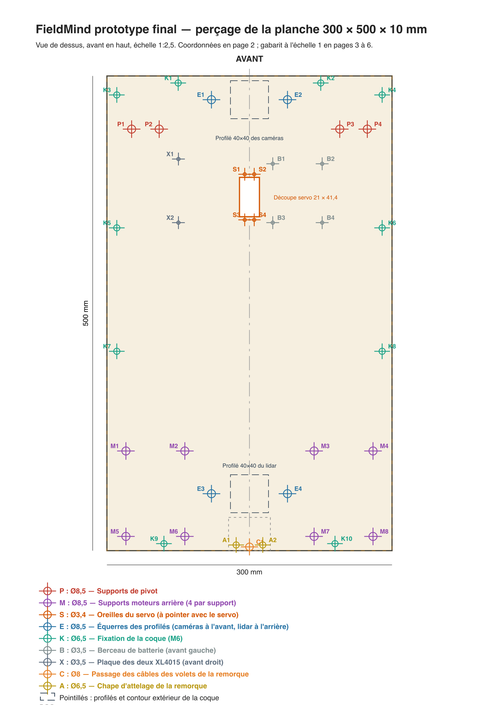

## Remorque porte-drone

Une remorque à deux roues s'attelle derrière le rover par une chape et une seule vis M6 serrée à
la main :
- un plateau en bois de 300 × 380 mm avec des rebords bleus et une croix d'atterrissage ;
- deux volets latéraux, chacun mû par un SG90, qui l'élargissent à 530 mm pour poser le drone ;
- les mêmes roues que l'avant, chacune libre sur deux roulements 5×16×5.

Elle a **son propre document Fusion**, `remorque fieldmind`, inséré par référence dans ce
document : on la reconstruit sans toucher au rover. La chape d'attelage reste ici. Tout est décrit
dans [remorque/README.md](remorque/README.md).

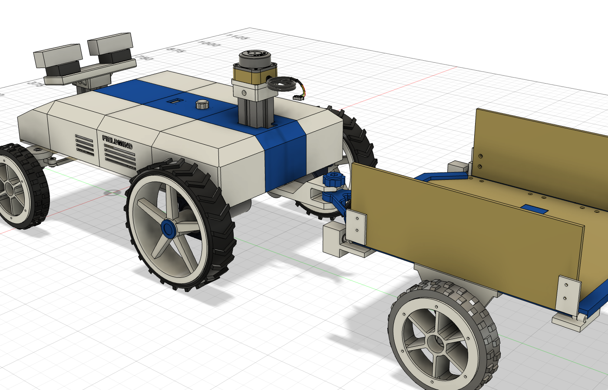

## À mesurer ou à valider

- **Boîtier du Pi** : 68 × 96 × 32 mm supposés.
- **Roues arrière** : 50 mm de large, juste après le support moteur, supposées. Elles passent
  alors à 3 mm du flanc. Si elles sont plus près du support, le dire : on rentre les flancs de
  l'arrière.
- **Écran** : contrôler au pied à coulisse l'entraxe des trous (23,3 × 23,8 sur le plan du fabricant)
  et la hauteur de son support femelle (8,5 mm) avant d'imprimer C3. Tout se règle en tête de
  `02_coque.py` (`OLED_TROUS`, `OLED_ZPCB`, `ECRAN`).
- **Inserts** : faire un essai dans un coupon avant la série.
- **Masses** : peser la batterie, un moteur avec sa roue et le Pi (voir « Équilibrage »).

## Scripts

Ils passent par le serveur MCP local de Fusion (client `../mounts/prototype/direction_v04_servo_traversant/scripts/fusion_mcp.py`).

| Script | Rôle |
| --- | --- |
| `pf_helpers.py` | Outils communs (document « prtotype final fieldmind », groupe `FM_Prototype_Final`) |
| `01_composants.py` | Composants embarqués (écran d'après le plan du fabricant, Knob importé de son STEP officiel), berceau de batterie, capuchon du Knob ; réexécutable |
| `02_coque.py` | Coque complète : volume, ouvertures (fenêtre biseautée de l'écran, 61 × 61 autour du mât du lidar), découpe en 12 pièces, rebords, bossages (carte A7, écran M2, Knob M3), nervures, fentes M6, inscription ; réexécutable (environ 10 minutes) |
| `03_verifier.py` | Collisions, jeux, champ des caméras, plan du lidar, pièces d'un seul tenant → JSON |
| `04_exporter.py` | STL orientés pour l'impression, STEP + F3D du groupe, manifeste |
| `05_percages.py` | Trous de la coque, du berceau, de la chape d'attelage et des câbles de la remorque dans la planche, relevé → `plan_percages.json` |
| `06_plan_percages.py` | Hors Fusion : plan de perçage PDF (plan, coordonnées, gabarit 1:1) |
| `07_apparences.py` | Couleurs : pièces imprimées en blanc, bande de la coque en bleu |
| `08_roues_arriere.py` | Roues arrière et moteurs seuls (roues sur l'arbre des moteurs), sans refaire les autres composants |
| `09_plans_atelier.py` | Hors Fusion : plans d'atelier en un PDF (découpe et perçages remorque, volets et rover, forets entiers) |
| `10_support_xl4015.py` | Plaque des deux XL4015 et les modules dessus, sans refaire les autres composants ; STL et trous de la planche |
| `11_gabarit_xl4015.py` | Hors Fusion : gabarit 1:1 pour vérifier l'entraxe des trous des XL4015 |
| `12_mats_profiles_90.py` | Profilés de 90 mm (les deux disponibles) : caméras 5 mm plus bas ; support du lidar refait 60 mm plus haut, emboîté sur le profilé, 2 vis M8 latérales dans des écrous en T (lidar à la même hauteur) ; STL du support |
| `13_centre_de_gravite.py` | Centre de gravité et répartition avant-arrière et gauche-droite, d'après `masses.json` → `centre_de_gravite.json` (lecture seule) |
| `14_batterie_avant.py` | Batterie et berceau seuls (à l'avant gauche), sans refaire les autres composants ; trous de la planche, STL du berceau |
| `15_ouverture_coque_lidar.py` | Ouverture de la coque agrandie à 61 × 61 autour du mât du lidar, en place sur C4 : la coque passe par-dessus le mât monté |
| `16_supports_moteurs.py` | Supports moteurs arrière agrandis : moteur tenu sur 85 mm, collier serré par 2 M6, semelle à 4 vis M8 ; trous de la planche, STL |
| `17_supports_pivot.py` | Essai de renfort des supports de pivot (non retenu : c'est la fusée qui plie) |
| `18_document_supports.py` | Document séparé « supports roues fieldmind » (supports moteurs), enregistré et inséré par référence dans le rover ; STL |
| `19_fusees_renfort.py` | Fusées avant renforcées par un gousset sous le pont (coin du L), en place dans le rover ; STL |
| `20_incrustations.py` | Incrustation FIELDMIND sur les flancs : poches de 1,2 mm et lettres de la couleur opposée ; STL |
| `21_planche_10mm.py` | Planche de 10 mm : paramètre d4_planche_ep, pièces posées dessus montées de 5 mm (fonction Déplacer), sans reconstruire |
| `20_support_moteur_v2.py` | Support moteur V2 allégé (−31 %, mêmes interfaces), à côté du V1 dans le document des supports ; référence du rover mise à jour ; STL |
| `pf_helpers.py` → `importer_step` | Import d'un vrai modèle STEP, recopié en place dans le composant (Knob, SG90, palonnier) |

Le document Fusion n'est pas enregistré par les scripts.
