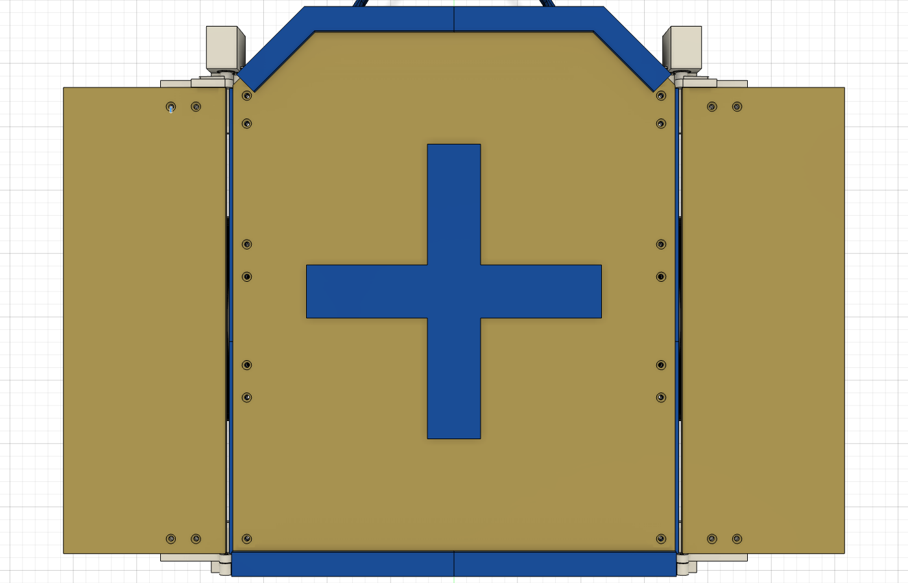
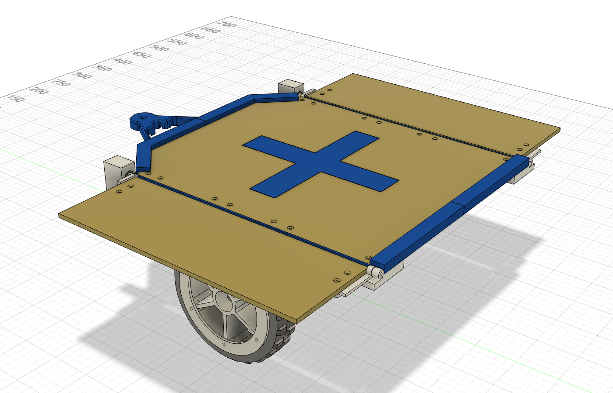
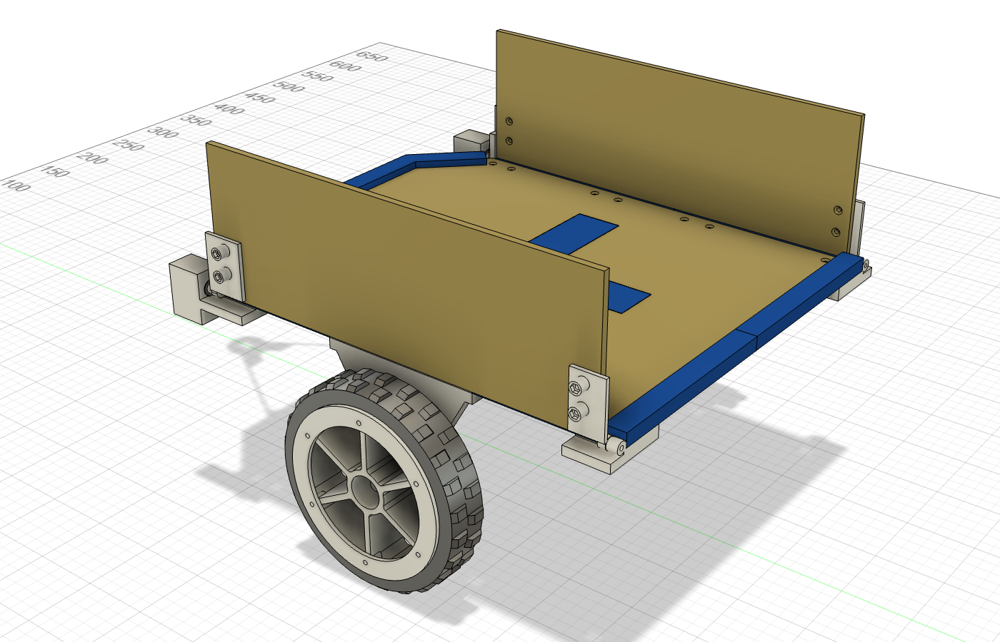
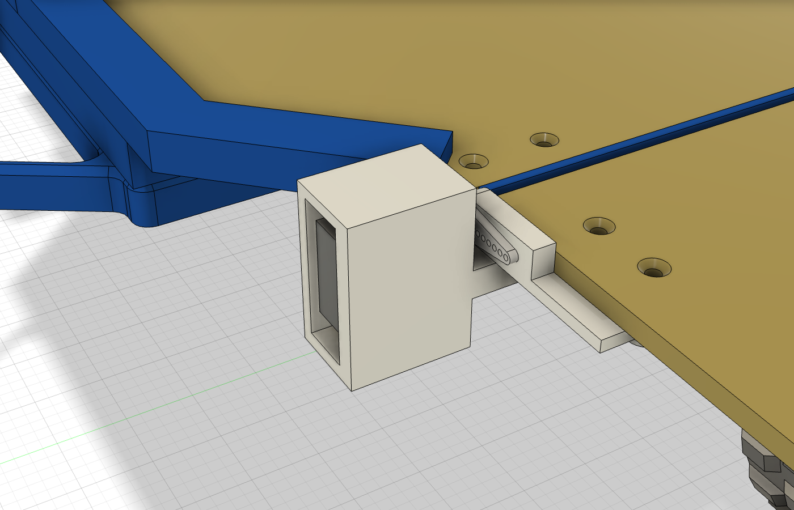
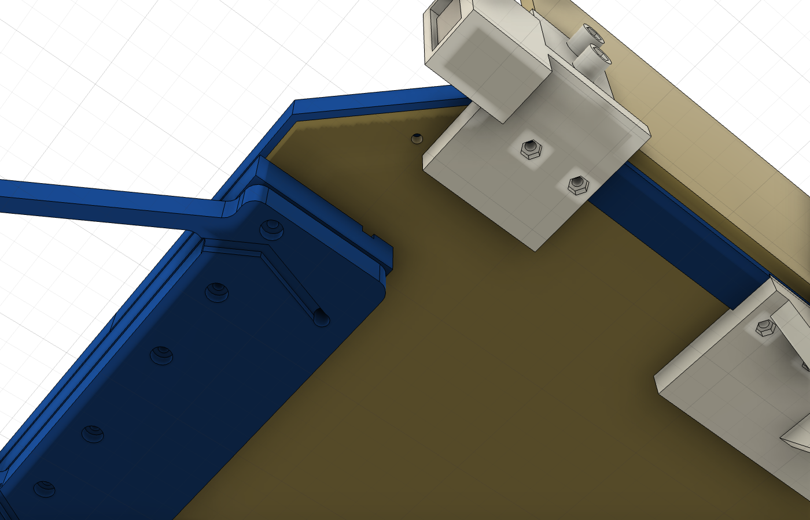
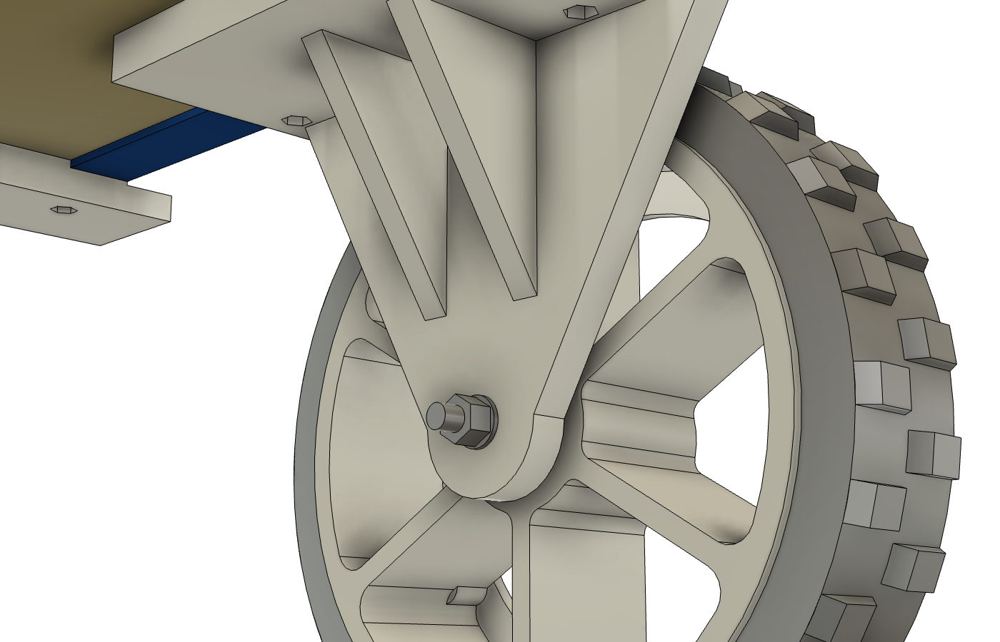
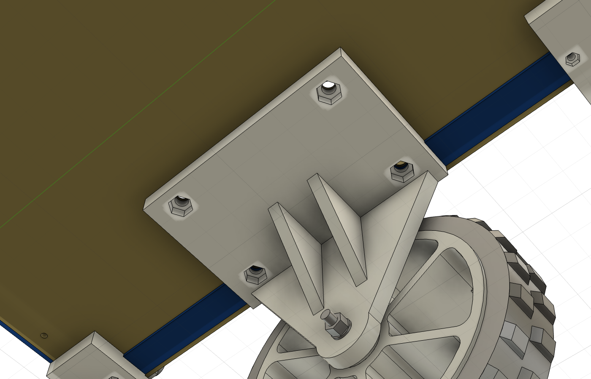
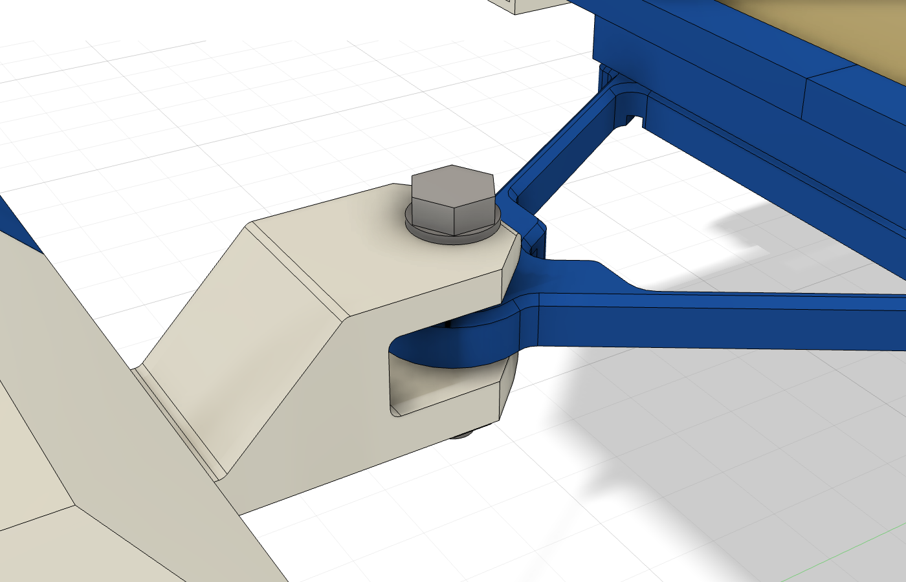
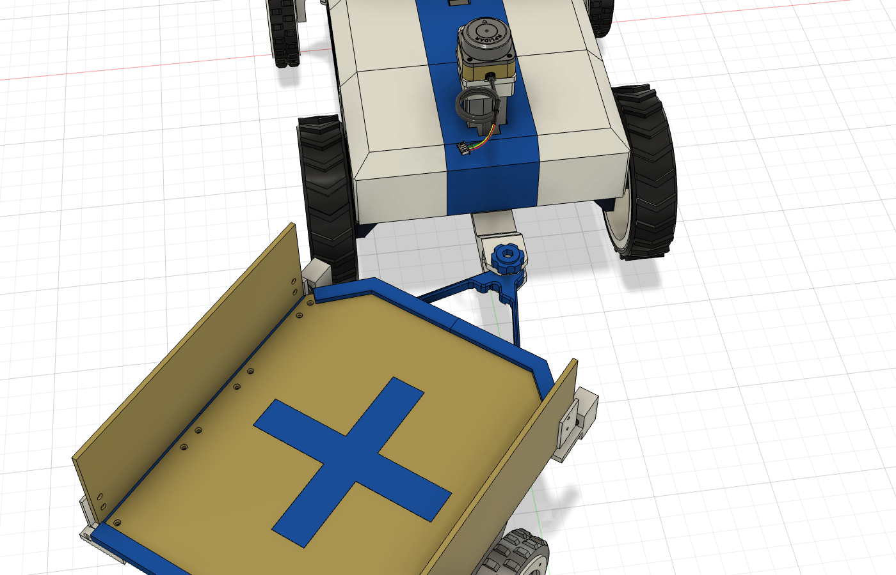
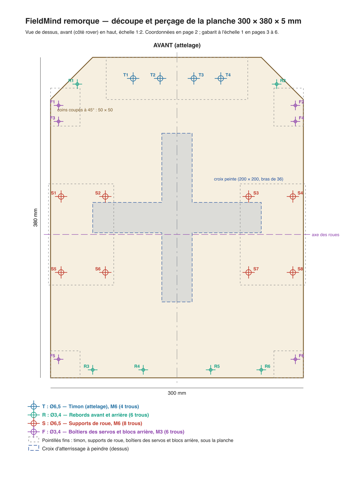

# FieldMind — remorque porte-drone

La remorque a son propre document Fusion, **`remorque fieldmind`**, inséré par référence dans le
document du rover **`prtotype final fieldmind`** (voir [Documents Fusion et scripts](#documents-fusion-et-scripts)).
La chape d'attelage côté rover reste dans le document du rover (`PF_IMP_Attelage`).

C'est un plateau en bois sur deux roues, attelé derrière le rover. Le drone se pose sur la croix
peinte au centre. Deux volets latéraux, chacun mû par un SG90, se rabattent pour agrandir la zone
d'atterrissage.

## Ce qui la compose

- **Planche de bois** : 300 × 380 × 5 mm, la même largeur et le même bois que la planche du rover.
  - Les deux coins avant sont coupés à 45° sur 50 mm : la remorque peut braquer plus loin avant
    de toucher les roues arrière du rover.
  - Elle est posée 13,5 mm plus haut que la planche du rover, pour que les volets dépliés, au ras
    du plateau, passent au-dessus des roues.
- **Rebords bleus à l'avant et à l'arrière** (4 pièces) :
  - ils cachent la tranche du bois et dépassent de 5,5 mm au-dessus du plateau ;
  - ils sont tenus par des vis M3×10 posées par-dessous, dans des écrous noyés dans la lèvre : 1 par
    rebord avant (dans le coin coupé), 2 par rebord arrière. **Les coller en plus** (cyanoacrylate ou
    colle à bois sur la lèvre) : les rebords avant ne portent plus le timon.
- **Joues bleues sur les côtés** (4 pièces), là où les volets se déplient :
  - **pas de lèvre** : elles cachent la tranche du bois **au ras du plateau**, pour que le plateau et
    les volets dépliés forment une seule surface plane ;
  - leur semelle passe sous la planche, pincée par les boîtiers des servos, les supports de roue
    et les blocs arrière ;
  - ces pièces sont tenues par des vis **à tête bombée** posées par le dessus, **sans fraisage**
    dans le bois : **M6×16 pour les supports de roue**, qui portent la remorque, M3×16 pour le
    reste. La tête reste posée sur le plateau (1,7 mm de haut en M3, 3,3 mm en M6), et l'écrou
    est noyé sous le bras de la pièce.
- **Croix d'atterrissage**, à peindre au centre :
  - 200 × 200 mm, bras de 36 mm ;
  - mate et foncée (bleu ou noir) sur le bois clair, pour un bon contraste vu de la caméra du drone.
- **Deux roues identiques aux roues avant du rover** :
  - même jante, même pneu TPU 90A, même flasque vissé ;
  - non reliées entre elles : chacune tourne librement sur sa vis, sans différentiel ;
  - posées 20 mm derrière le centre du plateau : la remorque appuie un peu sur l'attelage.
- **Supports de roue** (blancs), vissés sous la planche par **4 vis M6×16 à tête bombée** et des écrous M6 noyés : 2 près du bord, à travers la semelle de la joue, et 2 vers le milieu de la planche, où le bras du support s'avance (jusqu'à 75 mm de l'axe).
- **Volets latéraux** : voir plus bas.
- **Attelage** : chape sous le rover, timon en A, une vis M10 qui traverse le tout, écrou dessous.
  Le timon tient sous la planche par **4 vis M6×25 à tête bombée**, par le dessus (x ±20 et ±52,
  25 mm derrière le bord avant), écrous M6 noyés sous le timon (`09_timon_m6.py`).

## Volets d'atterrissage

- **Un panneau de contreplaqué de chaque côté** : 110 × 316,5 × 5 mm, dans le même bois que la planche.
- **Replié** :
  - le volet est debout, comme une ridelle ;
  - il tient le drone pendant le transport ;
  - il s'appuie contre la joue latérale, qui sert de butée sur toute sa longueur.
- **Déplié** :
  - le volet est couché à plat, **exactement au niveau du plateau** : une seule surface plane ;
  - la zone d'atterrissage passe de 300 à environ 530 mm de large.
- **Butées dépliées, pour la stabilité** : le volet ne porte jamais sur le servo. Ses deux
  ferrures reposent sur deux butées, une à chaque bout, sans pièce de plus :
  - à l'avant, la butée fait partie du boîtier du servo ;
  - à l'arrière, elle fait partie du bloc de charnière.

  Le poids du drone, et le choc à l'atterrissage, passent par ces butées jusqu'à la planche. Le
  servo plaque simplement le volet dessus. (Les 4 consoles sous les volets, et leurs 8 vis, ont été
  supprimées.)
- **Charnière** : l'axe longe le bord du plateau, juste à l'extérieur de la joue.
  - **À l'avant : le SG90**, dans le coin coupé de la planche, arbre dans l'axe de la charnière. Son
    palonnier 1 bras est vissé sur la ferrure avant du volet. Le câble est ainsi tout près du timon.
  - **À l'arrière : un bloc de charnière** vissé sous la planche, avec une joue au ras du plateau.
    Une **vis M3×20 sert d'axe** : elle traverse librement le bloc et la ferrure arrière (Ø3,4),
    avec une rondelle de chaque côté et un écrou frein. Rien n'est vissé dans le plastique.
- **Boîtier du servo**, une seule pièce imprimée bien fermée :
  - le SG90 y entre par l'avant et se visse par ses oreilles (vis fournies avec le servo) ;
  - sa semelle passe sous la planche : 2 vis M3×16 à tête bombée par le dessus, écrous noyés dessous ;
  - dehors, la même pièce forme la butée de la ferrure avant du volet déplié ;
  - le câble passe à l'intérieur (voir plus bas).
- **Ferrures sous le panneau** : 2 vis M3×16 à tête bombée par le dessus du contreplaqué (sans
  fraisage), écrous noyés sous des bossages de la ferrure.
- **Mouvement** : 90° entre replié et déplié, dans la course du SG90 (180°). Commander chaque
  servo 2 à 3° au-delà de chaque position, pour qu'il appuie le volet sur sa butée.
- **Le SG90 suffit-il ?** Oui, avec une marge d'environ 3.
  - Le volet (contreplaqué de 110 × 316,5 × 5 mm et ses ferrures) pèse environ 125 g, avec son
    centre de gravité à 55 mm de l'axe : il faut 0,07 N·m pour le soulever depuis l'horizontale.
  - Le SG90 donne 0,18 N·m à 4,8 V et environ 0,22 N·m à 6 V.
  - Déplié, le servo ne porte jamais le drone : le volet repose sur ses butées.
  - Le point faible, ce sont ses engrenages en plastique : rafale de vent sur un volet replié, ou
    chocs en roulant.
  - Pour plus de marge, le **MG90S** a la même taille, les mêmes fixations et des engrenages
    métal, pour 0,22 N·m. On peut aussi passer les volets en contreplaqué de 3 mm, ce qui double
    la marge.
- **Câblage** : voir [Câbles des servos](#câbles-des-servos). On peut alimenter les servos sur la
  branche 6 V du servo de direction.
- **Dans Fusion**, chaque volet tourne sur une liaison pivot avec butées à 0° et 90° : on peut le
  basculer à la souris (voir [Liaisons](#liaisons-dans-fusion)).
- **En roulant**, garder les volets repliés. Dépliés, ils débordent de 110 mm de chaque côté.

## Câbles des servos

Avec les servos à l'avant, le câble de chaque SG90 fait un chemin court et caché jusqu'à l'attelage :
1. **Il sort sous le corps du servo**, dans le boîtier, file vers l'arrière dans un tunnel sous le
   servo, puis remonte au niveau de la planche.
2. **Il part vers le timon sous la planche**, dans une rainure de 4,5 × 4,5 mm creusée dans la
   semelle du boîtier ; la planche la referme.
3. **Entre le boîtier et le timon** (3 cm), il est tenu par une embase adhésive de collier.
4. **Il entre dans le timon** par l'encoche de la cale, descend par un trou Ø5, puis court dans une
   rainure sous le bras du A, jusqu'à la tête.
5. **Les deux câbles finissent dans une prise 4 broches** (5 V, masse, signal gauche, signal droit),
   logée dans une poche sous la tête du timon.

**Longueur** : environ 30 cm du servo à la prise, contre 65 cm quand les servos étaient à l'arrière.
Le fil d'origine du SG90 fait 25 cm :
- couper sa fiche et enfiler le fil dans le tunnel avant de glisser le servo dans son boîtier ;
- l'allonger d'environ 8 cm (soudure et gaine thermo, cachées dans la rainure du timon), ou sertir
  directement des fils plus longs dans la prise.

Côté rover, une rallonge de 4 fils sort de la coque par le trou C1 (Ø8) de la planche, passe dans
l'encoche de la semelle de la chape et descend en boucle souple jusqu'à la prise. On la débranche
pour dételer.

## Roulements : pas de 608

Chaque roue tourne sur deux **5×16×5 (625ZZ)** de la liste, soit 4 sur les 10 disponibles.

- La jante est exactement celle de l'avant, avec ses logements Ø22 prévus pour les 608.
- Dans chaque logement, on presse une **bague imprimée** (Ø22 × 7) qui reçoit un 5×16×5 :
  - la lèvre de 2 mm de la bague est tournée vers l'arête de la jante ;
  - l'arête de la jante est prise entre les deux bagues ;
  - la roue ne peut pas sortir de ses roulements.
- L'axe est une **vis CHC M5×40**, qui serre uniquement les bagues intérieures :
  - tête ;
  - rondelle imprimée Ø7,5 × 2 ;
  - roulement extérieur ;
  - entretoise imprimée de 6,2 mm ;
  - roulement intérieur ;
  - cale imprimée de 3 mm ;
  - jambe du support ;
  - rondelle M5 et écrou frein.

## Attelage : une vis, ça tourne

- **Côté rover : une chape** en C, vue de côté.
  - Elle est vissée sous l'arrière de la planche par 2 vis M6 (trous A1 et A2 du
    [plan de perçage du rover](../plan_percages/plan_percages.pdf)).
  - Elle sort de sous la coque par une semelle, puis un montant incliné porte une mâchoire basse et
    une mâchoire haute.
  - Ses arêtes sont arrondies.
- **Côté remorque : un timon en A** (bleu, comme les rebords) :
  - deux bras qui partent des coins de la planche ;
  - un évidement triangulaire ;
  - le dessus chanfreiné ;
  - une tête ronde de Ø36 qui se loge entre les deux mâchoires.
- **Une vis H M10×55**, mise par le dessus avec une rondelle, traverse :
  - la mâchoire haute ;
  - la tête du timon ;
  - la mâchoire basse ;

  puis une rondelle et un **écrou frein M10** dessous. Un attelage classique, et une grosse vis
  qui tient. On attelle et on dételle avec deux clés de 17.
- **Ça tourne autour de la vis** : la tête repose sur un anneau d'appui de la mâchoire basse.
- **Le trou de la tête est en diabolo** (Ø10,6 au milieu, évasé à 12°), avec du jeu sous la
  mâchoire haute : la remorque bascule de ±10° en tangage et en roulis dans les bosses. La vis serre
  la chape, pas la tête du timon : serrer l'écrou frein au contact, sans écraser les mâchoires.

## Vérifications dans Fusion

Contrôlé dans Fusion :
- `02_verifier.py`, dans le document de la remorque → `verification_remorque.json` ;
- `05_verifier_attelage.py`, dans le document du rover avec la remorque insérée → `verification_attelage.json`.

- **Collisions** : aucune, volets dépliés comme repliés, ni entre la remorque et le rover.
- **Braquage**, volets repliés : libre jusqu'à **52°** à gauche et **52°** à droite.
  - À 54°, le boîtier du servo, dans le coin avant, touche une roue arrière du rover (64° quand les
    servos étaient à l'arrière).
  - Quand le rover braque au maximum (31°), la remorque se met à environ 43° en virage : il reste
    environ 9° de marge.
- **Tangage et roulis de ±10° à l'attelage** : la tête du timon ne touche ni la vis M10, ni la chape, ni les rondelles.
- **Jeux** :
  - pneu → volet déplié : 5,5 mm ;
  - pneu → volet replié : 8,69 mm ;
  - pneu → rebords et supports : 5,2 mm ;
  - jante → support : 3 mm ;
  - volet → boîtier du servo et bloc arrière : 3 mm ;
  - SG90 → planche : 5,9 mm ; SG90 → rebord avant : 3,5 mm ;
  - timon → rover, hors attelage : 79 mm.
- **Pièces** : toutes d'un seul tenant.

## Pièces à imprimer

STL déjà orientés, sans support, dans `exports/stl/` (manifeste : `exports/manifest.json`).

| Pièce | Qté | Couleur | Taille (mm) | Posée sur le plateau |
| --- | ---: | --- | --- | --- |
| `rebord_AV_G` | 1 | bleu | 146,7 × 57,3 × 10,5 | retourné, lèvre contre le plateau |
| `rebord_AR_G` | 1 | bleu | 150 × 16,4 × 10,5 | retourné, lèvre contre le plateau |
| `rebord_AR_D` | 1 | bleu | 150 × 16,4 × 10,5 | retourné, lèvre contre le plateau |
| `rebord_AV_D` | 1 | bleu | 146,7 × 57,3 × 10,5 | retourné, lèvre contre le plateau |
| `joue_M1_G` | 1 | bleu | 7 × 172 × 16,4 | couchée sur sa face extérieure |
| `joue_M2_G` | 1 | bleu | 7 × 144 × 16,4 | couchée sur sa face extérieure |
| `joue_M2_D` | 1 | bleu | 7 × 144 × 16,4 | couchée sur sa face extérieure |
| `joue_M1_D` | 1 | bleu | 7 × 172 × 16,4 | couchée sur sa face extérieure |
| `boitier_servo_G` | 1 | blanc | 39 × 69,5 × 50,9 | couché sur sa face extérieure (boîtier et butée) |
| `charniere_AR_G` | 1 | blanc | 50,9 × 17 × 34,4 | debout sur sa face arrière |
| `boitier_servo_D` | 1 | blanc | 39 × 69,5 × 50,9 | couché sur sa face extérieure (boîtier et butée) |
| `charniere_AR_D` | 1 | blanc | 50,9 × 17 × 34,4 | debout sur sa face arrière |
| `ferrure_AV_G` | 1 | blanc | 49,6 × 18 × 31,5 | debout sur la face du palonnier |
| `ferrure_AR_G` | 1 | blanc | 49,6 × 18 × 26 | debout, noeud vertical |
| `ferrure_AV_D` | 1 | blanc | 49,6 × 18 × 31,5 | debout sur la face du palonnier |
| `ferrure_AR_D` | 1 | blanc | 49,6 × 18 × 26 | debout, noeud vertical |
| `timon` | 1 | bleu | 168 × 168 × 25,5 | à plat, dessous contre le plateau |
| `support_roue_G` | 1 | blanc | 94,5 × 120 × 77,5 | couché sur la face extérieure de la jambe |
| `bague_625_dans_logement_608` | 4 | blanc | 22 × 22 × 7 | lèvre contre le plateau |
| `entretoise_625_6.2mm` | 2 | blanc | 7,5 × 7,5 × 6,2 | à plat |
| `rondelle_tete_M5_2mm` | 2 | blanc | 7,5 × 7,5 × 2 | à plat |
| `cale_jambe_3mm` | 2 | blanc | 7,5 × 7,5 × 3 | à plat |
| `support_roue_D` | 1 | blanc | 94,5 × 120 × 77,5 | couché sur la face extérieure de la jambe |
| `chape_attelage_rover` | 1 | blanc | 37 × 147 × 44 | couchée sur son flanc |

- **Filament** (pièces comptées pleines, donc un majorant) : bleu (PLA) environ 420 g, blanc (PETG) environ 630 g, hors roues.
- La plus grande pièce imprimée mesure 168 mm : tout tient sur le plateau de 180 mm de l'A1 mini.
- **Bagues** : imprimer d'abord une bague et essayer un roulement : il doit entrer à la main ou à l'étau, sans tomber.

Les jantes, pneus et flasques sont ceux des roues avant : mêmes STL que la
[direction V04](../../mounts/prototype/direction_v04_servo_traversant/exports/stl/) (`jante_608ZZ`,
`pneu_TPU`, `flasque_pneu`), deux de plus.

## Visserie et achats

Liste complète du rover et de la remorque, par taille : [../VISSERIE.md](../VISSERIE.md).

| Quoi | Nombre | Où |
| --- | ---: | --- |
| Servo SG90 (avec son palonnier 1 bras et ses vis) | 2 | Volets |
| Roulement 5×16×5 (625ZZ) | 4 | 2 par roue, dans les bagues |
| Vis CHC M5×40 + rondelle M5 + écrou frein M5 | 2 | Axe de chaque roue |
| Vis M3×8 + insert à chaud M3 | 12 | Flasques des pneus, 6 par roue, comme à l'avant |
| Vis M6×25 tête bombée (ISO 7380) + écrou M6 | 4 | Timon, par le dessus à travers la planche, écrou noyé sous le timon (trous T1–T4, Ø6,5) |
| Vis M6×16 tête bombée (ISO 7380) + écrou M6 | 8 | Supports de roue, 4 par support, par le dessus, écrou noyé sous le bras |
| Vis M3×16 tête bombée (ISO 7380) | 14 | Par le dessus : boîtiers des servos (4), blocs arrière (2), ferrures des volets (8) |
| Vis M3×10 + rondelle | 6 | Rebords avant et arrière, par-dessous |
| Écrou M3 | 20 | Noyés dans la lèvre des rebords (6), sous les bras des boîtiers et des blocs arrière (6), sous les ferrures (8) |
| Vis M3×20 + 2 rondelles + écrou frein M3 | 2 | Axe arrière de chaque volet |
| Vis H M10×55 + 2 rondelles M10 + écrou frein M10 | 1 | Vis d'attelage, par le dessus, écrou sous la chape |
| Vis M6×20 + rondelle + écrou M6 | 2 | Chape sur la planche du rover (écrous dans la chape) |
| Prise 4 broches (JST-XH ou Dupont) mâle + femelle, 4 fils souples | 1 | Câbles des volets à l'attelage, rallonge côté rover |
| Embase adhésive pour collier + collier | 2 | Câbles sous la planche, entre le boîtier du servo et le timon |
| Contreplaqué 5 mm | 300 × 380 + 2 × (110 × 316,5) | Plateau et volets |
| Peinture mate | — | Croix |

## Plan de découpe et de perçage

[plan_planche/plan_planche.pdf](plan_planche/plan_planche.pdf) contient :
- la planche cotée, avec ses coins coupés ;
- ses trous Ø3,4 ;
- les empreintes des pièces vissées dessous ;
- le tableau des coordonnées ;
- un gabarit à l'échelle 1 sur 4 feuilles A4.

Aucun fraisage : tous les trous sont droits (foret 4 pour les M3, foret 7 pour les M6). Plans
d'atelier avec les forets et les cotes : [../plans_atelier/plans_atelier.pdf](../plans_atelier/plans_atelier.pdf).

**Volets** (2 panneaux de 110 × 316,5 mm) : 4 trous droits (foret 4) par panneau, à 20 et
37 mm du bord côté charnière, à 13 mm du bout avant et à 10 mm du bout arrière.

## Montage

1. **Planche** : couper les coins avant, percer les trous, peindre la croix.
2. **Rover** :
   - percer A1 et A2 ;
   - visser la chape sous la planche (vis M6×20 par le dessus, écrous dans les fentes) ;
3. **Roues** :
   - presser les bagues dans les jantes, lèvre vers l'arête, puis les roulements ;
   - monter le pneu et le flasque comme à l'avant.
4. **Servos** : couper la fiche de chaque SG90, enfiler le fil dans le tunnel du boîtier (il ressort
   en haut, dans la rainure de la semelle), glisser le servo par l'avant et visser ses oreilles.
5. **Assemblage à l'envers sur la table** :
   - poser les rebords avant et arrière retournés, et mettre un écrou M3 dans chaque poche ;
   - poser la planche dessus, croix vers le bas, puis les joues latérales, semelle sur la planche ;
   - poser le timon, un écrou M6 dans chacune de ses 4 poches ; les vis M6×25 à tête bombée se
     mettent par le dessus, une fois la planche retournée ;
   - mettre un écrou dans chaque poche sous les bras : M6 sous les supports de roue, M3 sous les
     boîtiers des servos et les blocs arrière ;
   - poser ces pièces sur la semelle des joues, le fil de chaque servo couché dans la rainure de la
     semelle ;
   - retourner la remorque et visser les vis à tête bombée par le dessus : M6×16 pour les
     supports de roue, M3×16 pour le reste ;
   - passer chaque fil dans le timon (encoche, trou, rainure) jusqu'à la prise sous sa tête, et le
     tenir par une embase adhésive entre le boîtier et le timon.
6. **Roues sur les supports**, de l'extérieur vers l'intérieur :
   - la vis M5 avec sa rondelle imprimée ;
   - la roue ;
   - la cale de 3 mm ;
   - la jambe ;
   - la rondelle et l'écrou frein. Serrer jusqu'à ce que la roue n'ait plus de jeu mais tourne
     librement.
7. **Volets** :
   - visser les ferrures sous chaque panneau : vis M3×16 à tête bombée par le dessus du contreplaqué,
     écrous dans les poches des bossages ;
   - visser le palonnier sur la face avant de la ferrure avant ;
   - régler le servo au milieu de sa course, puis engager le moyeu du palonnier sur l'arbre, volet
     à moitié ouvert ;
   - passer l'axe M3×20 à travers le bloc arrière et la ferrure arrière, avec une rondelle de chaque
     côté, puis l'écrou frein, serré juste assez pour ne pas laisser de jeu. Le bloc arrière tient le
     volet en long : le palonnier ne peut pas quitter l'arbre du servo.
8. **Atteler** : poser la tête du timon entre les mâchoires, passer la vis M10 par le dessus avec sa
   rondelle, puis la rondelle et l'écrou frein dessous ; serrer au contact (deux clés de 17).

## À valider

- **Drone E800** : je n'ai pas pu identifier ce modèle de façon sûre. Le plateau suppose un petit
  drone d'environ 30 cm hélices comprises ; volets dépliés, la zone fait environ
  530 × 316 mm. Pour un drone plus grand, élargir les volets (`VOLET_W` dans
  `rm_helpers.py`) ou rallonger la planche (`LONG`), puis relancer `01` à `04`.
- **Cotes des SG90** : le boîtier est dessiné aux cotes Tower Pro (corps 22,5 × 11,8 × 22,7 mm,
  pignon de 4 mm, arbre de 3,2 mm, oreilles de 2,5 mm à 15,9 mm du fond, trous à 27,3 mm), avec
  0,3 mm de jeu par côté. Les copies varient de quelques dixièmes : mesurer le servo au pied à
  coulisse et imprimer d'abord un boîtier pour l'essayer. Un MG90S (12,2 de large) entre aussi, plus
  juste.
- **Course des SG90** : régler les deux positions extrêmes à l'essai (butées franches) avant de les
  figer dans le logiciel.
- **Tenue des vis M3 dans les rebords** : faire un essai de serrage sur un premier rebord.

## Liaisons dans Fusion

Les pièces de la remorque sont reliées par de vraies liaisons, comme sur l'objet réel :

| Liaison | Type | Entre | Course |
| --- | --- | --- | --- |
| `pivot_roue_G`, `pivot_roue_D` | pivot | roue (jante, pneu, flasque, bagues, roulements) / support | libre |
| `charniere_volet_G`, `charniere_volet_D` | pivot | volet (panneau, ferrures, palonnier) / charnières | 0° (déplié) à 90° (replié) |
| `attelage_remorque` (document du rover) | rotule, au milieu du trou en diabolo | timon / chape | lacet ±64°, tangage ±10° |

L'axe M5, ses rondelles, ses entretoises et son écrou restent fixes, dans `RM_REF_Axe_roue_G/D`.
Toutes les pièces fixes (planche, croix, rebords, joues, charnières, boîtiers, SG90, timon, supports,
axes) forment le groupe rigide `chassis_remorque` : la rotule tient le timon, et toute la remorque
suit. La rotule de Fusion ne donne que deux rotations franches (lacet et tangage) ; le roulis de
±10°, vérifié par `05_verifier_attelage.py`, ne se manipule pas à la souris.
Dans le document du rover, les deux groupes du rover sont ancrés. On fait donc braquer et basculer
la remorque, rouler ses roues et ouvrir ses volets à la souris.

## Documents Fusion et scripts

La remorque a **son propre document Fusion**, **`remorque fieldmind`**, dans le même dossier que le
document du rover, **`prtotype final fieldmind`**.

- Elle est **insérée par référence** dans le document du rover, à l'identité. Elle est dessinée
  dans le repère du rover, donc elle tombe attelée dans l'axe.
- On la modifie et on la reconstruit dans son document : environ 5 minutes au lieu de 30 quand
  elle était dans le document du rover. Le rover n'est pas touché.
- Le document de la remorque est enregistré **volets repliés**. Ses deux liaisons pivot
  (`charniere_volet_G/D`) se manipulent dans Fusion, entre leurs butées de 0° et 90°.
- La **chape d'attelage** (`PF_IMP_Attelage`) reste dans le document du rover : elle est vissée
  sous sa planche.

Les scripts passent par le serveur MCP local de Fusion (client
`../../mounts/prototype/direction_v04_servo_traversant/scripts/fusion_mcp.py`). Ordre pour tout
refaire :

| Script | Document actif | Rôle |
| --- | --- | --- |
| `06_creer_document.py` | rover | Une seule fois : crée et enregistre le document de la remorque, retire l'ancienne remorque du rover |
| `01_remorque.py` | remorque | Planche, croix, rebords et joues, boîtiers des servos (avant), blocs de charnière (arrière), volets et SG90, timon, supports, roues (copiées des roues avant du rover, qui doit être ouvert), liaisons des roues et des volets, groupe rigide → `remorque_bilan.json` |
| `02_verifier.py` | remorque | Collisions (volets dépliés et repliés), jeux, pièces → `verification_remorque.json` ; laisse les volets repliés |
| `03_exporter.py` | remorque | STL orientés, STEP + F3D, manifeste |
| `07_enregistrer_remorque.py` | remorque | Fige la position des volets et enregistre une nouvelle version |
| `08_inserer_dans_rover.py` | → rover | Insère la remorque dans le rover, ou met la référence à jour ; crée la rotule `attelage_remorque` |
| `00_chape_rover.py` | rover | Chape d'attelage (trou M10), vis et écrou en référence, son STL → `chape_bilan.json` |
| `05_verifier_attelage.py` | rover | Collisions remorque / rover, braquage, bascule à l'attelage → `verification_attelage.json` |
| `04_plan_planche.py` | hors Fusion | Plan de découpe et de perçage de la planche (PDF) |
| `rm_helpers.py` | — | Cotes et outils communs |

Modèles 3D réels utilisés (dans `../sources/`) :
- SG90 et son palonnier 1 bras : [bibliothèque FreeCAD](https://github.com/FreeCAD/FreeCAD-library/tree/master/Electrical%20Parts/Servos/SG-90), aux cotes Tower Pro.

Les trous A1 et A2 (chape) et C1 (câbles) du rover sont ajoutés par `../scripts/05_percages.py`,
qui lit `remorque_bilan.json`.

Seul le document de la remorque est enregistré par les scripts (`06` et `07`). Celui du rover ne
l'est pas : c'est toi qui l'enregistres quand tu veux.
