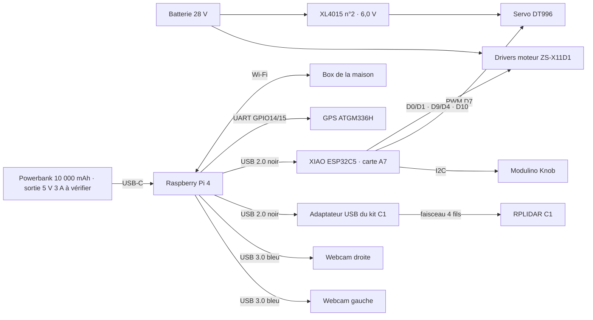

[Français](CONNEXIONS.md) · **English**

<a id="fieldmind--qui-est-branché-sur-quoi"></a>
# FieldMind — what is connected to what

**Prototype rover connection reference file.** Any wiring changes must be recorded here, in the same commit as the schematic or firmware change. Power and shutdown details are in the [system schematic](systeme_rover/README.en.md); the internal pinout of the sensor board is in the [A7 board](carte_capteurs/perfboard_une_plaque_c5_a7.en.md).

**Motorization — 16 October 2026 datasheet: [ZS-X11D1, motor, and ESP connections](CONNEXIONS_MOTEUR_ZS_X11D1.en.md).** It supplements the previous mentions of the E600 controller below with the purchased driver, declared battery, and proposed control assignments; their wiring remains to be validated.

Update: **18 October 2026** (GPS moved to the Pi, 15 October tests postponed). Status of each line: **Planned** (schematic only), **Doc verified** (checked against component documentation), **Tested** (observed on hardware, with date).

<a id="vue-densemble"></a>
## Overview



<a id="ports-du-raspberry-pi-4"></a>
## Raspberry Pi 4 Ports

| Pi Port | Connected To | Cable | Status |
| --- | --- | --- | --- |
| USB-C (power) | **USB 5 V 3 A external battery** | Short USB-C cable | Chosen on 18/10; XL4015 abandoned for Pi |
| Pins 2, 4 (5 V) | Nothing | — | Free (XL4015 test on 18/10 abandoned: undervoltage) |
| USB 3.0 #1 (blue) | Left UGREEN Webcam | Webcam cable | One webcam seen on USB port 1.4, 1280 × 720 — Tested 15/10 |
| USB 3.0 #2 (blue) | Right UGREEN Webcam | Webcam cable | Planned |
| USB 2.0 #1 (black) | **RPLIDAR C1 USB adapter** | USB cable from kit | `/dev/ttyUSB0`, 460 800 bauds, ≈ 11 rpm — Tested 15/10 |
| USB 2.0 #2 (black) | XIAO ESP32C5 (A7 sensor board) | Data USB-C cable | `/dev/ttyACM0`, telemetry received — Tested 15/10 |
| 40 pin connector | **GPS ATGM336H** on pins 1, 6, 8, 10 | 4 female Dupont wires | `/dev/ttyS0`, 9 600 bauds, 3D fix — Tested 18/10 |
| Ethernet | Nothing | — | Free |
| Wi-Fi | Home router (rover.local) | — | Tested |

The four USB ports provide **1,2 A total**. Lidar 230 mA, two webcams, and the sensor board: measure the entire connected load; use a powered hub if the Pi reports undervoltage.

<a id="raspberry-pi--lidar-rplidar-c1"></a>
## Raspberry Pi ↔ RPLIDAR C1 lidar

The C1 communicates via **UART 3,3 V, 460 800 bauds, 8N1**, and is powered by **5 V (4,8–5,2 V), 230 mA**. Its connector is an XH2,54; only 4 signals are used: VCC, TX, RX, GND ([Waveshare, RPLIDAR C1](https://www.waveshare.com/wiki/RPLIDAR_C1)).

Connection **via USB, using the kit's adapter** (confirmed by Hugo on 15 October 2026).

```
RPLIDAR C1                 Adaptateur USB du kit            Raspberry Pi 4
 VCC  (rouge) ───────────── 5V
 TX   (jaune) ───────────── RX          USB ─────────────── USB 2.0 n°1 (noir)
 RX   (vert)  ───────────── TX
 GND  (noir)  ───────────── GND
```

| Lidar wire | Adapter pin | Role |
| --- | --- | --- |
| Red — VCC | 5V | The lidar is powered by the Pi's USB via the adapter |
| Yellow — Lidar TX | RX | Lidar measurements to the Pi |
| Green — Lidar RX | TX | Pi commands to the lidar (start/stop scan) |
| Black — GND | GND | Ground |

The kit's cable is already crimped in the correct orientation: connect the lidar connector to the adapter, then the adapter to the Pi. **Verify colors on the received cable** before any cutting or extension. Status: Doc verified (levels and speed), not tested.

On the Linux side, the adapter (CP210x chip) appears as `/dev/ttyUSB0`. The `dax` user must be in the `dialout` group. ROS driver 2: `sllidar_ros2`, launch `sllidar_c1_launch.py` with `serial_port:=/dev/ttyUSB0`, `serial_baudrate:=460800`. For a stable name, add a udev rule that creates `/dev/rplidar` from the adapter's USB identifier retrieved via `lsusb`.

## Raspberry Pi ↔ GPS ATGM336H

The GPS is connected **directly to the Pi's 40-pin connector**, not to the XIAO: the XIAO's current firmware uses D6 for I2C (SDA D5, SCL D6), which blocks plan A7 (GPS on D6/D7). The Pi's supervision already reads a NMEA GPS on `/dev/ttyS0`.

| GPS pin | Pi physical pin | Pi signal |
| --- | --- | --- |
| VCC | **1** | 3,3 V |
| GND | **6** | GND |
| TXD | **10** | GPIO15 · RXD (the Pi receives NMEA frames) |
| RXD | **8** | GPIO14 · TXD (optional, only to configure the GPS) |
| PPS | — | Not connected |

```
   Connecteur 40 broches du Pi (vu de dessus, ports USB vers le bas,
   colonne de droite = bord de la carte ; la broche 1 a une pastille carrée)
   3,3 V  (1) ●  ● (2)  5 V
              ●  ● (4)  5 V
              ●  ● (6)  GND
              ●  ● (8)  GPIO14 TXD
              ●  ● (10) GPIO15 RXD
   VCC GPS ← 1 · GND GPS ← 6 · RXD GPS ← 8 · TXD GPS → 10
```

- TX and RX cross: the GPS's TXD goes to the Pi's RXD.
- Powered by **3,3 V** (pin 1), the module outputs signals at 3,3 V, compatible with the Pi. Common ATGM336H modules accept 3,3 to 5 V: **check the marking on the received module**. Do not power it at 5 V without verifying that its TXD remains at 3,3 V.
- Consumption is around 25 to 30 mA, posing no problem for the Pi's 3,3 V pin.
- On the Pi side: `enable_uart=1` in `/boot/firmware/config.txt` and serial console disabled (`sudo raspi-config nonint do_serial_cons 1`), then restart. The GPS appears at `/dev/ttyS0` to 9 600 bauds; supervision detects it automatically. Bluetooth remains active.
- Antenna outdoors, facing the sky, away from the Pi and the lidar.

Status: **Tested on 18 October 2026** — NMEA frames received on `/dev/ttyS0`, 3D fix with 5 satellites used on 7, "ANTENNA OK", position displayed in supervision. Serial console removed from `cmdline.txt` (`raspi-config nonint do_serial_cons 1`), `enable_uart=1` kept. The module's red LED blinks once per second when it has a position.

<a id="raspberry-pi--alimentation"></a>
## Raspberry Pi: power supply

**Hugo's decision, 18 October 2026: the Pi is powered by an external USB battery (power bank)**, separate from the 28 V battery. The XL4015 n°1 tried on pins 2/4 heated up, vibrated, and left the Pi underpowered (`0x50005`): it is no longer used for the Pi. Hugo specifies a capacity of **10 000 mAh**. The exact model, energy in Wh, and USB output current have not yet been recorded. The estimate is approximately **2–3 h for computing**, with **30–60 min of traction on grass/trailer** on the NGP pack, two full batteries. See assumptions and calculations (working reference not included).

| Element | Requirement |
| --- | --- |
| External battery | Output **5 V 3 A** (15 W or more, USB-C PD or USB-A 3 A) |
| Cable | USB-C to USB-C for the Pi, short (≤ 1 m) and thick |
| Control | `vcgencmd get_throttled` must provide `0x0` with webcams, lidar, and XIAO connected |

- The Pi's 2/4 pins are no longer powered: disconnect the XL4015 wires.
- The computing and traction sections share a **common ground** via the driver/servo commands and the XIAO-to-Pi USB connection. The positive outputs of the two power supplies remain separate. The motors and servo have dedicated power returns; see the Common Ground section.
- The servo remains on its XL4015 powered by the 28 V battery; its signal (D7) is referenced by the same common ground.

<a id="xiao-esp32c5-firmware-esp_c5-identifiant-rover_2"></a>
## XIAO ESP32C5 (firmware `esp_c5`, ID ROVER_2)

Assignments of the current firmware, source: [CONNEXION_RASPBERRY.md](../../software/esp32/esp_c5/CONNEXION_RASPBERRY.en.md). They replace the original plan A7 (servo on D8, GPS on D6/D7, I2C on D4/D5).

| XIAO Pin | Connected to | Wire | Status |
| --- | --- | --- | --- |
| USB-C | Pi's USB 2.0 n°2 — data and card power | — | Tested 15/10 |
| D0 / GPIO1 | Speed (0–5 V) of the left motor driver | Red | A motor tested by Hugo on 17/10 |
| D1 / GPIO0 | D/R of the left driver (direction reversed in software) | Yellow | Planned |
| D9 / GPIO9 | Speed (0–5 V) of the right motor driver | Red | Planned |
| D4 / GPIO23 | D/R of the right driver — **yellow wire separate from D1's** | Yellow | Planned |
| D10 / GPIO10 | BRAKE for both drivers | Green | Planned |
| D7 / GPIO12 | Signal from the DT996 servo | According to harness | Servo tested alone on 18/10 (on D0, test program) |
| D5 / GPIO24 | Common SDA: IMU, barometer, OLED, Knob | — | IMU read on 15/10 |
| D6 / GPIO11 | Common SCL: IMU, barometer, OLED, Knob | — | IMU read on 15/10 |
| GND | GND for driver control (orange) and servo reference | Orange | Planned |
| D2 / GPIO25 | Reserved: `SC` of the left driver (wheel speed), firmware `roues 1` | — | Planned, **SC level to be measured beforehand**, adaptation in [CONNEXION_RASPBERRY.md](../../software/esp32/esp_c5/CONNEXION_RASPBERRY.en.md) |
| D3 / GPIO7 | Reserved: `SC` of the right driver | — | Planned, same |
| D8 | Nothing | — | Free |

STOP and the 5 V output from the drivers are not connected to the ESP. Details, Hall colors and limits: [motor connections](CONNEXIONS_MOTEUR_ZS_X11D1.en.md).

<a id="puissance"></a>
## Power

| From | To | Status |
| --- | --- | --- |
| Battery + | Fuse F0 → switch S1 → bus | Planned |
| — | Pi powered by external USB battery (XL4015 n°1 abandoned on 18/10) | — |
| Bus → F2 | XL4015 n°2 → **6,0 V** → servo + ; servo − on OUT− | Planned |
| Bus → F4 | XL4015 n°3 → **12 V** → safety chain (K1, K2) | Planned |
| Bus → F3 → K2 | V+ of the E600 traction controller | Planned, controller not identified |

Details, ratings, and emergency stop chain: [system diagram](systeme_rover/README.en.md).

<a id="masse-commune"></a>
## Common Ground

Hugo's decision, 18 October 2026: **all grounds are connected together**, in a star configuration on a single ground bar near the battery.

| Connected to ground bar | Wire |
| --- | --- |
| Battery − | Thick wire, cross-section for motor current |
| Power GND of each ZS-X11D1 | Thick wire, each its own |
| IN− of XL4015s (servo, stop); OUT− connected internally | One wire per converter |
| Servo − | Directly on its XL4015 OUT−, not on the sensor board |
| Driver control GND → XIAO GND | Thin wire, accompanies control wires |
| Pi ↔ XIAO | **Already done via USB cable**, no additional wire needed |

- The common ground serves as the **signal reference**. High currents (motors, servo) return each via their own wire to the bar, never through the sensor board, USB cable, or Pi.
- The XL4015s are not isolated: their IN− and OUT− are already connected internally.
- Risk to avoid: if the thick ground wire of a driver disconnects while its control ground remains connected to the ESP, the motor current will flow through the ESP, USB, and Pi. Tighten and check the thick ground wires before each power-up.

<a id="mettre-ce-fichier-à-jour"></a>
## Update this file

- A connection changes: modify the line, update its status, and date the test.
- A component arrives or changes: also update the inventory (working reference not included).
- The KiCad schematic of the [system](systeme_rover/README.en.md) is generated by script: regenerate it after modification, then verify that this file says the same thing.
