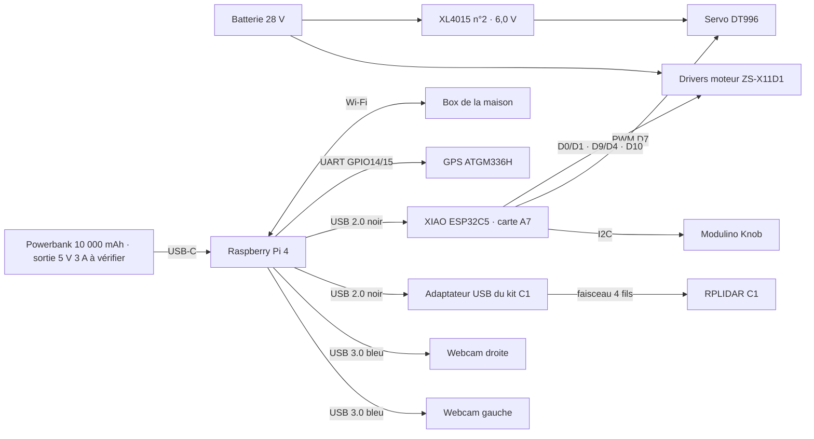

# FieldMind — qui est branché sur quoi

**Fichier de référence des connexions du rover prototype.** Toute modification de câblage
se reporte ici, dans le même commit que le changement de schéma ou de firmware.
Les détails de puissance et d'arrêt sont dans le [schéma système](systeme_rover/README.md) ;
le brochage interne de la carte capteurs dans la [carte A7](carte_capteurs/perfboard_une_plaque_c5_a7.md).

**Motorisation — fiche du 16 octobre 2026 : [connexions du ZS-X11D1, du moteur et de l'ESP](CONNEXIONS_MOTEUR_ZS_X11D1.md).**
Elle complète les anciennes mentions du contrôleur E600 ci-dessous avec le driver acheté,
la batterie déclarée et les affectations de commande proposées ; leur câblage reste à valider.

Mise à jour : **18 octobre 2026** (GPS déplacé sur le Pi, essais du 15 octobre reportés). Statut de chaque ligne :
**Prévu** (schéma seulement), **Vérifié doc** (contrôlé sur la documentation du composant),
**Testé** (constaté sur le matériel, avec la date).

## Vue d'ensemble



## Ports du Raspberry Pi 4

| Port du Pi | Branché sur | Câble | Statut |
| --- | --- | --- | --- |
| USB-C (alimentation) | **Batterie externe USB 5 V 3 A** | USB-C court | Choisi le 18/10 ; XL4015 abandonné pour le Pi |
| Broches 2, 4 (5 V) | Rien | — | Libres (essai XL4015 du 18/10 abandonné : sous-tension) |
| USB 3.0 n°1 (bleu) | Webcam UGREEN gauche | Câble de la webcam | Une webcam vue sur le port USB 1.4, 1280 × 720 — Testé 15/10 |
| USB 3.0 n°2 (bleu) | Webcam UGREEN droite | Câble de la webcam | Prévu |
| USB 2.0 n°1 (noir) | **Adaptateur USB du RPLIDAR C1** | Câble USB du kit | `/dev/ttyUSB0`, 460 800 bauds, ≈ 11 tours/s — Testé 15/10 |
| USB 2.0 n°2 (noir) | XIAO ESP32C5 (carte capteurs A7) | USB-C de données | `/dev/ttyACM0`, télémétrie reçue — Testé 15/10 |
| Connecteur 40 broches | **GPS ATGM336H** sur les broches 1, 6, 8, 10 | 4 fils Dupont femelle | `/dev/ttyS0`, 9 600 bauds, fix 3D — Testé 18/10 |
| Ethernet | Rien | — | Libre |
| Wi-Fi | Box de la maison (rover.local) | — | Testé |

Les quatre ports USB fournissent **1,2 A au total**. Lidar 230 mA, deux webcams et la carte
capteurs : mesurer l'ensemble branché ; passer par un hub alimenté si le Pi signale une sous-tension.

## Raspberry Pi ↔ lidar RPLIDAR C1

Le C1 parle en **UART 3,3 V, 460 800 bauds, 8N1**, et s'alimente en **5 V (4,8–5,2 V), 230 mA**.
Son connecteur est un XH2,54 ; seuls 4 signaux sont utilisés : VCC, TX, RX, GND
([Waveshare, RPLIDAR C1](https://www.waveshare.com/wiki/RPLIDAR_C1)).

Branchement **en USB, par l'adaptateur du kit** (confirmé par Hugo le 15 octobre 2026).

```
RPLIDAR C1                 Adaptateur USB du kit            Raspberry Pi 4
 VCC  (rouge) ───────────── 5V
 TX   (jaune) ───────────── RX          USB ─────────────── USB 2.0 n°1 (noir)
 RX   (vert)  ───────────── TX
 GND  (noir)  ───────────── GND
```

| Fil du lidar | Broche de l'adaptateur | Rôle |
| --- | --- | --- |
| Rouge — VCC | 5V | Le lidar est alimenté par l'USB du Pi via l'adaptateur |
| Jaune — TX lidar | RX | Mesures du lidar vers le Pi |
| Vert — RX lidar | TX | Commandes du Pi vers le lidar (démarrage, arrêt du scan) |
| Noir — GND | GND | Masse |

Le faisceau du kit est déjà serti dans le bon sens : on branche le connecteur du lidar sur
l'adaptateur, puis l'adaptateur sur le Pi. **Couleurs à confirmer sur le faisceau reçu** avant
toute coupe ou rallonge. Statut : Vérifié doc (niveaux et vitesse), non testé.

Côté Linux, l'adaptateur (puce CP210x) apparaît en `/dev/ttyUSB0`. L'utilisateur `dax` doit
être dans le groupe `dialout`. Pilote ROS 2 : `sllidar_ros2`, lancement `sllidar_c1_launch.py`
avec `serial_port:=/dev/ttyUSB0`, `serial_baudrate:=460800`. Pour un nom stable, ajouter une
règle udev qui crée `/dev/rplidar` à partir de l'identifiant USB de l'adaptateur relevé par `lsusb`.

## Raspberry Pi ↔ GPS ATGM336H

Le GPS est branché **directement sur le connecteur 40 broches du Pi**, plus sur le XIAO :
le firmware actuel du XIAO utilise D6 pour l'I2C (SDA D5, SCL D6), ce qui bloque le plan A7
(GPS sur D6/D7). La supervision du Pi lit déjà un GPS NMEA sur `/dev/ttyS0`.

| Broche du GPS | Broche physique du Pi | Signal du Pi |
| --- | --- | --- |
| VCC | **1** | 3,3 V |
| GND | **6** | GND |
| TXD | **10** | GPIO15 · RXD (le Pi reçoit les trames NMEA) |
| RXD | **8** | GPIO14 · TXD (facultatif, seulement pour configurer le GPS) |
| PPS | — | Non branché |

```
   Connecteur 40 broches du Pi (vu de dessus, ports USB vers le bas,
   colonne de droite = bord de la carte ; la broche 1 a une pastille carrée)
   3,3 V  (1) ●  ● (2)  5 V
              ●  ● (4)  5 V
              ●  ● (6)  GND
              ●  ● (8)  GPIO14 TXD
              ●  ● (10) GPIO15 RXD
   VCC GPS ← 1 · GND GPS ← 6 · RXD GPS ← 8 · TXD GPS → 10
```

- TX et RX se croisent : le TXD du GPS va au RXD du Pi.
- Alimenté en **3,3 V** (broche 1), le module sort des signaux en 3,3 V, compatibles avec le Pi.
  Les modules ATGM336H courants acceptent 3,3 à 5 V : **vérifier la sérigraphie du module reçu**.
  Ne pas l'alimenter en 5 V sans avoir mesuré que son TXD reste à 3,3 V.
- Consommation de l'ordre de 25 à 30 mA, sans problème pour la broche 3,3 V du Pi.
- Côté Pi : `enable_uart=1` dans `/boot/firmware/config.txt` et console série coupée
  (`sudo raspi-config nonint do_serial_cons 1`), puis redémarrage. Le GPS apparaît en
  `/dev/ttyS0` à 9 600 bauds ; la supervision le détecte seule. Le Bluetooth reste actif.
- Antenne à l'extérieur, vers le ciel, éloignée du Pi et du lidar.

Statut : **Testé le 18 octobre 2026** — trames NMEA reçues sur `/dev/ttyS0`, fix 3D avec 5 satellites
utilisés sur 7, « ANTENNA OK », position affichée dans la supervision. Console série retirée de
`cmdline.txt` (`raspi-config nonint do_serial_cons 1`), `enable_uart=1` conservé.
La LED rouge du module clignote une fois par seconde quand il a une position.

## Raspberry Pi : alimentation

**Décision d'Hugo, 18 octobre 2026 : le Pi est alimenté par une batterie externe USB (power bank)**,
séparée de la batterie 28 V. Le XL4015 n°1 essayé sur les broches 2/4 chauffait, vibrait et
laissait le Pi en sous-tension (`0x50005`) : il n'est plus utilisé pour le Pi.
Hugo précise une capacité de **10 000 mAh**. Le modèle exact, l'énergie
en Wh et le courant de sortie USB ne sont pas encore relevés. L'estimation
est d'environ **2–3 h pour l'informatique**, avec **30–60 min de traction
sur herbe/remorque** sur le pack NGP, deux batteries pleines.
Voir les hypothèses et calculs (référence de travail non incluse).

| Élément | Exigence |
| --- | --- |
| Batterie externe | Sortie **5 V 3 A** (15 W ou plus, USB-C PD ou USB-A 3 A) |
| Câble | USB-C vers USB-C du Pi, court (≤ 1 m) et épais |
| Contrôle | `vcgencmd get_throttled` doit donner `0x0` avec webcams, lidar et XIAO branchés |

- Les broches 2/4 du Pi ne sont plus alimentées : débrancher les fils du XL4015.
- La partie informatique et la traction partagent une **masse de référence**
  via les commandes drivers/servo et l'USB du XIAO vers le Pi. Les sorties
  positives des deux alimentations restent séparées. Les moteurs et le
  servo ont des retours de puissance dédiés ; voir la section Masse commune.
- Le servo reste sur son XL4015 alimenté par la batterie 28 V ; son signal (D7) est référencé
  par la même masse commune.

## XIAO ESP32C5 (firmware `esp_c5`, identifiant ROVER_2)

Affectations du firmware actuel, source :
[CONNEXION_RASPBERRY.md](../../software/esp32/esp_c5/CONNEXION_RASPBERRY.md).
Elles remplacent le plan A7 d'origine (servo sur D8, GPS sur D6/D7, I2C sur D4/D5).

| Broche XIAO | Branché sur | Fil | Statut |
| --- | --- | --- | --- |
| USB-C | USB 2.0 n°2 du Pi — données et alimentation de la carte | — | Testé 15/10 |
| D0 / GPIO1 | Vitesse (0–5 V) du driver moteur gauche | Rouge | Un moteur testé par Hugo le 17/10 |
| D1 / GPIO0 | D/R du driver gauche (sens inversé en logiciel) | Jaune | Prévu |
| D9 / GPIO9 | Vitesse (0–5 V) du driver moteur droit | Rouge | Prévu |
| D4 / GPIO23 | D/R du driver droit — **fil jaune séparé de celui de D1** | Jaune | Prévu |
| D10 / GPIO10 | BRAKE des deux drivers | Verts | Prévu |
| D7 / GPIO12 | Signal du servo DT996 | Selon faisceau | Servo testé seul le 18/10 (sur D0, programme de test) |
| D5 / GPIO24 | SDA commun : IMU, baromètre, OLED, Knob | — | IMU lue le 15/10 |
| D6 / GPIO11 | SCL commun : IMU, baromètre, OLED, Knob | — | IMU lue le 15/10 |
| GND | GND de commande des drivers (orange) et référence du servo | Orange | Prévu |
| D2 / GPIO25 | Réservée : `SC` du driver gauche (vitesse de roue), firmware `roues 1` | — | Prévu, **niveau de SC à mesurer avant**, adaptation dans [CONNEXION_RASPBERRY.md](../../software/esp32/esp_c5/CONNEXION_RASPBERRY.md) |
| D3 / GPIO7 | Réservée : `SC` du driver droit | — | Prévu, idem |
| D8 | Rien | — | Libre |

STOP et la sortie 5 V des drivers ne sont pas reliés à l'ESP. Détails, couleurs Hall et
limites : [connexions moteur](CONNEXIONS_MOTEUR_ZS_X11D1.md).

## Puissance

| De | Vers | Statut |
| --- | --- | --- |
| Batterie + | Fusible F0 → interrupteur S1 → bus | Prévu |
| — | Pi alimenté par batterie externe USB (XL4015 n°1 abandonné le 18/10) | — |
| Bus → F2 | XL4015 n°2 → **6,0 V** → servo + ; servo − sur OUT− | Prévu |
| Bus → F4 | XL4015 n°3 → **12 V** → chaîne d'arrêt (K1, K2) | Prévu |
| Bus → F3 → K2 | V+ du contrôleur de traction du E600 | Prévu, contrôleur non identifié |

Détails, calibres et chaîne d'arrêt d'urgence : [schéma système](systeme_rover/README.md).

## Masse commune

Décision d'Hugo, 18 octobre 2026 : **toutes les masses sont reliées entre elles**, en étoile
sur une barre de masse unique proche de la batterie.

| Relié à la barre de masse | Fil |
| --- | --- |
| Batterie − | Gros fil, section du courant moteur |
| GND de puissance de chaque ZS-X11D1 | Gros fil, chacun le sien |
| IN− des XL4015 (servo, arrêt) ; OUT− relié en interne | Un fil par convertisseur |
| Servo − | Directement sur OUT− de son XL4015, pas sur la carte capteurs |
| GND de commande des drivers → GND du XIAO | Petit fil, accompagne les fils de commande |
| Pi ↔ XIAO | **Déjà fait par le câble USB**, pas de fil supplémentaire nécessaire |

- La masse commune sert de **référence aux signaux**. Les gros courants (moteurs, servo)
  reviennent chacun par leur propre fil jusqu'à la barre, jamais par la carte capteurs,
  le câble USB ou le Pi.
- Les XL4015 ne sont pas isolés : leur IN− et OUT− sont déjà reliés à l'intérieur.
- Risque à éviter : si le gros fil de masse d'un driver se débranche alors que sa masse de
  commande reste reliée à l'ESP, le courant moteur passe par l'ESP, l'USB et le Pi.
  Serrer et vérifier les gros fils de masse avant chaque mise sous tension.

## Mettre ce fichier à jour

- Un branchement change : modifier la ligne, passer son statut et dater le test.
- Un composant arrive ou change : mettre aussi à jour l'inventaire (référence de travail non incluse).
- Le schéma KiCad du [système](systeme_rover/README.md) est généré par script : le régénérer
  après modification, puis vérifier que ce fichier dit la même chose.
