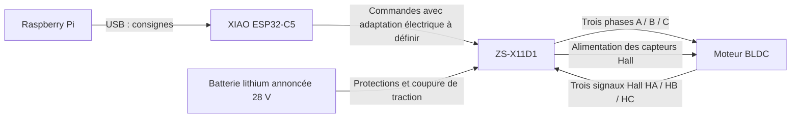

[Français](CONNEXIONS_MOTEUR_ZS_X11D1.md) · **English**

<a id="connexions-moteur--fowecry-zs-x11d1-et-xiao-esp32-c5"></a>
# Motor connections — Fowecry ZS-X11D1 and XIAO ESP32-C5

> A parallel version (motor NGP readings, driver output 5 V, battery monitoring) is archived in archives/CONNEXIONS_MOTEUR_proposition_NGP_2026-10-18.md (non-included working reference). Its pin assignments are **not** those of the firmware: follow this file.

**Current firmware, 18 October: esp_c5 / ROVER_2; TOUT_MOTEUR_4 test.** Servo on D7/GPIO12; motor speeds D0/D9; driver D/R D0 on D1/GPIO0 and driver D/R D9 on D4/GPIO23, separate yellow wires; common BRAKE D10, common GND. Driver D0 is inverted in software for the mirror assembly. These assignments concern the main and `test_tout_moteur`, which share actionneurs.cpp. Hugo confirms D/R already separated D1/D4. The software now sets speeds and direction independently (left/right, sensg/sensd). The right side is inverted relative to ROVER_1, left side kept. inverseg/inversed store in flash the correction of the front of each wheel, without affecting phasing/Hall. See [the current wiring of the test](../../software/esp32/esp_c5/TEST_TOUT_MOTEUR.en.md).

**Power supply specified on 18 October: 10 000 mAh powerbank for the Pi, its peripherals and the XIAO via USB; NGP pack for the motors and the XL4015 servo 6 V.** The old XL4015 5,1 V branch for the Pi is replaced. Grounds remain common, positive outputs remain separate. See [the reference connections](CONNEXIONS.en.md#raspberry-pi--alimentation) and the new autonomy estimates (non-included working reference).

Update: **17 October 2026**.

This document gathers the connections discussed for **one driver and one motor**. The main also prepares a [common command for two drivers](../../software/esp32/esp_c5/DEUX_MOTEURS.en.md), described in section 4 below. The operation of one motor was then confirmed by Hugo; the second driver and the two-motor assembly remain to be tested. ESP assignments are proposed; the electrical connection of the commands and the order of the motor wires have not yet been validated on the received hardware. **This document does not therefore validate powering on the motor.**

<a id="matériel-et-état-connu"></a>
## Hardware and known status

| Element | Information |
| --- | --- |
| Purchased driver | Fowecry **ZS-X11D1**, Amazon **B0H1MPRXF9** |
| Characteristics announced by the seller | 6–60 V, 400 W, 16 A nominal, 20 A peak; values not measured |
| Declared battery | Lithium, **28 V**; maximum charged voltage and pack characteristics to be recorded |
| Motor | Three thick wires and five thin wires, confirmed by Hugo |
| Markings recorded on the driver | `A`, `B`, `C` and `HA`, `HB`, `HC` |
| Selected control controller | **XIAO ESP32-C5**, connected to the Raspberry Pi via USB |
| Number of drivers | To be specified; each independent motor requires its own driver |

<a id="répartition-des-rôles"></a>
## Role distribution



The Pi handles supervision and sends setpoints. The ESP must generate the PWM, manage direction and stop the command upon loss of setpoints. A first command by pulses is implemented in the [ESP C5 project](../../software/esp32/esp_c5/README.en.md) since 17 October. It remains to be validated on the hardware and does not constitute the complete rover piloting. The serial monitor offers `test`: a single pulse of 200 ms at 1 % PWM, then disarming. The duty cycle can be chosen manually from 1 to 5 %. This percentage guarantees neither a slow speed nor a current limitation.

<a id="1-batterie-vers-driver--puissance"></a>
## 1. Battery to driver: power

**Make battery connections with the battery disconnected.**

| Start | End | Note |
| --- | --- | --- |
| Battery `+` | Main fuse → general switch → branch protection and traction cutoff → `VCC` / `V+` of the driver | Identify the actual positive terminal; size the ratings and protection components accordingly |
| Battery `−` | `GND` / `V−` power terminals of the driver | Direct power return, using a cable suitable for motor current |

The hardware shutdown chain and its components are described as a proposal in the [system diagram](systeme_rover/README.en.md); their implementation is not confirmed. The fuse protects the wiring; it does not replace the hardware shutdown.

The declared 28 V are within the driver's stated range, but this does not validate the motor's allowable voltage, current under load, or the maximum voltage of the charged pack. Do not send battery voltage to the ESP or Pi.

<a id="2-driver-vers-moteur--trois-gros-fils"></a>
## 2. Driver to motor: three thick wires

| Driver terminal | Destination |
| --- | --- |
| `A` (also named `MA` in some documentation) | Motor Phase A, to be identified |
| `B` / `MB` | Motor Phase B, to be identified |
| `C` / `MC` | Motor Phase C, to be identified |

These terminals denote the phases if they belong to the power terminal block. The order of the motor wires still needs to be determined: no color-based correspondence has been confirmed. The phase order must be consistent with that of the Hall sensors; do not consider an arbitrary permutation as validated.

<a id="3-driver-vers-moteur--cinq-petits-fils-hall"></a>
## 3. Driver to motor: five small Hall wires

| Driver terminal | Motor-side function |
| --- | --- |
| `+5V` of the Hall connector | Positive supply for Hall sensors, subject to their allowable voltage |
| `GND` of the Hall connector | Ground for Hall sensors |
| `HA` | Hall sensor A signal |
| `HB` | Hall sensor B signal |
| `HC` | Hall sensor C signal |

The five small wires go to the **driver**, not directly to the ESP. The driver harness colors and motor harness positions are listed below. The electrical assignment on the motor side and the observation face of its connector remain to be confirmed. Identify the power supply and ground before any connection. Hall sensors are used for motor commutation; their presence does not mean that odometry is already being read by the Pi.

<a id="faisceau-hall-du-driver--repères-relevés-par-hugo-le-17-octobre"></a>
### Driver Hall harness — references recorded by Hugo on 17 October

| Driver side color | Pin identified on the driver |
| --- | --- |
| Black | `GND` |
| Green | `HC` |
| Yellow | `HB` |
| White | `HA` |
| Red | `+5V` |

This table records the color/pin correspondences provided by Hugo, without fixing an orientation or physical numbering of the driver connector. The motor has a **blue** wire where the driver harness has a **white** wire in the color list: this does not prove a motor blue → driver white correspondence (`HA`). Identical colors alone do not validate the assignment on the motor side either.

<a id="conventions-de-couleurs-recherchées--17-octobre"></a>
### Sought color conventions — 17 October

The Grin Technologies repair guide indicates that most **hub motors** use red/black for Hall sensor power supply and yellow/green/blue for the three signals. This convention makes the hypothesis red = power supply and black = ground plausible for this harness; it does not constitute an identification of the motor recovered for this project.

There is no common color → Hall letter correspondence among the manufacturer examples consulted:

| Function | Kelly KLS-D, manual V1.9 | Golden Motor HPC, manufacturer guide | Received driver, Hugo's notes |
| --- | --- | --- | --- |
| Hall A | Yellow | Blue | White |
| Hall B | Green | Green | Yellow |
| Hall C | Blue | Yellow | Green |

These examples concern different assemblies. They do not provide a wiring recipe between this motor and the ZS-X11D1. In particular, matching green/green and yellow/yellow then blue/blue remains an unvalidated hypothesis. A poorly phased rotation test can damage the driver; the absence of current-limited power supply does not turn direct connection to the battery into a controlled diagnostic test.

<a id="relevé-du-connecteur-moteur-à-huit-positions--17-octobre"></a>
### Motor connector pinout — 17 October

Description provided by Hugo: **two rows of four positions, notch facing up**, read from left to right in the view he describes.

```text
                   DÉTROMPEUR EN HAUT

                      Col. 1   Col. 2   Col. 3   Col. 4
Rangée haute :        Rouge    Vert     Bleu     Jaune
Rangée basse :        Phase 1  Phase 2  Phase 3  Noir
```

`Phase 1/2/3` here refers only to the three thick wires in the order described, not a validated mapping with `A/B/C` from the driver. The colors of the three thick wires have not yet been recorded.

The view side (contacts/holes or wire entry side) is **not yet specified**. The two views can invert left/right reading: this pinout does not constitute a standardized pin numbering.

| Small harness wire | Position in the described view | Function |
| --- | --- | --- |
| Red | Top, column 1 | To be confirmed; candidate for sensor power supply, not yet validated `+5V` |
| Green | Top, column 2 | To be identified among Hall signals after power supply confirmation |
| Blue | Top, column 3 | To be identified among Hall signals after power supply confirmation |
| Yellow | Top, column 4 | To be identified among Hall signals after power supply confirmation |
| Black | Bottom, column 4 | To be confirmed; candidate for sensor ground, not yet validated `GND` |

This pinout helps compare the harness with its original connector or manufacturer pinout. It does not prove electrical assignment on its own. Hugo indicates he does not have a variable power supply with current limiting; no test by swapping directly on the 28 V battery has been validated.

<a id="4-esp-vers-driver--affectation-proposée-pour-le-premier-moteur"></a>
## 4. ESP to driver: proposed assignment for the first motor

<a id="couleurs-du-faisceau-de-commande-relevées-par-hugo"></a>
### Wiring harness colors recorded by Hugo

Recorded on 18 October 2026 for ESP → driver connections:

| Driver pin | Wire color | ESP pin in main |
| --- | --- | --- |
| BRAKE / BREAK | **Green** | D10 / GPIO10, common to both drivers |
| D/R / DIR | **Yellow** | D1 / GPIO0 left; D4 / GPIO23 right; separate wires |
| GND | **Orange** | Common GND |
| Speed input 0–5 V | **Red** | D0 / GPIO1 for motor 1 ; D9 / GPIO9 for motor 2 |

« 0,5 volt » is used here as the reference **0–5 V** for the speed input. This table records the wiring colors for the control wiring indicated by Hugo.

**The table below reserves functions. Control lines are not yet validated for direct ESP → driver connection.**

| XIAO Pin | Real GPIO | Access on plan A7 | Driver Destination | Function / condition |
| --- | --- | --- | --- | --- |
| `GND` | — | `J6.2` | `GND` control | Common ground, wire accompanying the controls |
| `D0` | `GPIO1` | `J8.1` | Speed input `0–5 V` announced as PWM compatible | Speed ; electrical compatibility, potentiometer and jumper to be verified |
| `D1` | `GPIO0` | `J8.2` | `DIR` / `D/R` | Rotation direction ; levels and interface to be verified |
| `D10` | `GPIO10` | `J6.4` | `BRAKE` / `BREAK` | Brake ; high/low level controlled by code, driver polarity and thresholds to be confirmed |
| Not assigned | — | — | `STOP` | No wire to the ESP ; leave unconnected only after verifying its internal idle state |
| Not assigned | — | — | `5V` auxiliary | No connection to the power supply of the XIAO already powered by USB |
| D2 / GPIO25 (left), D3 / GPIO7 (right) | — | — | `SC` / speed output | Optional return read by ROVER_3 firmware (`roues 1`) and the Pi differential. Left unconnected until its electrical level is measured ; voltage divider or pull-up to 3V3 depending on measurement ([procedure](../../software/esp32/esp_c5/CONNEXION_RASPBERRY.en.md)) |

This assignment repeats the table provided by Hugo on 17 October and is implemented in `software/esp32/esp_c5/src/moteur_zs_x11d1.cpp`. `D/R` is the expected reference for direction ; the reading « DDR » remains to be confirmed. The references `J6` and `J8` come from plan A7 : verify continuity on the actually mounted board before using them for wiring.

<a id="points-électriques-à-résoudre"></a>
### Electrical points to resolve

- The ESP operates on **3,3 V** logic. The announcement describes an analog 0–5 V or PWM command without guaranteeing the electrical thresholds of each input of the received board. Do not conclude that a direct link is compatible.
- `VR` is the announced speed input. It may be distinct from the `P/PWM` input : identify both on this revision before choosing the connection.
- Verify the jumper and potentiometer for external control. No jumper position, PWM frequency or stop polarity is fixed here.
- Verify the internal voltages and resistances of `DIR`, `BRAKE` and `STOP` before choosing a direct output, level adaptation or open collector/drain command. **Do not arbitrarily apply 5 V to `STOP`.**
- `STOP` left free is a proposal, not a guaranteed inactive state. Verify it on this board. A software starting with zero PWM does not protect against an active potentiometer or a floating control input.
- **Do not connect any 5 V signal to an ESP input. Do not connect the `+5V` of the driver to the `3V3` or `5V` of the ESP already powered by USB.**
- The motor return current goes directly to the power distribution; it must not pass through the sensor board, the ESP, or the USB cable.

For a second driver, assign distinct outputs and review the overall GPIO budget. Do not copy D0/D1/D10 to both drivers to obtain two independent commands.

<a id="main-préparé-pour-deux-moteurs-ensemble"></a>
### Main prepared for two motors together

The `esp_c5` environment now controls two PWM outputs with **the same setpoint**. The logical direction and brake are common; the D/R levels are opposite for the mirror assembly. This assembly does not allow independent left/right commands.

| ESP32-C5 | Driver 1 | Driver 2 |
| --- | --- | --- |
| D0 / GPIO1 | External speed input validated on the board | — |
| **D9 / GPIO9** (J6.5 according to A7) | — | **External speed input to configure** |
| D1 / GPIO0 | DIR / D/R left, inverted in software | — |
| D4 / GPIO23 | — | DIR / D/R right |
| D10 / GPIO10 | BRAKE / BREAK | BRAKE / BREAK |
| GND | Control GND | Control GND |

The two DIR inputs remain separate on D1 and D4; the two BRAKE inputs go to D10. Each motor requires its own driver, its own phases, and its own Hall harness. Do not connect the phase outputs or the 5 V outputs of the two boards together. The electrical compatibility of each input remains necessary, even with a common command.

The program uses D7 / GPIO12 for the servo; no GPS can use this pin at the same time. The I2C bus of the current code is D5 / GPIO24 and D6 / GPIO11. The markers of the historical plan must be compared with the actually tested wiring. See the [main commands and limits](../../software/esp32/esp_c5/DEUX_MOTEURS.en.md).

<a id="5-raspberry-pi-vers-esp"></a>
## 5. Raspberry Pi to ESP

| Start | End | Role |
| --- | --- | --- |
| Raspberry Pi USB port | XIAO ESP32-C5 USB-C, data cable | Board power supply and command/telemetry serial link |

The driver is controlled by the ESP. No motor control wires are provided on the Pi's GPIO 40 pin connector in this architecture.

<a id="6-servo-de-direction--circuit-distinct"></a>
## 6. Steering servo: separate circuit

The servo does not connect to the `A/B/C` outputs of the ZS-X11D1. The [system plan](systeme_rover/README.en.md) foresees, without physical validation:

| Planned connection | Function |
| --- | --- |
| XIAO `D7` / `GPIO12` → servo signal | Current pin of the main and combined test; the historical D8 plan is outdated |
| Dedicated converter set to 6 V → servo `+` | Power supply planned for the selected DT996 |
| Servo `−` → `OUT−` of this converter | Direct power return |
| XIAO reference ground → common ground | Signal reference, without passing the servo current through it |

<a id="ce-qui-reste-à-valider-avant-un-essai-moteur"></a>
## What remains to be validated before a motor test

1. Photo or complete reading of the terminal blocks on the received board, especially the controls.
2. Identification of the motor phase and Hall wires, and motor specifications.
3. Maximum battery voltage when charged, protections, and traction cutoff.
4. ESP/driver electrical interfaces and behavior at startup, reset, and USB loss.
5. Firmware upload and motor validation: levels at boot, bounded command, and expiration; code available in the ESP C5 project.

Pi supervision, webcam, and sensors were verified on October 15$$. This does not constitute a motorization test. The Pi reported undervoltage on that date; its power supply must be stabilized for tests.

<a id="références"></a>
## References

- [Grin Technologies: replacement of wheel motor Hall sensors](https://www.ebikes.ca/documents/HubMotorHallSensorReplacement.pdf): usual colors for power and signals.
- [Kelly KLS-D, manual V1.9, schematic 3.2.2](https://www.kellycontrollers.eu/custom/kellycontroller/image/data/srattached/d4b9c190b18dd18c2444c0fe42065557_KellyKLS-DUserManualV1.9.pdf): example of Hall A/B/C marking.
- [Golden Motor HPC, manufacturer guide, Hall sensors section](https://www.goldenmotor.com/HPC%20Series%20Controller%20User%20Guide.pdf): another example of Hall A/B/C marking.
- [Amazon product provided by Hugo — B0H1MPRXF9](https://www.amazon.fr/dp/B0H1MPRXF9): seller specifications copied into the discussion.
- [Official pinout of the XIAO ESP32-C5](https://wiki.seeedstudio.com/xiao_esp32c5_getting_started/).
- [Danilo Gervasio's thesis, University of Padua, figures 2.11 and 2.12](https://thesis.unipd.it/retrieve/dfe158de-ec8a-41d3-a9b9-6854970fbf38/Gervasio_Danilo.pdf): example of ZS-X11D1, revision to be compared with the one received.
- [A7 board schematic](carte_capteurs/perfboard_une_plaque_c5_a7.en.md), inventory (working reference not included), embedded software status (working reference not included).
