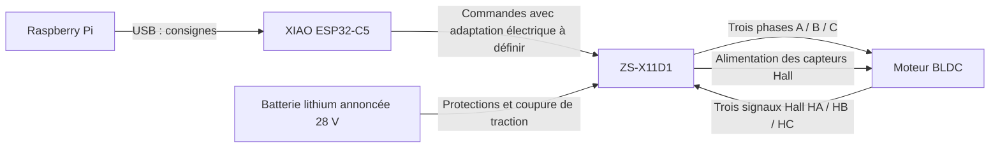

**Français** · [English](CONNEXIONS_MOTEUR_ZS_X11D1.en.md)

# Connexions moteur — Fowecry ZS-X11D1 et XIAO ESP32-C5

> Une version parallèle (relevés des moteurs NGP, sortie 5 V du driver, surveillance batterie) est
> archivée dans archives/CONNEXIONS_MOTEUR_proposition_NGP_2026-10-18.md (référence de travail non incluse).
> Ses affectations de broches ne sont **pas** celles du firmware : suivre ce fichier-ci.

**Firmware actuel, 18 octobre : esp_c5 / ROVER_2 ; test TOUT_MOTEUR_4.** Servo sur D7/GPIO12 ;
vitesses moteurs D0/D9 ; D/R du driver D0 sur D1/GPIO0 et D/R du driver D9
sur D4/GPIO23, fils jaunes separes ; BRAKE commun D10, GND commun.
Le driver D0 est inverse en logiciel pour le montage miroir. Ces affectations
concernent le main et `test_tout_moteur`, qui partagent actionneurs.cpp.
Hugo confirme les D/R deja separes D1/D4. Le logiciel regle maintenant
vitesses et sens independamment (g/d, sensg/sensd). La droite est inversee
par rapport a ROVER_1, gauche conservee. inverseg/inversed memorisent en flash
la correction de l'avant de chaque roue, sans toucher au phasage/Hall.
Voir [le cablage actuel du test](../../software/esp32/esp_c5/TEST_TOUT_MOTEUR.md).

**Alimentation précisée le 18 octobre : powerbank 10 000 mAh pour le Pi,
ses périphériques et le XIAO via USB ; pack NGP pour les moteurs et le
XL4015 servo 6 V.** L'ancienne branche XL4015 5,1 V du Pi est remplacée.
Les masses restent communes, les sorties positives restent séparées.
Voir [les connexions de référence](CONNEXIONS.md#raspberry-pi--alimentation)
et les nouvelles estimations d'autonomie (référence de travail non incluse).

Mise à jour : **17 octobre 2026**.

Ce document rassemble les connexions discutées pour **un driver et un moteur**.
Le main prépare aussi une [commande commune de deux drivers](../../software/esp32/esp_c5/DEUX_MOTEURS.md),
décrite en section 4 ci-dessous. Le fonctionnement d'un moteur a ensuite été
confirmé par Hugo ; le deuxième driver et le montage à deux restent à tester.
Les affectations ESP sont proposées ; le raccordement électrique des commandes
et l'ordre des fils moteur ne sont pas encore validés sur le matériel reçu.
**Ce document ne valide donc pas une mise sous tension du moteur.**

## Matériel et état connu

| Élément | Information |
| --- | --- |
| Driver acheté | Fowecry **ZS-X11D1**, Amazon **B0H1MPRXF9** |
| Caractéristiques annoncées par le vendeur | 6–60 V, 400 W, 16 A nominal, 20 A crête ; valeurs non mesurées |
| Batterie déclarée | Lithium, **28 V** ; tension maximale chargée et caractéristiques du pack à relever |
| Moteur | Trois gros fils et cinq petits fils, confirmés par Hugo |
| Repères relevés sur le driver | `A`, `B`, `C` et `HA`, `HB`, `HC` |
| Contrôleur de commande retenu | **XIAO ESP32-C5**, relié au Raspberry Pi par USB |
| Nombre de drivers | À préciser ; chaque moteur indépendant nécessite son driver |

## Répartition des rôles



Le Pi assure la supervision et envoie les consignes. L'ESP doit générer le PWM,
gérer le sens et arrêter la commande sur perte des consignes. Une première
commande par impulsions est implémentée dans le
[projet ESP C5](../../software/esp32/esp_c5/README.md) depuis le 17 octobre.
Elle reste à valider sur le matériel et ne constitue pas le pilotage complet du rover.
Le moniteur série propose `test` : une seule impulsion de 200 ms à 1 % de PWM,
puis désarmement. Le rapport cyclique peut être choisi manuellement de 1 à 5 %.
Ce pourcentage ne garantit ni une vitesse lente ni une limitation du courant.

## 1. Batterie vers driver : puissance

**Effectuer les raccordements batterie débranchée.**

| Départ | Arrivée | Précision |
| --- | --- | --- |
| Batterie `+` | Fusible principal → interrupteur général → protection de branche et coupure de traction → `VCC` / `V+` du driver | Repérer la borne positive réelle ; calibres et composants de protection à dimensionner |
| Batterie `−` | `GND` / `V−` de puissance du driver | Retour de puissance direct, avec un câble adapté au courant moteur |

La chaîne d'arrêt matériel et ses composants sont décrits comme une proposition
dans le [schéma système](systeme_rover/README.md) ; leur réalisation n'est pas
confirmée. Le fusible protège le câblage, il ne remplace pas l'arrêt matériel.

Les 28 V déclarés sont dans la plage annoncée du driver, mais cela ne valide pas
la tension admissible du moteur, le courant sous charge ou la tension maximale
du pack chargé. Ne pas envoyer la tension batterie sur l'ESP ou le Pi.

## 2. Driver vers moteur : trois gros fils

| Borne du driver | Destination |
| --- | --- |
| `A` (également nommé `MA` dans certaines documentations) | Phase A du moteur, à identifier |
| `B` / `MB` | Phase B du moteur, à identifier |
| `C` / `MC` | Phase C du moteur, à identifier |

Ces bornes désignent les phases si elles appartiennent bien au bornier de
puissance. L'ordre des fils moteur reste à relever : aucune correspondance par
couleur n'a été confirmée. L'ordre des phases doit être cohérent avec celui des
capteurs Hall ; ne pas considérer une permutation arbitraire comme validée.

## 3. Driver vers moteur : cinq petits fils Hall

| Borne du driver | Fonction côté moteur |
| --- | --- |
| `+5V` du connecteur Hall | Alimentation positive des capteurs Hall, sous réserve de leur tension admissible |
| `GND` du connecteur Hall | Masse des capteurs Hall |
| `HA` | Signal du capteur Hall A |
| `HB` | Signal du capteur Hall B |
| `HC` | Signal du capteur Hall C |

Les cinq petits fils vont au **driver**, pas directement à l'ESP. Les couleurs
du faisceau driver et les positions du faisceau moteur sont relevées ci-dessous.
L'affectation électrique côté moteur et la face d'observation de son connecteur
restent à confirmer.
Identifier particulièrement l'alimentation et la masse avant tout branchement.
Les capteurs Hall servent à la commutation du moteur ; leur présence ne signifie
pas qu'une odométrie est déjà lue par le Pi.

### Faisceau Hall du driver — repères relevés par Hugo le 17 octobre

| Couleur côté driver | Borne identifiée sur le driver |
| --- | --- |
| Noir | `GND` |
| Vert | `HC` |
| Jaune | `HB` |
| Blanc | `HA` |
| Rouge | `+5V` |

Ce tableau consigne les correspondances couleur/borne données par Hugo, sans
fixer une orientation ni une numérotation physique du connecteur driver.
Le moteur possède un fil **bleu** là où le faisceau driver possède un fil
**blanc** dans la liste des couleurs : cela ne prouve pas une correspondance
bleu moteur → blanc driver (`HA`). Les couleurs identiques ne valident pas
non plus à elles seules l'affectation côté moteur.

### Conventions de couleurs recherchées — 17 octobre

Le guide de réparation Grin Technologies indique que la plupart des
**moteurs-roues** utilisent rouge/noir pour l'alimentation des capteurs Hall
et jaune/vert/bleu pour les trois signaux. Cette convention rend l'hypothèse
rouge = alimentation et noir = masse plausible pour ce faisceau ; elle ne
constitue pas une identification du moteur récupéré pour ce projet.

Il n'existe pas de correspondance couleur → lettre Hall commune aux exemples
constructeurs consultés :

| Fonction | Kelly KLS-D, manuel V1.9 | Golden Motor HPC, guide constructeur | Driver reçu, relevé Hugo |
| --- | --- | --- | --- |
| Hall A | Jaune | Bleu | Blanc |
| Hall B | Vert | Vert | Jaune |
| Hall C | Bleu | Jaune | Vert |

Ces exemples concernent des ensembles différents. Ils ne donnent pas une
recette de raccordement entre ce moteur et le ZS-X11D1. En particulier, faire
correspondre vert/vert et jaune/jaune puis bleu/blanc reste une hypothèse non
validée. Un essai de rotation mal phasé peut endommager le driver ; l'absence
d'alimentation limitée en courant ne transforme pas le branchement direct
à la batterie en test de diagnostic maîtrisé.

### Relevé du connecteur moteur à huit positions — 17 octobre

Description donnée par Hugo : **deux rangées de quatre positions, détrompeur
vers le haut**, lecture de gauche à droite dans la vue qu'il décrit.

```text
                   DÉTROMPEUR EN HAUT

                      Col. 1   Col. 2   Col. 3   Col. 4
Rangée haute :        Rouge    Vert     Bleu     Jaune
Rangée basse :        Phase 1  Phase 2  Phase 3  Noir
```

`Phase 1/2/3` désignent ici uniquement les trois gros fils dans l'ordre décrit,
pas une correspondance déjà validée avec `A/B/C` du driver. Les couleurs des
trois gros fils ne sont pas encore relevées.

La vue côté contacts/trous ou côté entrée des fils **n'est pas encore précisée**.
Les deux vues peuvent inverser la lecture gauche/droite : ce relevé ne constitue
pas une numérotation normalisée des broches.

| Fil du petit faisceau | Position dans la vue décrite | Fonction |
| --- | --- | --- |
| Rouge | Haut, colonne 1 | À confirmer ; candidat pour l'alimentation des capteurs, pas encore validé `+5V` |
| Vert | Haut, colonne 2 | À identifier parmi les signaux Hall après confirmation de l'alimentation |
| Bleu | Haut, colonne 3 | À identifier parmi les signaux Hall après confirmation de l'alimentation |
| Jaune | Haut, colonne 4 | À identifier parmi les signaux Hall après confirmation de l'alimentation |
| Noir | Bas, colonne 4 | À confirmer ; candidat pour la masse des capteurs, pas encore validé `GND` |

Ce relevé aide à comparer le faisceau avec son connecteur d'origine ou un
brochage constructeur. Il ne prouve pas à lui seul l'affectation électrique.
Hugo indique ne pas disposer d'alimentation réglable avec limitation de courant ;
aucun essai par permutation directement sur la batterie 28 V n'est validé.

## 4. ESP vers driver : affectation proposée pour le premier moteur

### Couleurs du faisceau de commande relevées par Hugo

Relevé du 18 octobre 2026 pour les branchements ESP → driver :

| Borne du driver | Couleur du fil | Broche ESP dans le main |
| --- | --- | --- |
| BRAKE / BREAK | **Vert** | D10 / GPIO10, commun aux deux drivers |
| D/R / DIR | **Jaune** | D1 / GPIO0 gauche ; D4 / GPIO23 droite ; fils separes |
| GND | **Orange** | GND commun |
| Entrée vitesse 0–5 V | **Rouge** | D0 / GPIO1 pour le moteur 1 ; D9 / GPIO9 pour le moteur 2 |

« 0,5 volt » est repris ici comme le repère **0–5 V** de l'entrée de vitesse.
Ce tableau enregistre les couleurs du câblage de commande indiqué par Hugo.

**Le tableau ci-dessous réserve des fonctions. Les lignes de commande ne sont
pas encore validées pour un raccordement direct ESP → driver.**

| Broche XIAO | GPIO réel | Accès sur le plan A7 | Destination driver | Fonction / condition |
| --- | --- | --- | --- | --- |
| `GND` | — | `J6.2` | `GND` de commande | Masse commune, fil accompagnant les commandes |
| `D0` | `GPIO1` | `J8.1` | Entrée vitesse `0–5 V` annoncée compatible PWM | Vitesse ; compatibilité électrique, potentiomètre et cavalier à vérifier |
| `D1` | `GPIO0` | `J8.2` | `DIR` / `D/R` | Sens de rotation ; niveaux et interface à vérifier |
| `D10` | `GPIO10` | `J6.4` | `BRAKE` / `BREAK` | Frein ; niveau haut/bas commandé par le code, polarité et seuils du driver à confirmer |
| Non attribuée | — | — | `STOP` | Aucun fil vers l'ESP ; laisser non raccordé seulement après vérification de son état de repos interne |
| Non attribuée | — | — | `5V` auxiliaire | Aucune liaison vers l'alimentation du XIAO déjà alimenté par USB |
| D2 / GPIO25 (gauche), D3 / GPIO7 (droite) | — | — | `SC` / sortie vitesse | Retour facultatif lu par le firmware ROVER_3 (`roues 1`) et le différentiel du Pi. Laissé non raccordé tant que son niveau électrique n'est pas mesuré ; pont diviseur ou tirage au 3V3 selon la mesure ([procédure](../../software/esp32/esp_c5/CONNEXION_RASPBERRY.md)) |

Cette affectation reprend le tableau fourni par Hugo le 17 octobre et est
implémentée dans `software/esp32/esp_c5/src/moteur_zs_x11d1.cpp`.
`D/R` est le repère attendu pour le sens ; la lecture « DDR » reste à confirmer.
Les repères `J6` et `J8` viennent du plan A7 : vérifier la continuité
sur la plaque réellement montée avant de s'en servir pour câbler.

### Points électriques à résoudre

- L'ESP fonctionne en logique **3,3 V**. L'annonce décrit une commande analogique
  0–5 V ou PWM sans garantir les seuils électriques de chaque entrée de la carte
  reçue. Ne pas conclure qu'une liaison directe est compatible.
- `VR` est l'entrée de vitesse annoncée. Elle peut être distincte de l'entrée
  `P/PWM` : identifier les deux sur cette révision avant de choisir la connexion.
- Vérifier le cavalier et le potentiomètre pour la commande externe. Aucune
  position du cavalier, fréquence PWM ou polarité d'arrêt n'est figée ici.
- Vérifier les tensions et résistances internes de `DIR`, `BRAKE` et `STOP` avant de
  choisir une sortie directe, une adaptation de niveau ou une commande à
  collecteur/drain ouvert. **Ne pas appliquer arbitrairement 5 V à `STOP`.**
- `STOP` laissé libre est une proposition, pas un état inactif garanti.
  Le vérifier sur cette carte. Un logiciel démarrant avec PWM nul ne protège
  pas contre un potentiomètre actif ou une entrée de commande flottante.
- **Ne relier aucun signal 5 V à une entrée ESP. Ne pas relier le `+5V` du driver
  au `3V3` ou au `5V` de l'ESP déjà alimenté par USB.**
- Le courant moteur retourne directement à la distribution de puissance ; il
  ne doit pas traverser la plaque capteurs, l'ESP ou le câble USB.

Pour un deuxième driver, attribuer des sorties distinctes et revoir le budget
GPIO global. Ne pas recopier D0/D1/D10 sur les deux drivers pour obtenir deux
commandes indépendantes.

### Main préparé pour deux moteurs ensemble

L'environnement `esp_c5` commande désormais deux sorties PWM avec **la même
consigne**. Le sens logique et le frein sont communs ; les niveaux D/R sont opposes pour le montage miroir. Ce montage ne permet pas de
commandes indépendantes gauche/droite.

| ESP32-C5 | Driver 1 | Driver 2 |
| --- | --- | --- |
| D0 / GPIO1 | Entrée vitesse externe validée sur la carte | — |
| **D9 / GPIO9** (J6.5 selon A7) | — | **Entrée vitesse externe à configurer** |
| D1 / GPIO0 | DIR / D/R gauche, inverse en logiciel | — |
| D4 / GPIO23 | — | DIR / D/R droite |
| D10 / GPIO10 | BRAKE / BREAK | BRAKE / BREAK |
| GND | GND de commande | GND de commande |

Les deux entrees DIR restent separees sur D1 et D4 ; les deux entrees
BRAKE vont a D10. Chaque moteur nécessite son propre driver, ses propres phases
et son propre faisceau Hall. Ne relier ni les sorties de phase ni les sorties
5 V des deux cartes entre elles. La compatibilité électrique de chaque entrée
reste nécessaire, même avec une commande commune.

Le programme utilise D7 / GPIO12 pour le servo ; aucun GPS ne peut utiliser cette broche en meme temps.
Le bus I2C du code actuel est D5 / GPIO24 et D6 / GPIO11. Les repères du plan
historique doivent être comparés au câblage réellement testé.
Voir les [commandes et limites du main](../../software/esp32/esp_c5/DEUX_MOTEURS.md).

## 5. Raspberry Pi vers ESP

| Départ | Arrivée | Rôle |
| --- | --- | --- |
| Port USB du Raspberry Pi | USB-C du XIAO ESP32-C5, câble de données | Alimentation de la carte et liaison série des consignes/télémétrie |

Le driver est commandé par l'ESP. Aucun fil de commande moteur n'est prévu sur
le connecteur GPIO 40 broches du Pi dans cette architecture.

## 6. Servo de direction : circuit distinct

Le servo ne se connecte pas aux sorties `A/B/C` du ZS-X11D1.
Le [plan système](systeme_rover/README.md) prévoit, sans validation physique :

| Liaison prévue | Fonction |
| --- | --- |
| XIAO `D7` / `GPIO12` → signal servo | Broche actuelle du main et du test combine ; le plan historique D8 est depasse |
| Convertisseur dédié réglé à 6 V → servo `+` | Alimentation prévue pour le DT996 retenu |
| Servo `−` → `OUT−` de ce convertisseur | Retour de puissance direct |
| Masse de référence XIAO → masse commune | Référence du signal, sans y faire passer le courant du servo |

## Ce qui reste à valider avant un essai moteur

1. Photo ou relevé complet des borniers de la carte reçue, en particulier les commandes.
2. Identification des fils phases et Hall du moteur, et caractéristiques du moteur.
3. Tension maximale batterie chargée, protections et coupure de traction.
4. Interfaces électriques ESP/driver et comportement au démarrage, au reset et à la perte USB.
5. Téléversement et validation du firmware moteur : niveaux au boot, commande bornée et expiration ; code disponible dans le projet ESP C5.

La supervision Pi, la webcam et les capteurs ont été vérifiés le 15 octobre.
Cela ne constitue pas un essai de la motorisation. Le Pi signalait une
sous-tension à cette date ; son alimentation doit être stabilisée pour les essais.

## Références

- [Grin Technologies : remplacement des capteurs Hall de moteurs-roues](https://www.ebikes.ca/documents/HubMotorHallSensorReplacement.pdf) : couleurs habituelles de l'alimentation et des signaux.
- [Kelly KLS-D, manuel V1.9, schéma 3.2.2](https://www.kellycontrollers.eu/custom/kellycontroller/image/data/srattached/d4b9c190b18dd18c2444c0fe42065557_KellyKLS-DUserManualV1.9.pdf) : exemple de repérage Hall A/B/C.
- [Golden Motor HPC, guide constructeur, section capteurs Hall](https://www.goldenmotor.com/HPC%20Series%20Controller%20User%20Guide.pdf) : autre exemple de repérage Hall A/B/C.
- [Produit Amazon fourni par Hugo — B0H1MPRXF9](https://www.amazon.fr/dp/B0H1MPRXF9) : caractéristiques vendeur recopiées dans la discussion.
- [Brochage officiel du XIAO ESP32-C5](https://wiki.seeedstudio.com/xiao_esp32c5_getting_started/).
- [Mémoire de Danilo Gervasio, Université de Padoue, figures 2.11 et 2.12](https://thesis.unipd.it/retrieve/dfe158de-ec8a-41d3-a9b9-6854970fbf38/Gervasio_Danilo.pdf) : exemple de ZS-X11D1, révision à comparer à celle reçue.
- [Plan carte A7](carte_capteurs/perfboard_une_plaque_c5_a7.md), inventaire (référence de travail non incluse), état du logiciel embarqué (référence de travail non incluse).
