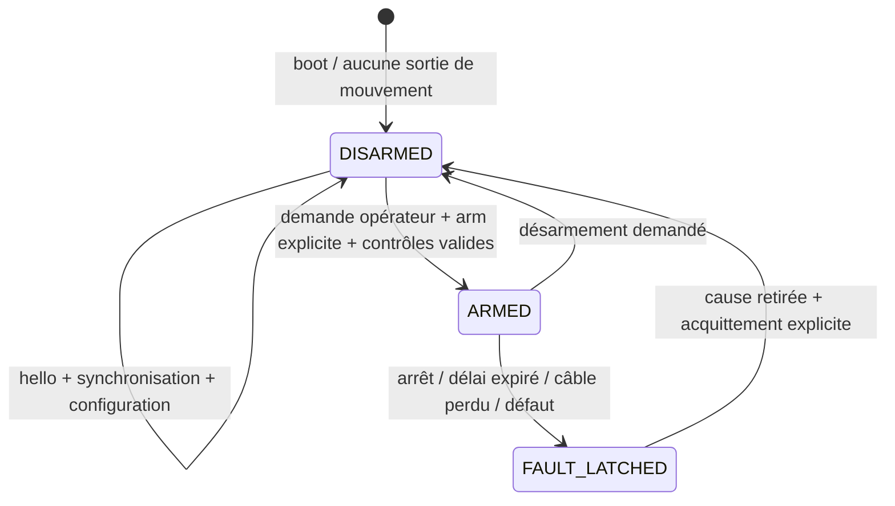

[Français](contrat_esp_pi.md) · **English**

<a id="contrat-usb-esppi-proposé--version-1"></a>
# Proposed ESP–Pi USB Contract — version 1

**Specification to implement**, not an existing firmware. Selected ESP: XIAO ESP32C5. Native USB Serial/JTAG from XIAO to Pi; separate GPS UART on D6/D7, configured as application UART without logs. No physical micro-ROS is assumed to be already available. The repository's service protocol remains a different network contract.

<a id="trames-et-temps"></a>
## Frames and timing

- Compact UTF-8 JSON, one frame terminated by `\n`, proposed maximum length **2048 bytes**, bounded buffer; overflow = discard until next `\n`, diagnostic, never block the stop loop.
- Finite numbers only; forbid `NaN`, infinities, duplicate keys, and unexpected fields. A partial/malformed command does not renew any authorization or any watchdog. No images or lidar on this link.
- Common envelope: `v:1`, `type`, `boot_id`, `session_id`, `seq` integer increasing by sender, `t_us` monotone 64 bits, `data`. `boot_id` changes at each ESP restart; `session_id` is chosen at each new link by the Pi and acknowledged by the ESP. IDs are bounded strings, not constants copied from examples.
- `t_us` of measurements = acquisition instant in the ESP clock, not transmission/reception instant. Never present this value as a UTC date. The Pi also keeps reception time, synchronization uncertainty, and translated ROS timestamp. Detection of a reboot = invalidate time, odometry, and previous session.
- Proposed synchronization: Pi request with t1; ESP response with t1, t2 reception and t3 transmission; Pi records t4. Estimate ESP−Pi offset = `((t2-t1)+(t3-t4))/2` and RTT = `(t4-t1)-(t3-t2)`. Keep an uncertainty bound, monitor drift, and reject arming if time is not sufficiently reliable. Clocks use the same µs unit for this operation; UTC GNSS/PPS optional is not required.

<a id="session-et-commandes"></a>
## Session and commands



`hello` ESP announces boot_id, firmware/protocol version, state, actual capabilities, available sensors, and calibration profile hash. Initial state DISARMED. Initial configuration: **`motion_enabled=false`**, as long as controller, geometry, and stop are not validated. `arm` refers to the current session/boot/profile, with zero speed setpoint; ADC menu command alone is insufficient to authorize movement. Release of hardware stop or return of the network never automatically rearms.

`cmd` contains `speed_m_s`, `steering_rad` (virtual steering of the central front wheel), `expires_esp_us`, `profile_id`. Positive speed forward, negative in reverse; positive steering to the left. The allowed range comes from the **measured profile**, not the simulated model. The wheel angle → servo pulse conversion is a dedicated calibration, not the same value as a rudder angle.

The deadline is expressed in the ESP monotonic clock after synchronization: do not start a new duration simply upon receiving an old command. The Pi deduces the deadline from the creation instant of the local setpoint and its remaining duration; a dated/old remote network command is rejected before this calculation, never rejuvenated. The ESP rejects a command from another session/boot/profile, non-increasing sequence, past or too distant deadline. Subtract synchronization uncertainty from the usable duration. Proposed tightening: TTL 250 ms, maximum 500 ms; target command rate 20 Hz, all values **to be tested**.

Independent monotonic watchdog from USB reception and menu: after **500 ms maximum without new valid movement command**, or as soon as the last setpoint expires, switch to stop/fault. A frame `hello`, `sync`, telemetry, sequence repetition, or rejected command does not extend the setpoint. A proposed control task at 100 Hz implies a TTL software detection target + 10 ms, to be measured. The physical braking delay remains unknown.

`stop`/`disarm` never requests arming to be applied. A syntactically valid `stop` may request disarm even if its session has expired; it cannot activate movement. `ack` returns the concerned sequence, accepted/rejected status, and reason; the acknowledgment means reception/acceptance, never position reached or braking guaranteed.

USB loss, hardware stop, reboot, command profile error, or expiration: remove traction authorization via the validated interface and lock the state. PWM servo at boot without pulses; behavior after fault to be defined with the servo/mechanics (do not force centering during taxiing). A still-unknown controller interface cannot be described as a validated stop. The wired cut-off chain remains independent.

Example **documentary**, fictitious session and deadline; do not send directly to the robot:

```json
{"v":1,"type":"cmd","boot_id":"example-boot","session_id":"example-session","seq":12,"t_us":1000000,"data":{"speed_m_s":0.0,"steering_rad":0.0,"expires_esp_us":1250000,"profile_id":"bench-no-motion"}}
```

<a id="mesures-et-capacités"></a>
## Measurements and capabilities

| Type | Data / units | Reference and missing values |
| --- | --- | --- |
| `imu` | `gyro_rad_s[3]`, `accel_m_s2[3]`, `t_sample_us`, quality/calibration, covariances if estimated | `imu_link`, module axes measured and transformed; specific acceleration, gravity visible at rest. `orientation=null` if not estimated; `heading_absolute=false` for MPU6050 only |
| `baro` | pressure Pa, temperature °C if available, relative altitude m optional | Pressure/temperature reference specified; no absolute map height derived without model/calibration |
| `gnss` | lat/lon WGS84 degrees, MSL altitude m and geoid separation m if present, satellites, fix, HDOP, known covariance or `null` | Antenna `gnss_link`; ellipsoidal altitude = MSL + separation only if both are provided. Without fix, position `null`, never (0,0). No RTK announced for ATGM336H |
| `encoders` | signed integer counts and period µs; present channels only | Effective pulses/turn (and quadrature factor), direction, and radius in the real profile; without returns, no invented odometry |
| `buttons` | button name, press/release after debouncing, calibrated ADC if useful | Multiple presses/ADC outside windows = invalid; menu only |
| `status` | DISARMED/ARMED/FAULT_LATCHED, reason, chain state, command age, resets, losses, available sensors, `motion_enabled` | Setpoints applied separately from measurements; battery/current/SoC `null` if not acquired; measured servo angle `null` without return |

Proposed rates: IMU 50 Hz, baro 5 Hz, state 10 Hz, event-driven buttons. GNSS at its measured rate, without imposing simulated 10 Hz RTK. Encoders to be sized after real frequency. These targets are not measurements. If the bandwidth saturates, reduce telemetry or report losses; commands and watchdog remain prioritized.

The Pi creates a new profile upon MCU change, geometry, servo/controller, or calibration. Wheelbase, real radius, IMU direction, speed/angle limits, neutral, and PWM ranges, feedback gain, and stop strategy are mandatory before `motion_enabled=true`. ADC buttons require their measured centers/windows; no traction limits from simulation are automatically reused.
