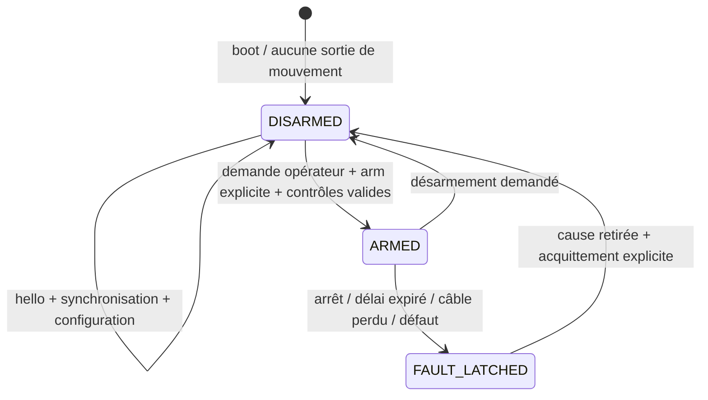

# Contrat USB ESP–Pi proposé — version 1

**Spécification à implémenter**, pas un firmware existant. ESP retenu : XIAO ESP32C5. USB natif Serial/JTAG du XIAO vers le Pi ; UART GPS séparé sur D6/D7, configuré comme UART applicatif sans logs. Aucun micro-ROS physique n'est supposé déjà disponible. Le protocole des services du dépôt reste un contrat réseau différent.

## Trames et temps

- JSON UTF-8 compact, une trame terminée par `\n`, longueur maximale proposée **2048 octets**, tampon borné ; dépassement = jeter jusqu'au prochain `\n`, diagnostic, jamais bloquer la boucle d'arrêt.
- Nombres finis uniquement ; interdire `NaN`, infinities, clés dupliquées et champs inattendus. Une commande partielle/malformée ne renouvelle aucune autorisation ni aucun watchdog. Pas d'images ni de lidar sur cette liaison.
- Enveloppe commune : `v:1`, `type`, `boot_id`, `session_id`, `seq` entier croissant par émetteur, `t_us` monotone 64 bits, `data`. `boot_id` change à chaque redémarrage ESP ; `session_id` est choisi à chaque nouvelle liaison par le Pi et acquitté par l'ESP. Les IDs sont des chaînes bornées, pas des constantes copiées depuis des exemples.
- `t_us` des mesures = instant d'acquisition dans l'horloge ESP, pas instant d'émission/réception. Jamais présenter cette valeur comme une date UTC. Le Pi conserve aussi heure de réception, incertitude de synchronisation et timestamp ROS traduit. Détection d'un reboot = invalider temps, odométrie et session précédente.
- Synchronisation proposée : requête Pi avec t1 ; réponse ESP avec t1, t2 réception et t3 émission ; Pi relève t4. Estimer offset ESP−Pi = `((t2-t1)+(t3-t4))/2` et RTT = `(t4-t1)-(t3-t2)`. Conserver une borne d'incertitude, surveiller dérive et rejeter l'armement si le temps n'est pas suffisamment fiable. Les horloges utilisent la même unité µs pour cette opération ; UTC GNSS/PPS facultatif n'est pas requis.

## Session et commandes



`hello` ESP annonce boot_id, version firmware/protocole, état, capacités réellement présentes, capteurs disponibles et hash du profil de calibration. Premier état DISARMED. Configuration initiale : **`motion_enabled=false`**, tant que contrôleur, géométrie et arrêt ne sont pas validés. `arm` se réfère à la session/boot/profil courants, avec consigne vitesse nulle ; commande de menu ADC seule insuffisante pour autoriser le mouvement. Le relâchement de l'arrêt matériel ou le retour du réseau ne réarme jamais automatiquement.

`cmd` contient `speed_m_s`, `steering_rad` (braquage virtuel de la roue avant centrale), `expires_esp_us`, `profile_id`. Vitesse positive vers l'avant, négative en marche arrière ; braquage positif vers la gauche. La plage autorisée vient du **profil mesuré**, pas du modèle simulé. La conversion angle de roue → impulsion servo est une calibration dédiée, pas la même valeur qu'un angle de palonnier.

L'échéance est exprimée dans l'horloge monotone ESP après synchronisation : ne pas commencer une nouvelle durée simplement à réception d'une vieille commande. Le Pi déduit l'échéance de l'instant de création de la consigne locale et de sa durée restante ; une commande réseau distante datée/ancienne est rejetée avant ce calcul, jamais rajeunie. L'ESP rejette une commande d'une autre session/boot/profil, séquence non croissante, échéance passée ou trop lointaine. Soustraire l'incertitude de synchronisation à la durée utilisable. Resserrement proposé : TTL 250 ms, maximum 500 ms ; cadence commande cible 20 Hz, toutes valeurs **à tester**.

Watchdog monotone indépendant de la réception USB et du menu : après **500 ms maximum sans nouvelle commande de mouvement valide**, ou dès échéance de la dernière consigne, passer en arrêt/défaut. Une trame `hello`, `sync`, télémétrie, répétition de séquence ou commande rejetée ne prolonge pas la consigne. Une tâche de contrôle proposée à 100 Hz implique une cible de détection logicielle TTL + 10 ms, à mesurer. Le délai de freinage physique reste inconnu.

`stop`/`disarm` ne demande jamais d'armement pour être appliqué. Un `stop` syntaxiquement valide peut demander l'arrêt même si sa session est périmée ; il ne peut pas activer un mouvement. `ack` renvoie séquence concernée, accepté/rejeté et raison ; l'accusé signifie réception/acceptation, jamais position atteinte ou freinage garanti.

Perte USB, arrêt matériel, reboot, erreur du profil de commande ou expiration : retirer autorisation traction par l'interface validée et verrouiller l'état. PWM servo au boot sans impulsions ; comportement après défaut à définir avec le servo/mécanique (ne pas forcer le centrage en roulage). Une interface de contrôleur encore inconnue ne peut pas être décrite comme un arrêt validé. La chaîne câblée de coupure reste indépendante.

Exemple **documentaire**, session fictive et échéance fictive ; ne pas envoyer directement au robot :

```json
{"v":1,"type":"cmd","boot_id":"example-boot","session_id":"example-session","seq":12,"t_us":1000000,"data":{"speed_m_s":0.0,"steering_rad":0.0,"expires_esp_us":1250000,"profile_id":"bench-no-motion"}}
```

## Mesures et capacités

| Type | Données / unités | Repère et valeurs absentes |
| --- | --- | --- |
| `imu` | `gyro_rad_s[3]`, `accel_m_s2[3]`, `t_sample_us`, qualité/calibration, covariances si estimées | `imu_link`, axes du module relevés et transformés ; accélération spécifique, gravité visible au repos. `orientation=null` si non estimée ; `heading_absolute=false` pour MPU6050 seul |
| `baro` | pression Pa, température °C si disponible, altitude relative m facultative | Référence pression/température explicitée ; pas de hauteur map absolue déduite sans modèle/calibration |
| `gnss` | lat/lon degrés WGS84, altitude MSL m et séparation géoïde m si présentes, satellites, fix, HDOP, covariance connue ou `null` | Antenne `gnss_link` ; altitude ellipsoïdale = MSL + séparation seulement si les deux sont fournies. Sans fix, position `null`, jamais (0,0). Pas de RTK annoncé pour ATGM336H |
| `encoders` | comptes signés entiers et période µs ; voies présentes seulement | Impulsions/tour effectives (et facteur quadrature), sens et rayon dans le profil réel ; sans retours, pas d'odométrie inventée |
| `buttons` | nom du bouton, press/release après anti-rebond, ADC calibré si utile | Appuis multiples/ADC hors fenêtres = invalid ; menu seulement |
| `status` | DISARMED/ARMED/FAULT_LATCHED, motif, état chaîne, âge commande, resets, pertes, capteurs disponibles, `motion_enabled` | Consignes appliquées séparées de mesures ; batterie/courant/SoC `null` si non acquis ; angle servo mesuré `null` sans retour |

Cadences proposées : IMU 50 Hz, baro 5 Hz, état 10 Hz, boutons événementiel. GNSS à sa cadence mesurée, sans lui imposer les 10 Hz RTK simulés. Encodeurs à dimensionner après fréquence réelle. Ces cibles ne sont pas des mesures. Si le débit sature, réduire télémétrie ou signaler pertes ; commandes et watchdog restent prioritaires.

Le Pi crée un nouveau profil au changement de MCU, géométrie, servo/contrôleur ou calibration. Empattement, rayon réel, sens de l'IMU, limites de vitesse/angle, neutre et plages PWM, gain des retours et stratégie d'arrêt sont obligatoires avant `motion_enabled=true`. Les boutons ADC exigent leurs centres/fenêtres mesurés ; aucune limite de traction issue de la simulation n'est reprise automatiquement.
