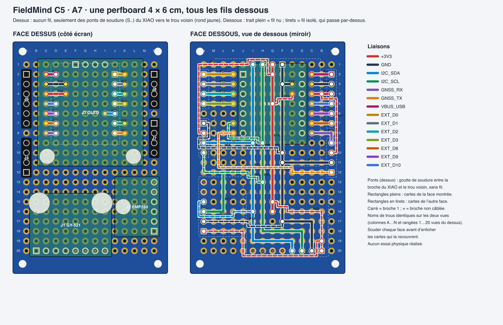

[Français](perfboard_une_plaque_c5_a7.md) · **English**

# FieldMind — XIAO ESP32C5 and sensors on a perfboard 4 × 6 cm, all wires underneath (revision A7)

**A7 is the current revision.** It builds on A6: same connections, no resistors or capacitors, and all XIAO pins accessible. The wiring has been redone so that **no wires are on the screen side**. A0 to A6 are retained. Nothing was purchased.

[KiCad project 10](cad/perfboard_c5_a7/fieldmind_c5_a7.kicad_pro) · [Interactive guide](exports/c5_a7/guide_cablage.html) · [Pinout, no wires](exports/c5_a7/plan_broches.html) · [Connections by component](connexions_c5_a7.csv) · [Wire list](fils_c5_a7.csv) · [Hole usage](occupation_trous_c5_a7.csv) · Validation (working reference not included)

## Principle

| Side | What is on it |
| --- | --- |
| **Top (screen side)** | The screen, the GY-521 and the BMP280 on their holders, as well as headers J4 (GPS), J6 and J8 (expansions) and J7 (Knob) at the edge. **No wires**: only 14 visible solder bridges |
| **Bottom** | The XIAO on its holders (USB-C at the top edge) and **all wires** |

- **Solder bridges**: under its holder, the XIAO hides its pads on the bottom side; its pins are only soldered on the screen side. Each pin is connected **to the adjacent hole by a drop of solder**, without a wire. The wire then leaves from this hole, on the bottom side. GND and 3V3 pins are bridged on both sides (3 pads). On a non-plated board, pass the wire end through this hole up to the bridge.
- **Common lines**: four bare wire rails (GND, 3V3, SCL, SDA) descend from the screen pins, between the two XIAO holders. At the bottom, SDA, SCL and GND turn in an L-shape towards the GY-521. Other boards connect to them via short wires.
- **Aligned expansions**: J6 (left edge) faces the XIAO pins 5V, GND, 3V3, D10, D9, D8, and J8 (right edge) faces D0, D1, D2, D3. Each of these connections is a straight bare wire on a row.
- **30 wires** (19 bare, 11 insulated, 607 mm total), **16 crossings**. One insulated wire passes over another, always at a right angle and between two pads. At most one wire end per hole.

## Connections by component

Holes named in top view (columns A to N, rows 1 to 20). For a component placed on top, the hole is soldered on the bottom.

| Component | Pin → hole | Connected to |
| --- | --- | --- |
| **OLED Screen (J3)** | 1 GND → F1 · 2 VCC → G1 · 3 SCL → H1 · 4 SDA → I1 | GND, 3V3, SCL, SDA common |
| **GY-521 (J1)** | 1 VCC → B20 · 2 GND → C20 · 3 SCL → D20 · 4 SDA → E20 | same; XDA, XCL, AD0, INT (F20 to I20) not wired |
| **BMP280 (J2)** | 1 VCC → N18 · 2 GND → N17 · 3 SCL → N16 · 4 SDA → N15 | same; CSB (N14), SDO (N13) not wired |
| **Modulino Knob (J7)** | 1 GND → N7 · 2 3V3 → N8 · 3 SDA → N9 · 4 SCL → N10 | same (connector order 1×4 of the Knob) |
| **GPS (J4)** | 1 RX_GPS → A12 · 2 GND → A11 · 3 VCC → A10 · 4 TX_GPS → A9 | RX_GPS ← D6 from XIAO, TX_GPS → D7 from XIAO |
| **Extension J6** | 1 5V → A2 · 2 GND → A3 · 3 3V3 → A4 · 4 D10 → A5 · 5 D9 → A6 · 6 D8 → A7 | XIAO pin with the same name |
| **Extension J8** | 1 D0 → N2 · 2 D1 → N3 · 3 D2 → N4 · 4 D3 → N5 | XIAO pin with the same name |

| XIAO (U1, bottom side) | Hole | Bridge to | Role |
| --- | --- | --- | --- |
| D0, D1, D2, D3 | J2, J3, J4, J5 | K2, K3, K4, K5 | J8.1 to J8.4 |
| D4 / GPIO23 | J6 | I6 (SDA rail) | SDA |
| D5 / GPIO24 | J7 | K7 | SCL |
| D6 / GPIO11 | J8 | K8 | TX ESP → RX GPS (J4.1) |
| D7 / GPIO12 | D8 | C8 | RX ESP ← TX GPS (J4.4) |
| D8, D9, D10 | D7, D6, D5 | C7, C6, C5 | J6.6, J6.5, J6.4 |
| 3V3 | D4 | C4 and E4 | J6.3 and 3V3 rail |
| GND | D3 | C3 and E3 | J6.2 and GND rail |
| 5V | D2 | C2 | J6.1 |

The complete table, pin by pin with all connected pins, is in `connexions_c5_a7.csv` and at the beginning of the interactive guide.

## Assembly

1. Top side: solder the holders for the three boards and the J4, J6, J7 and J8 headers, as well as the **14 bridges** of the XIAO, after soldering its holders on the bottom side.
2. Bottom side: first place the 4 rails and bare wires, then the insulated wires on top.
3. Check net continuity one by one, and the absence of short circuits between 5V, 3V3 and GND, with cards unplugged.
4. Plug in the cards.

**Space requirement**: approximately 11 mm of cards on each side. The Dupont connectors for J4, J6, J7 and J8 plug in from the top, at the edge. Use spacers of at least 14 mm under the board (XIAO and wires), 18 mm for safety.

## Before soldering

- The dimensions and pin order of the cards, by placing them on the board. The gap between the GY-521 and the BMP280 (approximately 0,8 mm) and that between the BMP280 and a spacer of the GY-521 (approximately 0,5 mm) are small.
- The CSB/SDO (BMP280) and AD0 (GY-521) pull-ups, with an ohmmeter.
- The GNSS power supply, before connecting the VCC of J4.
- The Knob address, by an I2C scan (expected 0x3A, 0x3C, 0x68, 0x76).
- Signals at a maximum of 3,3 V. The 5V from J6.1 comes from USB: for a sensor, never for a servo.

**Status: plan checked in KiCad, not physically tested, not manufactured.**
