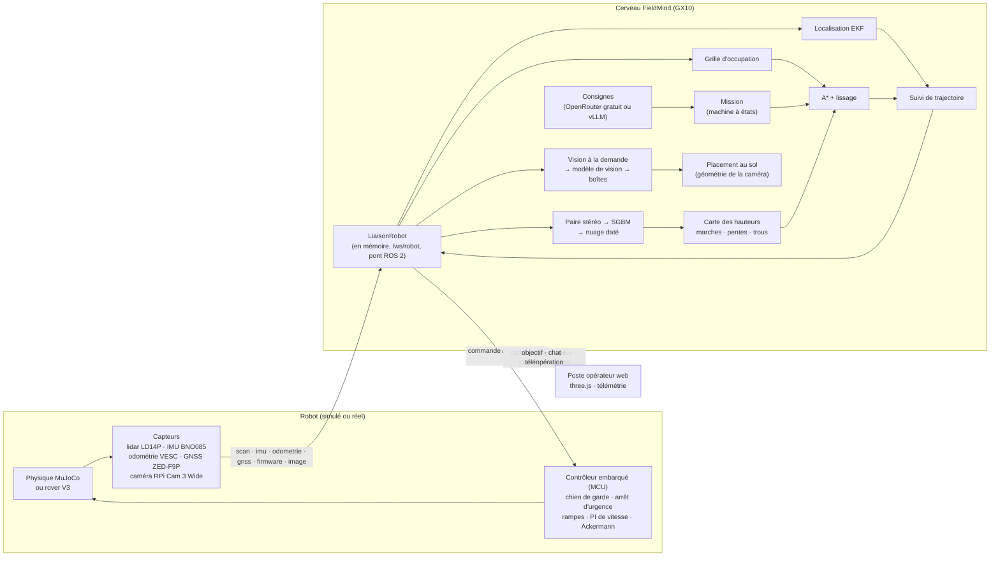

[Français](ARCHITECTURE_demo_web.md) · **English**

# Autonomous Navigation Demo Architecture

Written on 29 September 2026, based on the brief (working reference not included) and Hugo's instructions: **the same algorithm must run on the real rover, with a true physical simulation**, and all sensor data must be visible in real time. Completed on 30 September with vision (front camera, free vision model), then on October 1st with **stereo perception**: low obstacles are seen locally by a pair of cameras; the vision model is only used to describe the scene on demand. Terrain relief (hills, undulations) in the simulation.

## Overview

## The three layers, and what separates them

| Layer | Code | Role | On the real rover |
|---|---|---|---|
| **Brain** | `services/` | Localization, map, path, tracking, mission, commands | The same code, on the GX10 |
| **Onboard Controller** | `simulation/firmware.py` | Protections and regulation, independent of the brain | MCU firmware (to be written in C++ based on this model) |
| **World and Sensors** | `simulation/` | Physics, forest, noisy sensors | The real world, ROS 2 drivers |

Rules, verified by tests:

1. **The brain never imports the simulator** (`tests/test_architecture.py`). It only sees the `LiaisonRobot`: `SimulationTempsReel` in demo, `LiaisonRobotDistante` for a robot connected on `/ws/robot`, and the ROS bridge 2 (`ros2/packages/fieldmind_pont`) on the rover.
2. **The brain knows the world only through its sensors**: no trees, no rocks, no exact pose. It only knows named locations and zone boundaries (what an operator would mark on a map).
3. **The brain is driven by message timestamps** and never by the wall clock. It therefore runs identically in real time, accelerated on the test bench, or on the rover.
4. **AI proposes, code decides**: the language model returns a JSON intention; the code validates it (known location, point within the zone, reasonable distance) and composes the response itself. The vision model returns boxes in the image; the code places them on the ground and decides alone what goes into the map.
6. **Free models only**: with OpenRouter, each request caps the price at zero, and the server refuses a paid model or one absent from the public catalog at startup.
5. **The onboard controller protects the rover** without the brain: watchdog (0,5 s without command → braking), emergency stop when the free space in front (or behind) is less than the braking distance plus 40 cm, acceleration ramps, limited steering at speed.

## Protocol

SI units; ground reference frame x towards east, y towards north, trigonometric heading. Strict Pydantic messages (`services/protocole/messages.py`), JSON over WebSocket.

| Message | Direction | Frequency | ROS 2 Equivalent |
|---|---|---|---|
| `scan` | robot → brain | 6 Hz | `sensor_msgs/LaserScan` |
| `imu` | robot → brain | 50 Hz | `sensor_msgs/Imu` |
| `odometrie` | robot → brain | 50 Hz | `nav_msgs/Odometry` (VESC), servo steering |
| `gnss` | robot → brain | 10 Hz, 50 ms latency | `sensor_msgs/NavSatFix`, converted to local frame |
| `firmware` | robot → brain | 10 Hz | `diagnostic_msgs/DiagnosticStatus` |
| `image` | robot → brain | 2 Hz (JPEG 640 × 360) | `sensor_msgs/CompressedImage` |
| `commande` | brain → robot | 25 Hz | `ackermann_msgs/AckermannDriveStamped` |

To the operator station: `bienvenue`, `pose_estimee`, `carte` (modified rectangles, zlib), `chemin`, `statut`, `journal`, `mesures`, `chat_reponse`, `vision` (analysis result, with the analyzed image and vision layer), `etat_vision`, raw sensor telemetry, and, in simulation only, `vue` (ground truth for 3D display and localization error measurement; never sent to the brain).

## Brain

| Module | Method | Metrics (test bench, 3 forests) |
|---|---|---|
| Localization | EKF (x, y, heading, gyroscope bias): odometry + gyroscope, GNSS RTK with lever arm, latency compensated by replay, χ² rejection, weakly weighted magnetic heading | average error 1,7 cm, p95 4 cm, heading 1° |
| Mapping | Log-odds grid 0,10 m, vectorized ray casting, weights based on pose uncertainty | 93 % of obstacles within 20 cm of a real surface |
| Path Planning | Cost map 0,20 m (expansion 0,50 m, proximity and unknown penalties), compiled A* (numba), lossless smoothing | 8 ms on average, 28 ms max |
| Tracking | Pure pursuit on the rear axle; speed limited by curvature, arrival, and measured free space; U-turn when the target is behind | — |
| Mission | States `attente`, `calcul`, `route`, `bloque`, `atteint`, `echec`, `manuel`; new calculations at most at 2 Hz with hysteresis; three-step U-turn; reverse clearance; motivated abandonment | 30 random objectives on 30, no collisions, minimal real clearance 5 cm |
| Commands | Free model from OpenRouter (tried backups one after another) or OpenAI-compatible API (vLLM on the GX10), or Claude; without a model response, the command is not executed; path and map loop chained by the brain; quotas | — |
| Stereo Perception | SGBM (OpenCV) on the rectified pair, dated point cloud at capture time (EKF pose, roll and pitch, GNSS altitude), height map at 0,10 m: steps beyond 15 cm (+ 2σ noise at distance), slopes beyond 22°, holes behind occlusion edges; obstacle only if within 4 m and confirmed on two images; lidar echoes placed on the seen ground ignored | 3 forests × 6 objectives without AI model: 18 on 18, 0 collision, min clearance 19 cm; 8 to 14 ms per pair on the VPS |
| Vision | Images chosen by the brain (operator request, or vigilance: one every 4 s during mission, speed limited to 0,6 m/s); model boxes placed on the ground; vision layer fused with the cost map | 30 objectives on 30 and no collisions with fallen trunks; without vision, 25 collisions. Real free model: 7 trunks on 7, 0 false alert, 7 cm ground error, 6 s |

Load: 6 to 7 % of one core for the brain, 4 % for physics, 18 % for camera rendering (separate thread), per session.

## Stereo perception

The lidar measures in a plane at 0,32 m from the ground: a fallen trunk of 25 cm passes underneath, and on an incline the beam hits the ground. The **stereo module** (2 × OV9732 synchronized, baseline of 60 mm, 90°, 640 × 360 processed at 2 fps) sees both:

1. **Depth** (`services/perception/stereo.py`) : SGBM 5 × 5, left-right and uniqueness checks; pixels whose disparity varies too much in their neighborhood (object edges, where the block mixes the object and the background) are discarded. Z = f·B/d: 1 cm error at 1 m, 6 cm at 3 m.
2. **Timed point cloud** : each point is transformed into the world frame using the EKF pose, the IMU roll and pitch, and the altitude (GNSS RTK fused with integrated altitude) at the time of capture, not at message arrival.
3. **Height map** (`services/perception/elevation.py`, adapted from the ROS stack 2) : per 10 cm cell, the ground (2nd lowest value) and the top (2nd highest under 1,2 m) of the closest view. Works if the top exceeds the neighboring ground by 15 cm + 2σ of noise at that distance; slope if more than 22°; hole behind an occlusion edge (ground then much more distant surface in the image). Obstacle only within 4 m, confirmed over two images, never for an isolated cell.
4. **Usage** : these obstacles enter the cost map like lidar ones and limit speed when ahead; a lidar echo resting on ground seen bare by the camera is an incline, not a wall.

## Vision (on demand)

The lidar measures in a plane at 0,32 m from the ground: a **fallen trunk** 25 cm high passes underneath, and the onboard controller does not see it either. The front camera (Raspberry Pi Camera Module 3 Wide, position and tilt of −10° read in the Blender rig) sees it.

1. **Image selection** (brain) : on demand (“what do you see?”, *Analyze view* button), or in **vigilance** mode during a mission (speed limited to 0,6 m/s: the free model responds in about 6 s). Only one analysis at a time; the estimated pose at the time of capture accompanies the image.
2. **Analysis** (model) : category, bounding box (in pixels, converted by code), passable or not, confidence, short summary. JSON output validated object by object; a malformed object is discarded alone.
3. **Ground placement** (`services/perception/camera.py`) : the bottom of the box (contact with the ground) is projected onto the flat ground using the camera pinhole model; the footprint extends 40 cm beyond (trunk thickness). The camera is 27 cm from the ground: the lower half of the image covers 1,5 m, an error of one pixel near the horizon amounts to meters, and the top of a low object is always near the horizon (it provides no depth information). Uncertainty is calculated and published (0,4 m at 2 m, 2 m at 4 m).
4. **Vision layer** (`services/perception/observations.py`) : only low obstacles (fallen trunk, branch, hole, water) that are certain and within 12 m enter it; trees and rocks remain in the lidar, which is more precise. Views accumulate: a diagonal trunk is covered over successive views taken while approaching, each showing its nearest edge. Separate layer from the lidar grid, whose rays pass above the trunk and would erase it. Safeguards: a detection under the rover is discarded; a false or misplaced view is removed by **negative proof** (three analyses where its area is clearly visible, between 1 and 5 m, not masked by a lidar obstacle, with nothing re-detected there). A rover stuck to a late-discovered obstacle backs up instead of giving up.
5. **Proofs** : each analysis is kept (JPEG image + JSON result) in `logs/preuves/`.

Providers: a **free** model from OpenRouter (default `stealth/space-bunny-alpha`, multimodal, short reflection; fallback free models), vLLM on the GX10 (offline), or the **perfect simulation detector** (`simulation/vision_oracle.py`): exact bounding boxes drawn from ground truth, including occlusions, for testing, evaluation, and demo without a key. It is displayed as such at the operator station.

## Physical simulation

- **MuJoCo 3.14** (including ARM64): rigid chassis of 15 kg on four wheels; Ackermann steering via two position-controlled thrusters; rigid rear axle driven by belt 3:1 (sliding during turns, as on the real rover); Coulomb tire friction.
- **Sensors**: LD14P lidar launched from the chassis (360 beams, 1 cm noise, 1 % loss rate, it tilts with the rover), IMU (noise, gyroscope bias, slow magnetic sensor drift), quantized encoders (2048 pulses per revolution), degraded GNSS RTK under canopy (fixed, floating, DGNSS), 10S battery.
- **Forest**: generated by seed around the trailer track (`PATH_CTRL`), 400 trunks, 16 rocks as convex prisms (seen by the lidar at their true width), a physical edge of 10 m, and 10 **fallen trunks** (2 across the track, 8 in the undergrowth), lower than the lidar plane.
- **Camera**: MuJoCo off-screen rendering (OSMesa, no GPU) in a dedicated thread that releases the GIL, 2 JPEG images/s, 90 ms per image; textured ground (grass, undergrowth, track, clearing), conifer canopies (visual, ignored by lidar and physics), sky and fog.
- Deviations from theory are part of the test: the actual turning radius exceeds the geometric radius by 20 to 25 % (rigid axle), and the closed-loop brain absorbs them.

## Operator station

three.js 0.186 copied into the repository (no external resources, strict CSP). The displayed rover is the **real V3 firefighter model**, exported from the Blender rig (`outils/blender/exporter_rover_glb.py`, 110 000 triangles, 623 Ko in meshopt) and animated by physics: rotation of each wheel, angle of each thruster, servo horn and connecting rods. Live telemetry (curves with crosshair and tooltip, polar view lidar, onboard camera) on the colorblind-validated palette. **Vision** tab: last analyzed image with boxes, objects placed on the ground (distance ± uncertainty, confidence), commands and quota. The camera thumbnail optionally shows the image actually transmitted to the brain or the same view rendered by the station. Vision layer obstacles appear on the map and in the 3D scene.

## Assumed deviations from the brief

| Brief | Implemented | Why |
|---|---|---|
| Geometric simulator in the browser | MuJoCo physics on the server, browser as simple operator station | Hugo's request: true physical simulation, same algorithm as on the robot |
| Local control (pure pursuit) in the browser | Pure pursuit in the brain; protections in the simulated firmware | On the rover, tracking runs on the GX10 and protections on the MCU |
| Pose provided by simulation | Pose estimated by the EKF from sensors | The real rover has no perfect pose |
| 0,42 m inflation | 0,50 m | 0,42 m does not cover the rover's corners (0,44 m from center): 0,7 cm margin measured in one case |
| Emergency stop at 0,40 m | 0,40 m + braking distance + distance traveled since scan | At 1,5 m/s, 0,40 m fixed led to collision (verified in simulation) |
| 60 × 60 m zone | 60 × 66 m | Reuse the trailer track identically |
| 300 output tokens | 1024 | Recent models reflect before answering; 300 would truncate the response |
| Claude for chat | Free model on OpenRouter by default (Claude remains an option) | Hugo's request: free models only |
| Work on `main` | Branch `claude/beautiful-brahmagupta-4xtv2s` | Session constraint; merge via pull request |
