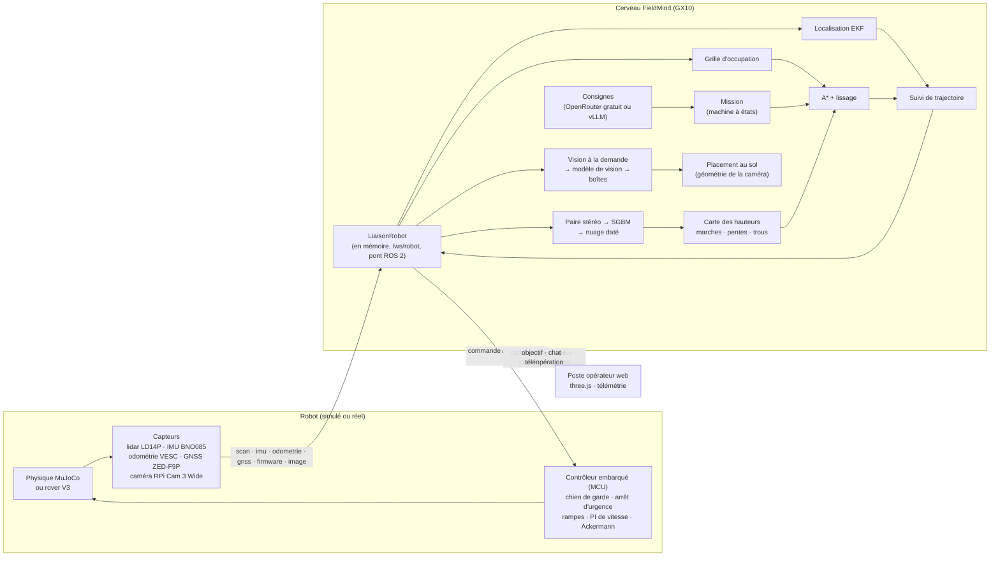

# Architecture de la démo de navigation autonome

Rédigé le 29 septembre 2026, à partir du brief (référence de travail non incluse) et de la consigne de Hugo :
**le même algorithme doit tourner sur le rover réel, avec une vraie simulation physique**, et toutes
les données des capteurs doivent être visibles en direct. Complété le 30 septembre par la vision
(caméra avant, modèle de vision gratuit), puis le 1er octobre par la **perception stéréo** : les
obstacles bas sont vus en local par une paire de caméras ; le modèle de vision ne sert plus qu'à
décrire la scène à la demande. Relief du terrain (butte, ondulations) dans la simulation.

## Vue d'ensemble

## Les trois couches, et ce qui les sépare

| Couche | Code | Rôle | Sur le rover réel |
|---|---|---|---|
| **Cerveau** | `services/` | Localisation, carte, chemin, suivi, mission, consignes | Le même code, sur le GX10 |
| **Contrôleur embarqué** | `simulation/firmware.py` | Protections et régulation, indépendantes du cerveau | Firmware du MCU (à écrire en C++ d'après ce modèle) |
| **Monde et capteurs** | `simulation/` | Physique, forêt, capteurs bruités | Le monde réel, les pilotes ROS 2 |

Règles, vérifiées par des tests :

1. **Le cerveau n'importe jamais le simulateur** (`tests/test_architecture.py`). Il ne voit que la
   `LiaisonRobot` : `SimulationTempsReel` en démo, `LiaisonRobotDistante` pour un robot connecté
   sur `/ws/robot`, et le pont ROS 2 (`ros2/packages/fieldmind_pont`) sur le rover.
2. **Le cerveau ne connaît le monde que par ses capteurs** : ni arbres, ni rochers, ni pose
   exacte. Il connaît seulement les lieux nommés et les limites de la zone (ce qu'un opérateur
   marquerait sur une carte).
3. **Le cerveau est piloté par l'horodatage des messages** et jamais par l'horloge murale. Il
   tourne donc à l'identique en temps réel, en accéléré sur le banc d'essai, ou sur le rover.
4. **L'IA propose, le code décide** : le modèle de langage renvoie une intention JSON ; le code la
   valide (lieu connu, point dans la zone, distance raisonnable) et compose lui-même la réponse.
   Le modèle de vision renvoie des boîtes dans l'image ; le code les place au sol et décide seul de
   ce qui entre dans la carte.
6. **Modèles gratuits seulement** : avec OpenRouter, chaque requête plafonne le prix à zéro et le
   serveur refuse au démarrage un modèle payant ou absent du catalogue public.
5. **Le contrôleur embarqué protège le rover** sans le cerveau : chien de garde (0,5 s sans
   consigne → freinage), arrêt d'urgence quand l'espace libre devant (ou derrière) est inférieur à
   la distance de freinage plus 40 cm, rampes d'accélération, braquage limité en vitesse.

## Protocole

Unités SI ; repère au sol x vers l'est, y vers le nord, cap trigonométrique. Messages Pydantic
stricts (`services/protocole/messages.py`), JSON sur WebSocket.

| Message | Sens | Fréquence | Équivalent ROS 2 |
|---|---|---|---|
| `scan` | robot → cerveau | 6 Hz | `sensor_msgs/LaserScan` |
| `imu` | robot → cerveau | 50 Hz | `sensor_msgs/Imu` |
| `odometrie` | robot → cerveau | 50 Hz | `nav_msgs/Odometry` (VESC), braquage du servo |
| `gnss` | robot → cerveau | 10 Hz, 50 ms de latence | `sensor_msgs/NavSatFix`, converti en repère local |
| `firmware` | robot → cerveau | 10 Hz | `diagnostic_msgs/DiagnosticStatus` |
| `image` | robot → cerveau | 2 Hz (JPEG 640 × 360) | `sensor_msgs/CompressedImage` |
| `commande` | cerveau → robot | 25 Hz | `ackermann_msgs/AckermannDriveStamped` |

Vers le poste opérateur : `bienvenue`, `pose_estimee`, `carte` (rectangles modifiés, zlib),
`chemin`, `statut`, `journal`, `mesures`, `chat_reponse`, `vision` (résultat d'analyse, avec
l'image analysée et la couche vision), `etat_vision`, la télémétrie brute des capteurs et, en
simulation seulement, `vue` (vérité terrain pour l'affichage 3D et la mesure de l'erreur de
localisation ; jamais transmise au cerveau).

## Cerveau

| Brique | Méthode | Mesures (banc d'essai, 3 forêts) |
|---|---|---|
| Localisation | EKF (x, y, cap, biais du gyroscope) : odométrie + gyroscope, GNSS RTK avec bras de levier, latence compensée par rejeu, rejet χ², cap magnétique faiblement pondéré | erreur moyenne 1,7 cm, p95 4 cm, cap 1° |
| Carte | Grille log-odds 0,10 m, lancer de rayons vectorisé, poids selon l'incertitude de pose | 93 % des obstacles à moins de 20 cm d'une surface réelle |
| Chemin | Carte de coûts 0,20 m (gonflement 0,50 m, pénalités de proximité et d'inconnu), A* compilé (numba), lissage sans perte de marge | 8 ms en moyenne, 28 ms au plus |
| Suivi | Poursuite pure sur l'essieu arrière ; vitesse limitée par la courbure, l'arrivée et l'espace libre mesuré ; demi-tour quand la cible est derrière | — |
| Mission | États `attente`, `calcul`, `route`, `bloque`, `atteint`, `echec`, `manuel` ; nouveaux calculs à 2 Hz au plus avec hystérésis ; demi-tour en trois temps ; dégagement par recul ; abandon motivé | 30 objectifs aléatoires sur 30, aucune collision, dégagement réel minimal 5 cm |
| Consignes | Modèle gratuit d'OpenRouter (secours essayés l'un après l'autre) ou API compatible OpenAI (vLLM sur le GX10), ou Claude ; sans réponse du modèle, la consigne n'est pas exécutée ; parcours et tour de la carte enchaînés par le cerveau ; quotas | — |
| Perception stéréo | SGBM (OpenCV) sur la paire rectifiée, nuage daté à la prise de vue (pose EKF, roulis et tangage, altitude GNSS), carte des hauteurs à 0,10 m : marches au-delà de 15 cm (+ 2σ du bruit à la distance), pentes au-delà de 22°, trous derrière les bords d'occultation ; obstacle seulement à moins de 4 m et confirmé sur deux images ; échos du lidar posés sur le sol vu ignorés | 3 forêts × 6 objectifs sans modèle d'IA : 18 sur 18, 0 collision, dégagement min 19 cm ; 8 à 14 ms par paire sur le VPS |
| Vision | Images choisies par le cerveau (demande de l'opérateur, ou vigilance : une toutes les 4 s en mission, vitesse limitée à 0,6 m/s) ; boîtes du modèle placées au sol ; couche vision fusionnée à la carte de coûts | 30 objectifs sur 30 et aucune collision avec les troncs couchés ; sans vision, 25 collisions. Modèle gratuit réel : 7 troncs sur 7, 0 fausse alerte, 7 cm d'erreur au sol, 6 s |

Charge : 6 à 7 % d'un cœur pour le cerveau, 4 % pour la physique, 18 % pour le rendu de la caméra
(fil séparé), par session.

## Perception stéréo

Le lidar mesure dans un plan à 0,32 m du sol : un tronc couché de 25 cm passe dessous, et sur une
montée le faisceau touche le sol. Le **module stéréo** (2 × OV9732 synchronisés, base de 60 mm,
90°, 640 × 360 traités à 2 images/s) voit les deux :

1. **Profondeur** (`services/perception/stereo.py`) : SGBM 5 × 5, contrôle gauche-droite et
   unicité ; les pixels dont la disparité varie trop dans leur voisinage (bords d'objets, où le
   bloc mêle l'objet et le fond) sont écartés. Z = f·B/d : 1 cm d'erreur à 1 m, 6 cm à 3 m.
2. **Nuage daté** : chaque point passe dans le repère du monde avec la pose de l'EKF, le roulis et
   le tangage de la centrale et l'altitude (GNSS RTK fusionné à l'altitude intégrée) à l'instant
   de la prise de vue, jamais à l'arrivée du message.
3. **Carte des hauteurs** (`services/perception/elevation.py`, adaptée de la pile ROS 2) : par
   cellule de 10 cm, le sol (2ᵉ valeur la plus basse) et le sommet (2ᵉ plus haute sous 1,2 m) de
   la vue la plus proche. Marche si le sommet dépasse le sol voisin de 15 cm + 2σ du bruit à
   cette distance ; pente si plus de 22° ; trou derrière un bord d'occultation (sol puis surface
   bien plus lointaine dans l'image). Obstacle seulement à moins de 4 m, confirmé sur deux
   images, jamais pour une cellule isolée.
4. **Usage** : ces obstacles entrent dans la carte de coûts comme ceux du lidar et limitent la
   vitesse quand ils sont devant ; un écho du lidar posé sur un sol vu nu par la caméra est une
   montée, pas un mur.

## Vision (à la demande)

Le lidar mesure dans un plan à 0,32 m du sol : un **tronc couché** de 25 cm de haut passe dessous,
et le contrôleur embarqué ne le voit pas non plus. La caméra avant (Raspberry Pi Camera Module 3
Wide, position et inclinaison de −10° lues dans le rig Blender) le voit.

1. **Choix des images** (cerveau) : à la demande (« que vois-tu ? », bouton *Analyser la vue*), ou
   en **vigilance** pendant une mission (vitesse limitée à 0,6 m/s : le modèle gratuit répond en
   6 s environ). Une seule analyse à la fois ; la pose estimée à l'instant
   de la prise de vue accompagne l'image.
2. **Analyse** (modèle) : catégorie, boîte englobante (en pixels, convertie par le code), passage
   bloqué ou non, confiance,
   court résumé. Sortie JSON validée objet par objet ; un objet mal formé est écarté seul.
3. **Placement au sol** (`services/perception/camera.py`) : le bas de la boîte (contact avec le
   sol) est projeté sur le sol plan avec le modèle sténopé de la caméra ; l'emprise s'étend de
   40 cm au-delà (épaisseur d'un tronc). La caméra est à 27 cm du sol : la moitié basse de
   l'image couvre 1,5 m, une erreur d'un pixel près de l'horizon vaut des mètres, et le haut d'un
   objet bas est toujours près de l'horizon (il ne renseigne pas sur la profondeur). L'incertitude
   est calculée et publiée (0,4 m à 2 m, 2 m à 4 m).
4. **Couche vision** (`services/perception/observations.py`) : seuls les obstacles bas (tronc
   couché, branche, trou, eau) sûrs et à moins de 12 m y entrent ; arbres et rochers restent au
   lidar, plus précis. Les vues s'accumulent : un tronc en biais est couvert au fil des vues prises
   en approchant, chacune montrant son bord le plus proche. Couche séparée de la grille du lidar,
   dont les rayons passent au-dessus du tronc et l'effaceraient. Garde-fous : une détection sous le
   rover est écartée ; une vue fausse ou mal placée est retirée par **preuve négative** (trois
   analyses où sa zone est nettement visible, entre 1 et 5 m, non masquée par un obstacle du lidar,
   sans que rien n'y soit revu). Un rover collé à un obstacle découvert tard recule au lieu
   d'abandonner.
5. **Preuves** : chaque analyse est conservée (image JPEG + résultat JSON) dans `logs/preuves/`.

Fournisseurs : un modèle **gratuit** d'OpenRouter (par défaut `stealth/space-bunny-alpha`,
multimodal, réflexion courte ; modèles gratuits de secours), vLLM sur le GX10 (hors ligne), ou le
**détecteur parfait de la simulation** (`simulation/vision_oracle.py`) : boîtes exactes tirées de
la vérité terrain, occultations comprises, pour les tests, l'évaluation et la démo sans clé. Il est
affiché comme tel au poste opérateur.

## Simulation physique

- **MuJoCo 3.14** (ARM64 compris) : châssis rigide de 15 kg sur quatre roues ; direction
  Ackermann par deux fusées commandées en position ; essieu arrière rigide entraîné par la courroie
  3:1 (glissement en virage, comme sur le vrai rover) ; frottement de Coulomb des pneus.
- **Capteurs** : lidar LD14P lancé depuis le châssis (360 faisceaux, bruit 1 cm, 1 % de pertes, il
  penche avec le rover), IMU (bruit, biais du gyroscope, dérive lente du cap magnétique), codeurs
  quantifiés (2048 impulsions par tour), GNSS RTK dégradé sous le couvert (fixe, flottant, DGNSS),
  batterie 10S.
- **Forêt** : générée par graine autour de la piste du trailer (`PATH_CTRL`), 400 troncs,
  16 rochers en prismes convexes (vus par le lidar à leur vraie largeur), une lisière physique de
  10 m, et 10 **troncs couchés** (2 en travers de la piste, 8 dans le sous-bois), plus bas que le
  plan du lidar.
- **Caméra** : rendu MuJoCo hors écran (OSMesa, sans GPU) dans un fil dédié qui libère le GIL,
  2 images/s en JPEG, 90 ms par image ; sol texturé (herbe, sous-bois, piste, clairière),
  houppiers des conifères (visuels, ignorés du lidar et de la physique), ciel et brume.
- Les écarts à la théorie font partie du test : le rayon de virage réel dépasse de 20 à 25 % le
  rayon géométrique (essieu rigide), et c'est la boucle fermée du cerveau qui les absorbe.

## Poste opérateur

three.js 0.186 copié dans le dépôt (aucune ressource externe, CSP stricte). Le rover affiché est
le **vrai modèle V3 pompier**, exporté du rig Blender (`outils/blender/exporter_rover_glb.py`,
110 000 triangles, 623 Ko en meshopt) et animé par la physique : rotation de chaque roue, angle de
chaque fusée, palonnier du servo et biellettes. Télémétrie en direct (courbes avec réticule et
infobulle, lidar en vue polaire, caméra embarquée) sur la palette validée pour le daltonisme.
Onglet **Vision** : dernière image analysée avec les boîtes, objets placés au sol (distance ±
incertitude, confiance), commandes et quota. La vignette caméra montre au choix l'image réellement
transmise au cerveau ou la même vue rendue par le poste. Les obstacles de la couche vision
apparaissent sur la carte et dans la scène 3D.

## Écarts assumés par rapport au brief

| Brief | Réalisé | Pourquoi |
|---|---|---|
| Simulateur géométrique dans le navigateur | Physique MuJoCo côté serveur, navigateur en simple poste opérateur | Demande de Hugo : vraie simulation physique, même algorithme que sur le robot |
| Contrôle local (poursuite pure) dans le navigateur | Poursuite pure dans le cerveau ; protections dans le firmware simulé | Sur le rover, le suivi tourne sur le GX10 et les protections sur le MCU |
| Pose fournie par la simulation | Pose estimée par l'EKF à partir des capteurs | Le rover réel n'a pas de pose parfaite |
| Gonflement 0,42 m | 0,50 m | 0,42 m ne couvre pas les coins du rover (0,44 m du centre) : 0,7 cm de marge mesurée dans un cas |
| Arrêt d'urgence à 0,40 m | 0,40 m + distance de freinage + chemin parcouru depuis le scan | À 1,5 m/s, 0,40 m fixes menaient à la collision (vérifié en simulation) |
| Zone de 60 × 60 m | 60 × 66 m | Reprendre la piste du trailer à l'identique |
| 300 jetons de sortie | 1024 | Les modèles récents réfléchissent avant de répondre ; 300 tronqueraient la réponse |
| Claude pour le chat | Modèle gratuit d'OpenRouter par défaut (Claude reste possible) | Demande de Hugo : modèles gratuits seulement |
| Travail sur `main` | Branche `claude/beautiful-brahmagupta-4xtv2s` | Contrainte de la session ; fusion par demande de fusion |
