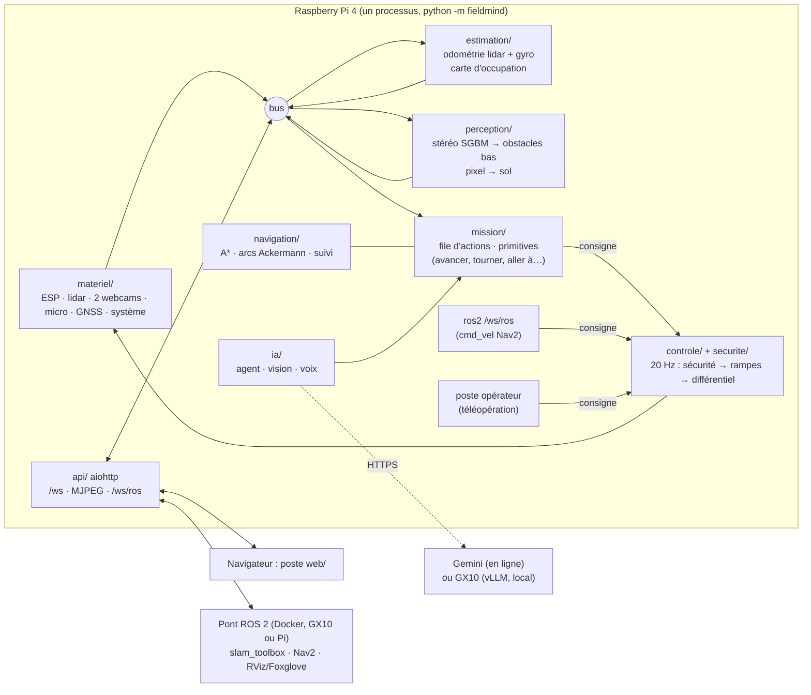

[Français](ARCHITECTURE.md) · **English**

# Rover Software Architecture

Final software for the real rover. It runs **on the Raspberry Pi 4** (Raspberry Pi OS, Debian 13, system Python 3.13, only `apt` packages) and, for development, on a PC with **simulated hardware** (`python -m fieldmind --materiel simulation`), using the same code.

## Principles

1. **Safety does not depend on any AI model or network.** The AI proposes actions; the code validates them (bounds, reachable location); safety (`securite/`) limits or cuts each command based on lidar, stereo, IMU, and ESP state, 20 times per second, on the rover. The workstation, Gemini, or GX10 may fail: the rover stops or safely completes its action.
2. **Three levels of shutdown.** ESP firmware: watchdog (expired command → zero traction) and USB loss. Pi: safety supervisor (obstacles, expired sensors, tilt, shock, lockup, workstation dead man). Software emergency stop locked, explicit rearming. (No wired hardware stop yet: to be added, see hardware/electronics.)
3. **Startup without movement**: `arret` mode, disarmed. No automatic resume after an emergency stop, USB reconnection, or reboot.
4. **Single owner per device**: this process alone opens serial ports, cameras, and microphone. It replaces `software/embarque` supervision (taking over its drivers).
5. **Time**: `time.monotonic()` everywhere (`types.py`), timestamped upon measurement reception.
6. **Same code in simulation**: `simulation/` provides a world, a fake ESP speaking the same text protocol as the firmware, a fake lidar, rendered stereo images, and a fake microphone.

## Execution Threads

| Thread | Role |
| --- | --- |
| asyncio loop | web server, broadcast to workstations, mission executor (10 Hz), AI agent |
| `conduite` | 20 Hz: last command → safety → ramps → differential → ESP |
| `esp`, `lidar`, `gnss` | serial reading (one thread per port) |
| `cam-gauche`, `cam-droite` | MJPEG capture |
| `micro` | `arecord` → 20 ms blocks |
| `estimation` | odometry (ICP) at each lidar turn, map at 2 Hz |
| `stereo` | depth and low obstacles, 4 Hz |
| `detection` | hot-plug connections (1 Hz), system (1 Hz) |

## Modules and interfaces

Modules communicate via the (`bus.py`, topics `S.*`) bus with `types.py` types. The profile (`config.py`, `config/rover.toml`) is passed to each constructor.

### `materiel/` — drivers

- `esp.py` — `PiloteEsp(bus, profil, port)`. Talks to `software/esp32/esp_c5` firmware: ROVER_2 (commands `g`, `d`, `sensg`, `sensd`, `s`, `v`, `stop`, with inversion sequence on the Pi side) or **ROVER_3** (combined command `p`, watchdog `wd`, fast telemetry `tel`, see below). `appliquer(CommandeRoues)`, `arreter()`, `envoyer_ligne(texte)`. Publishes `S.ESP`, `S.IMU`, `S.CONSOLE_ESP`.
- `lidar.py` — RPLIDAR C1 (binary SCAN protocol), dated scans converted into `base_link`, rover points removed → `S.SCAN`.
- `cameras.py` — UVC webcams (MJPEG passed through as-is) → `S.IMAGE_GAUCHE`, `S.IMAGE_DROITE`.
- `audio.py` — webcam microphone (ALSA, `arecord`, 16 kHz mono) → `S.AUDIO`.
- `gnss.py` — NMEA (ATGM336H on `/dev/ttyS0`) → `S.GNSS`.
- `systeme.py`, `detection.py` — Pi (temperature, undervoltage, Wi-Fi) and hot-plug connections.

### `simulation/` — simulated hardware

- `monde.py` — `Monde(graine, scenario)`: flat room or garden with walls, boxes, poles and **low obstacles** (lower than the lidar plane at 0,322 m). `lancer_lidar(pose, profil)` → `(angles, distances)` in `base_link` ; `rendre_camera(pose, camera, largeur, hauteur, profil)` → textured BGR image (SGBM stereo should work on it) ; `collision(pose, profil)`.
- `materiel_simule.py` — kinematic physics (bicycle, ramps, slipping), fake ESP in ROVER_3 text protocol, IMU, GNSS, fake microphone (WAV file).

### `securite/` — supervisor (on the Pi, without AI)

`Superviseur(bus, profil).evaluer(consigne, t) -> (Consigne limitée, EtatSecurite)`. Stopping distance `d = v·latence + v²/(2·décélération) + marge`. Corridor the width of the rover (plus lateral clearance) along the **planned arc** (current steering), in front or behind depending on direction. Sources: lidar points (`Scan`), stereo obstacles (`S.OBSTACLES_STEREO`, front only). Allowed speed = the one that allows stopping before the first obstacle in the corridor. Also cuts off on: expired lidar, missing or faulty ESP, tilt, impact, blockage (setpoint without measured movement), dead man switch, geofence in auto mode. Without stereo, speed is capped (an obstacle lower than 32 cm is invisible to the lidar). Reverse: lidar only, slow.

### `controle/` — driving

`Conduite(bus, profil, pilote_esp, superviseur)`: thread at 20 Hz. Chooses the active setpoint based on mode (`manuel`: station; `auto`: mission, otherwise ROS 2; `banc`: raw PWM), passes it through safety, applies ramps, converts speed/steering to left/right PWM (electronic differential: inner wheel slower) and servo angle, then calls `PiloteEsp.appliquer`. Publishes `S.COMMANDE`, `S.SECURITE`, `S.MODE`.

### `estimation/` — localization and mapping

- `odometrie.py` — `Odometre(profil)` : `scan(Scan) -> Odometrie | None`, `imu(Imu)`, `commande(CommandeRoues)`, `gnss(Gnss)`, `courant(t) -> Odometrie`, `remettre_a_zero()`. Lidar relocalization (2D line-to-point ICP between successive scans, against a local sub-map) + gyroscope (yaw) + control a priori. There are no wheel encoders.
- `cartographie.py` — `Cartographe(profil)` : `integrer_scan(scan, pose)`, `integrer_obstacles(obstacles, pose)`, `carte() -> CarteOccupation`, `effacer()`. Log-odds, ray casting, sliding window around the rover.

### `perception/` — cameras

- `stereo.py` — `Stereo(profil)` : `traiter(ImageCamera, ImageCamera) -> ResultatStereo | None` (SGBM depth on a reduced and rectified pair, estimated ground, low obstacles and holes → `Obstacles` in `base_link`, false-color depth image) ; `point_3d(camera, u, v)` on the latest depth. Without calibration, default model (field of view, baseline, tilt).
- `calibration_stereo.py` — checkerboard target: capture pairs, `cv2.stereoCalibrate`, `stereoRectify`, `~/.config/fieldmind/stereo.npz` file.
- `projection.py` — `ModeleCamera(profil, camera)` : `pixel_vers_sol(u, v, roulis, tangage)` and `sol_vers_pixel(x, y)` (normalized u, v), pinhole model, planar ground.

### `navigation/` — paths

- `planificateur.py` — `Planificateur(profil).planifier(carte, depart, but) -> Chemin | None` : A* on the inflated occupancy map, traversable unknowns with penalty, smoothing.
- `local.py` — `PiloteLocal(profil).commande(odom, chemin, obstacles_base_link, vitesse_max) -> CommandeLocale(vitesse, braquage, arrive, bloque, distance_restante)` : pure pursuit on the rear axle, evaluation of admissible curvature arcs (Ackermann) against obstacles, reverse clearance maneuver.

### `mission/` — actions

`Executeur(bus, profil, navigation, ia)` : asyncio task at 10 Hz. Action queue (`Action` in `types.py`). Primitives: `avancer` (straight line with held heading, distance measured by odometry), `tourner` (arc at maximum steering, three-step maneuver if space is insufficient), `aller_a` (planner + local driver), `aller_pixel` (ground projection, or stereo depth), `cap`, `attendre`, `retour_depart`, `chercher` and `decrire` (AI vision), `photo`, `stop`. A blocked action waits for the path to clear (10 s), then fails with its reason. `calibration.py`: wheel direction (wheels raised), speed (PWM → m/s measured by lidar), steering (measured radius), center at rest.

### `ia/` — agent, vision, voice

Interchangeable providers by profile (`config/ia.toml`): **`gemini`** (online, Google's OpenAI-compatible API: Gemini 4 Argon for the agent, Gemini Robotics ER 2 for spatial vision, Gemini transcription), **`gx10`** (local models served by vLLM / Whisper server on the ASUS Ascent GX10, same API), `aucun`. The choice is made in the cockpit (Settings > AI).

- `agent.py` — `Agent(bus, profil, config, outils)` : `await consigne(texte, origine)` → function calls (mission actions) → validated plan, then `outils.ajouter_actions`. Responses in `S.CHAT`. Stop commands ('stop', 'arrête') processed without a model.
- `vision.py` — describe the scene, point to an object (points `[y, x]` 0–1000 from Gemini Robotics ER) → `S.VISION`, points projected on the ground.
- `transcription.py` — audio → text (Gemini, or `/v1/audio/transcriptions` from the GX10).
- `voix.py` — speech detection on `S.AUDIO`, segments → transcription → agent. Active only when voice mode is enabled in the cockpit.

### `api/` — web server

aiohttp : `/` (port), `/ws` ([PROTOCOLE.md](PROTOCOLE.en.md)), MJPEG `/flux/<camera>`, `/ws/ros` (ROS bridge 2, below).

### `ros2/` — ROS bridge 2 (separate process, Docker)

`software/rover/ros2/`: ROS package 2 Jazzy `fieldmind_rover_ros`, client node for `/ws/ros`. It publishes `/scan`, `/imu/data_raw`, `/gps/fix`, `/odom` + TF, compressed images, and sends back `/cmd_vel` and `/goal_pose` to the rover (which passes them through its security, in `auto` mode). Launched in a container on the GX10 (or Pi) with slam_toolbox, Nav2, Foxglove.

#### `/ws/ros` (JSON)

Server → bridge: `{"type": "scan", "t", "t_envoi", "angles_b64", "distances_b64"}` (float32 little-endian, base_link), `{"type": "imu", "t", "accel_g": [3], "gyro_rad_s": [3]}`, `{"type": "odom", "t", "x", "y", "cap", "vitesse", "vitesse_lacet", "covariance": [9]}`, `{"type": "gnss", "t", "fix", "latitude", "longitude", "altitude_m", "hdop"}`, `{"type": "image", "t", "camera", "jpeg_b64"}` (if requested, 5 Hz), `{"type": "etat", ...}` (1 Hz, extracted from `etat`). `t` = Pi monotonic clock; `t_envoi` is used to resynchronize the clock. Bridge → server: `{"type": "cmd_vel", "vitesse": 0.3, "vitesse_lacet": 0.2}` (Twist; the rover infers steering from this), `{"type": "but", "x", "y"}` (odometry frame), `{"type": "abonner", "images": true}`.

## ESP Firmware: ROVER_3 extension

Added to `software/esp32/esp_c5` (all ROVER_2 commands remain valid):

| Command | Effect |
| --- | --- |
| `wd 400` | Watchdog: without a valid `p` or `hb` line for 400 ms, traction goes to zero (servo held), `[CHIEN] expire` message. `wd 0` disables it. Range 100–2000 ms. |
| `hb` | Heartbeat: refreshes the watchdog, no response required. |
| `p 12 -8 5.5` | Steering: signed left and right PWM (−100..100 %, sign = logical direction, 0 = stop) and servo angle (scale `s`). A sign change passes through zero and waits `inv` ms with wheels at zero before switching D/R. Silent except on error. |
| `inv 600` | Zero-wheel delay before inversion (100–3000 ms). |
| `tel 20` | Compact telemetry at 20 Hz (0 = off; also disables periodic `etat`): `T <ms> <pwm_g signé> <pwm_d signé> <servo_deg> <frein> <defaut> <chien_ok>` |
| `imu 50` | Central at 50 Hz (0 = original text format every 500 ms): `I <ms> <ax> <ay> <az> <gx> <gy> <gz> <lacet_deg>` (g, °/s, integrated yaw with bias estimated at standstill). |

Identifier `[FIRMWARE] ROVER_3`. The Pi driver detects the version and falls back to ROVER_2. After watchdog expiration, non-zero `m`, `g`, `d` are rejected until the next `hb` or `p`. A USB loss resets `wd`, `tel` and `imu` to 0: the driver reconfigures the ESP when it sees the welcome again (`=== FieldMind …`). Exact formats and order of attempts: software/esp32/esp_c5/CONNEXION_RASPBERRY.md.

## Deployment

`deploiement/deployer.sh` copies `software/rover` to the Pi and installs the user service `fieldmind-rover` (it stops `fieldmind-embarque`, which would open the same ports). Dependencies: `sudo apt install python3-numpy python3-scipy python3-opencv python3-serial python3-aiohttp alsa-utils`. GX10: `deploiement/gx10/` (vLLM and Whisper in Docker, then `gx10` profile).
