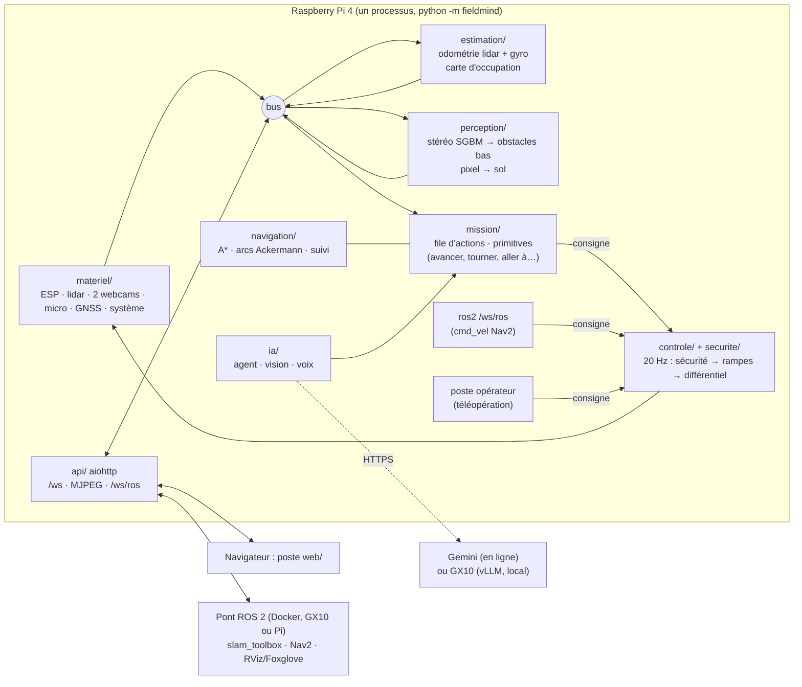

# Architecture du logiciel du rover

Logiciel final du rover réel. Il tourne **sur le Raspberry Pi 4** (Raspberry Pi OS, Debian 13,
Python 3.13 du système, paquets `apt` seulement) et, pour le développement, sur un PC avec le
**matériel simulé** (`python -m fieldmind --materiel simulation`), avec le même code.

## Principes

1. **La sécurité ne dépend d'aucun modèle d'IA ni du réseau.** L'IA propose des actions ; le code
   les valide (bornes, lieu atteignable) ; la sécurité (`securite/`) limite ou coupe chaque
   consigne d'après le lidar, la stéréo, la centrale et l'état de l'ESP, 20 fois par seconde, sur
   le rover. Le poste, Gemini ou le GX10 peuvent tomber : le rover s'arrête ou finit son action
   en sécurité.
2. **Trois niveaux d'arrêt.** Firmware ESP : chien de garde (consigne périmée → traction à zéro)
   et perte USB. Pi : superviseur de sécurité (obstacles, capteurs périmés, inclinaison, choc,
   blocage, homme mort du poste). Arrêt d'urgence logiciel verrouillé, réarmement explicite.
   (Pas encore d'arrêt matériel câblé : à ajouter, voir hardware/electronics.)
3. **Démarrage sans mouvement** : mode `arret`, désarmé. Aucune reprise automatique après un arrêt
   d'urgence, une reconnexion USB ou un redémarrage.
4. **Un seul propriétaire par appareil** : ce processus ouvre seul les ports série, les caméras et
   le micro. Il remplace la supervision `software/embarque` (dont il reprend les pilotes).
5. **Temps** : `time.monotonic()` partout (`types.py`), daté à la réception de la mesure.
6. **Le même code en simulation** : `simulation/` fournit un monde, un faux ESP qui parle le même
   protocole texte que le firmware, un faux lidar, des images stéréo rendues et un faux micro.

## Fils d'exécution

| Fil | Rôle |
| --- | --- |
| boucle asyncio | serveur web, diffusion vers les postes, exécuteur de mission (10 Hz), agent IA |
| `conduite` | 20 Hz : dernière consigne → sécurité → rampes → différentiel → ESP |
| `esp`, `lidar`, `gnss` | lecture série (un fil par port) |
| `cam-gauche`, `cam-droite` | capture MJPEG |
| `micro` | `arecord` → blocs de 20 ms |
| `estimation` | odométrie (ICP) à chaque tour du lidar, carte à 2 Hz |
| `stereo` | profondeur et obstacles bas, 4 Hz |
| `detection` | branchements à chaud (1 Hz), système (1 Hz) |

## Modules et interfaces

Les modules communiquent par le bus (`bus.py`, sujets `S.*`) avec les types de `types.py`.
Le profil (`config.py`, `config/rover.toml`) est passé à chaque constructeur.

### `materiel/` — pilotes

- `esp.py` — `PiloteEsp(bus, profil, port)`. Parle au firmware `software/esp32/esp_c5` :
  ROVER_2 (commandes `g`, `d`, `sensg`, `sensd`, `s`, `v`, `stop`, avec séquence d'inversion
  côté Pi) ou **ROVER_3** (commande combinée `p`, chien de garde `wd`, télémétrie rapide `tel`,
  voir plus bas). `appliquer(CommandeRoues)`, `arreter()`, `envoyer_ligne(texte)`.
  Publie `S.ESP`, `S.IMU`, `S.CONSOLE_ESP`.
- `lidar.py` — RPLIDAR C1 (protocole binaire SCAN), tours datés et convertis dans `base_link`,
  points du rover retirés → `S.SCAN`.
- `cameras.py` — webcams UVC (MJPEG passé tel quel) → `S.IMAGE_GAUCHE`, `S.IMAGE_DROITE`.
- `audio.py` — micro de la webcam (ALSA, `arecord`, 16 kHz mono) → `S.AUDIO`.
- `gnss.py` — NMEA (ATGM336H sur `/dev/ttyS0`) → `S.GNSS`.
- `systeme.py`, `detection.py` — Pi (température, sous-tension, Wi-Fi) et branchements à chaud.

### `simulation/` — matériel simulé

- `monde.py` — `Monde(graine, scenario)` : pièce ou jardin plat avec murs, boîtes, poteaux et
  **obstacles bas** (plus bas que le plan du lidar à 0,322 m). `lancer_lidar(pose, profil)` →
  `(angles, distances)` dans `base_link` ; `rendre_camera(pose, camera, largeur, hauteur,
  profil)` → image BGR texturée (la stéréo SGBM doit y fonctionner) ; `collision(pose, profil)`.
- `materiel_simule.py` — physique cinématique (bicyclette, rampes, glissement), faux ESP au
  protocole texte ROVER_3, IMU, GNSS, faux micro (fichier WAV).

### `securite/` — superviseur (sur le Pi, sans IA)

`Superviseur(bus, profil).evaluer(consigne, t) -> (Consigne limitée, EtatSecurite)`. Distance
d'arrêt `d = v·latence + v²/(2·décélération) + marge`. Couloir de la largeur du rover (plus la
marge latérale) le long de l'**arc prévu** (braquage courant), devant ou derrière selon le sens.
Sources : points du lidar (`Scan`), obstacles de la stéréo (`S.OBSTACLES_STEREO`, devant
seulement). Vitesse autorisée = celle qui permet de s'arrêter avant le premier obstacle du couloir.
Coupe aussi sur : lidar périmé, ESP absent ou en défaut, inclinaison, choc, blocage (consigne sans
déplacement mesuré), homme mort du poste, geofence en mode auto. Sans stéréo, vitesse plafonnée
(un obstacle plus bas que 32 cm est invisible au lidar). Marche arrière : lidar seul, lente.

### `controle/` — conduite

`Conduite(bus, profil, pilote_esp, superviseur)` : fil à 20 Hz. Choisit la consigne active selon
le mode (`manuel` : poste ; `auto` : mission, sinon ROS 2 ; `banc` : PWM bruts), la fait passer
par la sécurité, applique les rampes, convertit vitesse/braquage en PWM gauche/droite
(différentiel électronique : roue intérieure plus lente) et en angle de servo, puis appelle
`PiloteEsp.appliquer`. Publie `S.COMMANDE`, `S.SECURITE`, `S.MODE`.

### `estimation/` — pose et carte

- `odometrie.py` — `Odometre(profil)` : `scan(Scan) -> Odometrie | None`, `imu(Imu)`,
  `commande(CommandeRoues)`, `gnss(Gnss)`, `courant(t) -> Odometrie`, `remettre_a_zero()`.
  Recalage lidar (ICP point-à-ligne 2D entre tours successifs, contre une sous-carte locale) +
  gyroscope (lacet) + a priori de la commande. Il n'y a pas de codeurs de roue.
- `cartographie.py` — `Cartographe(profil)` : `integrer_scan(scan, pose)`,
  `integrer_obstacles(obstacles, pose)`, `carte() -> CarteOccupation`, `effacer()`. Log-odds,
  lancer de rayons, fenêtre glissante autour du rover.

### `perception/` — caméras

- `stereo.py` — `Stereo(profil)` : `traiter(ImageCamera, ImageCamera) -> ResultatStereo | None`
  (profondeur SGBM sur paire réduite et rectifiée, sol estimé, obstacles bas et trous →
  `Obstacles` dans `base_link`, image de profondeur en fausses couleurs) ; `point_3d(camera, u,
  v)` sur la dernière profondeur. Sans calibration, modèle par défaut (champ, base, inclinaison).
- `calibration_stereo.py` — mire en damier : capture de paires, `cv2.stereoCalibrate`,
  `stereoRectify`, fichier `~/.config/fieldmind/stereo.npz`.
- `projection.py` — `ModeleCamera(profil, camera)` : `pixel_vers_sol(u, v, roulis, tangage)`
  et `sol_vers_pixel(x, y)` (u, v normalisés), modèle sténopé, sol plan.

### `navigation/` — chemins

- `planificateur.py` — `Planificateur(profil).planifier(carte, depart, but) -> Chemin | None` :
  A* sur la carte d'occupation gonflée, inconnu traversable avec pénalité, lissage.
- `local.py` — `PiloteLocal(profil).commande(odom, chemin, obstacles_base_link, vitesse_max)
  -> CommandeLocale(vitesse, braquage, arrive, bloque, distance_restante)` : poursuite pure sur
  l'essieu arrière, évaluation d'arcs de courbure admissible (Ackermann) contre les obstacles,
  marche arrière de dégagement.

### `mission/` — actions

`Executeur(bus, profil, navigation, ia)` : tâche asyncio à 10 Hz. File d'actions (`Action` dans
`types.py`). Primitives : `avancer` (ligne droite à cap tenu, distance mesurée par l'odométrie),
`tourner` (arc au braquage maximal, manœuvre en trois temps si la place manque), `aller_a`
(planificateur + pilote local), `aller_pixel` (projection au sol, ou profondeur stéréo),
`cap`, `attendre`, `retour_depart`, `chercher` et `decrire` (vision IA), `photo`, `stop`.
Une action bloquée attend que la voie se libère (10 s), puis échoue avec sa raison.
`calibration.py` : sens des roues (roues levées), vitesse (PWM → m/s mesurée au lidar),
braquage (rayon mesuré), centrale au repos.

### `ia/` — agent, vision, voix

Fournisseurs interchangeables par profil (`config/ia.toml`) : **`gemini`** (en ligne, API
compatible OpenAI de Google : Gemini 4 Argon pour l'agent, Gemini Robotics ER 2 pour la vision
spatiale, transcription Gemini), **`gx10`** (modèles locaux servis par vLLM / serveur Whisper
sur l'ASUS Ascent GX10, même API), `aucun`. Le choix se fait dans le poste (Réglages > IA).

- `agent.py` — `Agent(bus, profil, config, outils)` : `await consigne(texte, origine)` →
  appel de fonctions (les actions de mission) → plan validé, puis `outils.ajouter_actions`.
  Réponses dans `S.CHAT`. Commandes d'arrêt (« stop », « arrête ») traitées sans modèle.
- `vision.py` — décrire la scène, pointer un objet (points `[y, x]` 0–1000 de Gemini Robotics
  ER) → `S.VISION`, points projetés au sol.
- `transcription.py` — audio → texte (Gemini, ou `/v1/audio/transcriptions` du GX10).
- `voix.py` — détection de parole sur `S.AUDIO`, segments → transcription → agent. Actif
  seulement quand le mode vocal est activé dans le poste.

### `api/` — serveur web

aiohttp : `/` (poste), `/ws` ([PROTOCOLE.md](PROTOCOLE.md)), MJPEG `/flux/<camera>`,
`/ws/ros` (pont ROS 2, ci-dessous).

### `ros2/` — pont ROS 2 (processus séparé, Docker)

`software/rover/ros2/` : paquet ROS 2 Jazzy `fieldmind_rover_ros`, nœud client de `/ws/ros`.
Il publie `/scan`, `/imu/data_raw`, `/gps/fix`, `/odom` + TF, images compressées, et renvoie
`/cmd_vel` et `/goal_pose` au rover (qui les fait passer par sa sécurité, en mode `auto`).
Lancé dans un conteneur sur le GX10 (ou le Pi) avec slam_toolbox, Nav2, Foxglove.

#### `/ws/ros` (JSON)

Serveur → pont : `{"type": "scan", "t", "t_envoi", "angles_b64", "distances_b64"}` (float32
little-endian, base_link), `{"type": "imu", "t", "accel_g": [3], "gyro_rad_s": [3]}`,
`{"type": "odom", "t", "x", "y", "cap", "vitesse", "vitesse_lacet", "covariance": [9]}`,
`{"type": "gnss", "t", "fix", "latitude", "longitude", "altitude_m", "hdop"}`,
`{"type": "image", "t", "camera", "jpeg_b64"}` (si demandé, 5 Hz), `{"type": "etat", ...}`
(1 Hz, extrait de `etat`). `t` = monotone du Pi ; `t_envoi` sert à recaler l'horloge.
Pont → serveur : `{"type": "cmd_vel", "vitesse": 0.3, "vitesse_lacet": 0.2}` (Twist ; le
rover en déduit le braquage), `{"type": "but", "x", "y"}` (repère odom), `{"type": "abonner",
"images": true}`.

## Firmware ESP : extension ROVER_3

Ajoutée à `software/esp32/esp_c5` (toutes les commandes ROVER_2 restent valables) :

| Commande | Effet |
| --- | --- |
| `wd 400` | Chien de garde : sans ligne `p` ou `hb` valide pendant 400 ms, traction à zéro (servo maintenu), message `[CHIEN] expire`. `wd 0` le coupe. Plage 100–2000 ms. |
| `hb` | Battement : renouvelle le chien de garde, sans réponse. |
| `p 12 -8 5.5` | Pilotage : PWM signés gauche et droite (−100..100 %, signe = sens logique, 0 = arrêt) et angle du servo (échelle `s`). Un changement de signe passe par zéro et attend `inv` ms roue à zéro avant de changer D/R. Silencieux sauf erreur. |
| `inv 600` | Délai roue à zéro avant inversion (100–3000 ms). |
| `tel 20` | Télémétrie compacte à 20 Hz (0 = coupée ; coupe aussi l'`etat` périodique) : `T <ms> <pwm_g signé> <pwm_d signé> <servo_deg> <frein> <defaut> <chien_ok>` |
| `imu 50` | Centrale à 50 Hz (0 = format texte d'origine toutes les 500 ms) : `I <ms> <ax> <ay> <az> <gx> <gy> <gz> <lacet_deg>` (g, °/s, lacet intégré avec biais estimé à l'arrêt). |

Identifiant `[FIRMWARE] ROVER_3`. Le pilote du Pi détecte la version et se rabat sur ROVER_2.
Après expiration du chien, `m`, `g`, `d` non nuls sont refusés jusqu'au prochain `hb` ou `p`. Une
perte USB remet `wd`, `tel` et `imu` à 0 : le pilote reconfigure l'ESP quand il revoit l'accueil
(`=== FieldMind …`). Formats exacts et ordre des essais : software/esp32/esp_c5/CONNEXION_RASPBERRY.md.

## Déploiement

`deploiement/deployer.sh` copie `software/rover` sur le Pi et installe le service utilisateur
`fieldmind-rover` (il arrête `fieldmind-embarque`, qui ouvrirait les mêmes ports). Dépendances :
`sudo apt install python3-numpy python3-scipy python3-opencv python3-serial python3-aiohttp
alsa-utils`. GX10 : `deploiement/gx10/` (vLLM et Whisper en Docker, puis profil `gx10`).
